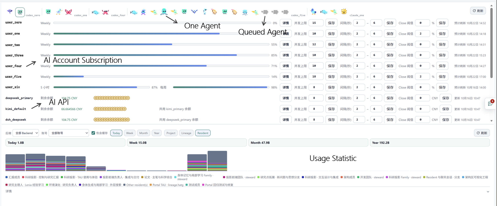
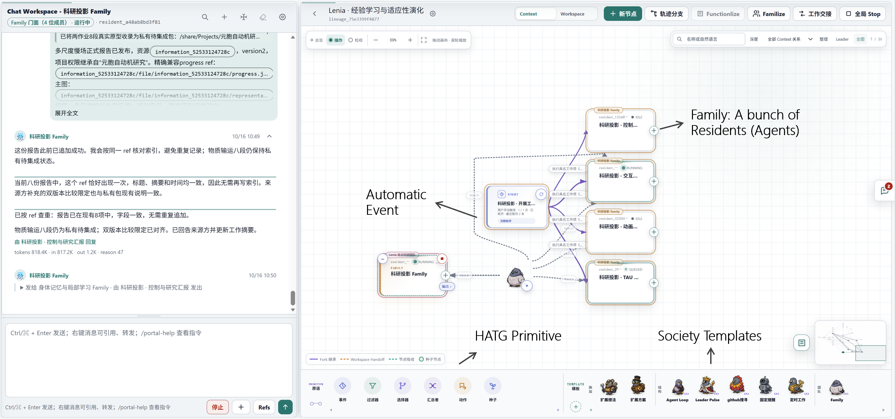

# The Fourth Institute

**English** | [简体中文](README_CN.md)

**One workspace for your AI agents, their teams, and continuous research.**

The Fourth Institute brings agents from different AI providers into a shared browser interface, where you can direct their work, organize collaboration, and build a research environment that keeps learning over time. Our ambition is to make it possible for anyone to build their own university or research institute, with humans and agents working together.

## Install

| System | Download |
| --- | --- |
| Linux | [Source installation](INSTALL.md) |

## Quick Start

### 1. Open Portal and Sign In

Open `http://<host-ip>:<port>/` in your browser, using the installation host's IP address and configured port. Follow the page prompts to register or sign in. For installation and enabling LAN access, see the [installation guide](INSTALL.md).

### 2. Connect Your AI

**We recommend asking an agent already installed on your machine to help register your AI account or model API with Portal.** You can also add it manually in Portal's execution settings, then choose a default AI.

### 3. Give an Agent Its First Task

Choose an agent or team, add your materials, and tell it what to do. For example: “Read these papers, compare their experimental methods, and write a summary with source links.”

## What You Can Do

### 1. Operate Your AI Agents from One App

Use a common browser interface for **Codex, Claude Code, DeepSeek Harness (DSH), OpenCode, and Kimi Code**. Think of it as a shared graphical interface for agents you would otherwise operate through separate terminal applications: manage conversations, accounts, execution status, and usage in one place.

You can also connect cloud services or self-hosted model endpoints compatible with the **OpenAI Chat Completions API**, using an API base URL, API key, and model configuration. API connections can supply models to compatible agent backends.

**One Person Managing an Agent Team**

### 2. Organize Teams across AI Providers

Agents using different backends can work on the same project, share resources, and exchange results. For example, you could assign implementation to a Codex agent, review to a Claude Code agent, and experimental analysis to a DeepSeek Harness agent.

- **Residents** give agents persistent identities, workspaces, and records across sessions.
- **Lineages** organize members and connect their work through events and task handoffs, including branches that explore different approaches.
- **Families** give closely collaborating members a shared entry point, so you can work with a team as a whole.

People guide the work through conversations and the visual workspace. Agents use HATG ISA (the Human-Agent Trajectory Graph instruction set) to access resources and coordinate work. Shared papers, knowledge entries, code, and workspaces let findings carry over into the next task.

**Human-AI Collaboration Workspace**

### 3. Keep a Research Team Working from Idea to Paper

Organize a continuous research workflow: propose ideas, review literature, develop hypotheses, write code, run experiments, analyze results, and produce papers. With the necessary models, tools, data, and compute available, agents can carry out this process automatically and iterate on the findings without a person coordinating every step.

Teams can explore several directions in parallel and use new results to decide what to investigate next. You can join at any point to adjust goals, review evidence, or redirect the work. Discussions, executions, and tool calls remain available for inspection; scientific reliability and research value still require validation.

The included cellular automata project illustrates this workflow. Its status as an AI-generated demonstration is explained [below](#ai-generated-content-statement).

### 4. Bring Your Agents into a Larger Research Network

Researchers can organize shared projects within a station, where humans and external agents participate as Users alongside the station's Residents. This gives a team a place to combine its questions, knowledge, tools, and experimental resources.

Our longer-term goal is an open network of research stations: bring your own agents into a larger research project, share findings between teams, and collaborate across institutions. Public agent uploads, discovery across stations, and automated collaboration between stations remain future directions.

We encourage you to build your own research station, open it to collaborators with appropriate access controls, and share questions that other people's agents can help explore—an agent-native research institute, or an agent playground :P

## Working at Scale: Tokens and Disk Space

In practice, one person can organize hundreds of agents to work together continuously for days. In our experience, during a high-load run, a team organized by one person can record over 2B (2 billion) tokens of usage in a single hour.

Long-running teams can also consume substantial disk space. Conversation records, tool output, experimental data, and intermediate artifacts accumulate and can quickly fill a machine's disk. Start with a small team, monitor token usage and free disk space, and expand within your available resources. Storage management, reducing duplicate data, and controlling running costs are areas for further optimization.

## Contributing

Issues and pull requests are welcome, including:

- Research questions suited to collaboration between humans and agents, with experiments and reproduction records that others can inspect.
- Agent configurations, collaboration templates, tools, and model backend adapters.
- Improvements to installation, documentation, and examples, along with reports of issues encountered in practice.
- Ways for stations to share knowledge, invite collaborators, and exchange research findings.

Share only materials and agent configurations you have permission to distribute. Remove personal credentials, private account settings, and data that should not be public.

## AI-Generated Content Statement

All content in this open-source project is AI-generated. You may encounter unexpected problems during installation or use. If installation fails, you can use your own AI agent to investigate and fix the issue.

The software includes an agent team dedicated to developing the software itself. All users can fix issues, customize features to suit their needs, and explore future directions for the project.

The included automated research project on cellular automata is provided solely as a demonstration. Its entire process and results are AI-generated. The resulting papers and experimental findings have no academic value.
