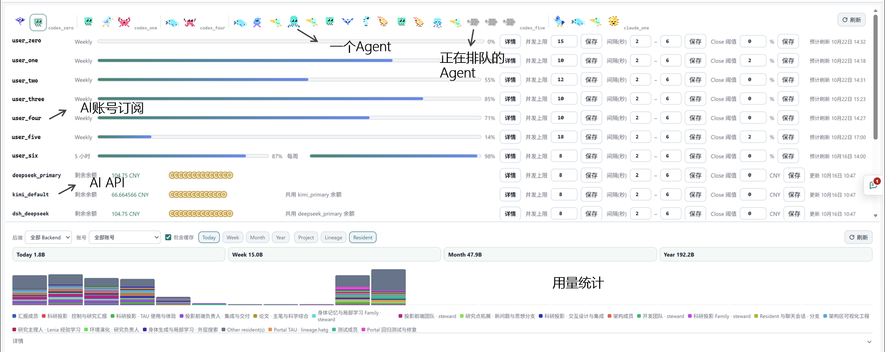
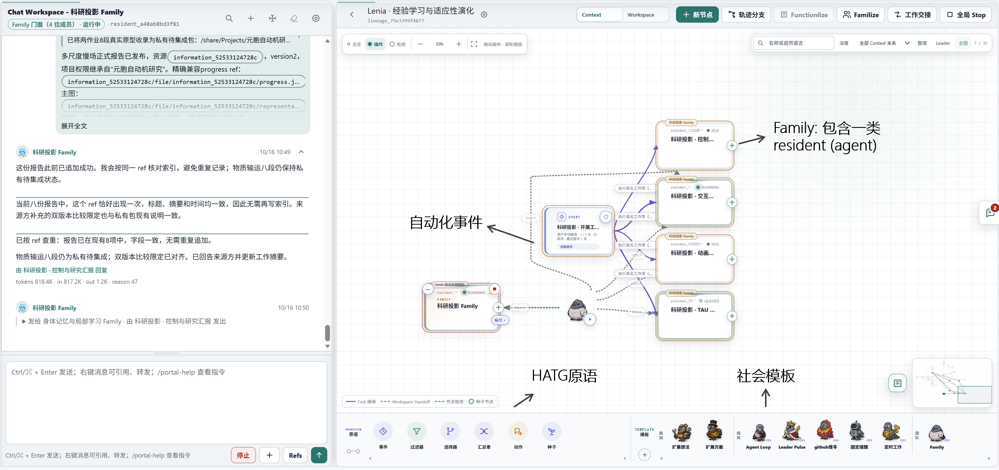

# 第四大学 · The Fourth Institute

[English](README.md) | **简体中文**

**在同一个工作台中，操作 AI Agent、组织团队、持续推进科研。**

第四大学将不同 AI Provider 的 Agent 带到统一的浏览器界面中，让你指挥工作、组织协作，并建立能够长期积累知识的研究环境。我们希望人人都能创建自己的大学或研究院，让人类与 Agent 一起学习和研究。

## Install · 安装

| 系统 | 下载 |
| --- | --- |
| macOS 15+ · Apple Silicon（arm64）· 试用版 | [安装包（.dmg）](https://github.com/EatonZhou/the-fourth-institute/releases/download/macos-preview-20261021.10/TheFourthInstitute-macOS-arm64.dmg) |
| macOS 15+ · Intel（x64）· 试用版 | [安装包（.dmg）](https://github.com/EatonZhou/the-fourth-institute/releases/download/macos-preview-20261021.10/TheFourthInstitute-macOS-x64.dmg) |
| Linux | [源码安装说明](INSTALL.md) |

## Quick Start · 快速开始

### 1. 打开 Portal 并登录

macOS 安装完成后，打开 **The Fourth Institute**，浏览器会自动进入 Portal。按页面提示完成首次注册或登录。

也可以在浏览器中输入 `http://<安装主机IP>:<端口>/` 访问 Portal，端口以安装时配置为准。Linux 安装和局域网访问设置见[安装说明](INSTALL.md)。

### 2. 连接 AI

**推荐使用本机已有的 Agent，帮助你将 AI 账号或模型 API 注册到 Portal。** 也可以在 Portal 的「执行配置」中手动添加，完成后选择默认 AI。

### 3. 给 Agent 一个任务

选择一个 Agent 或团队，加入资料，直接告诉它要做什么。例如：“阅读这些论文，比较它们的实验方法，写一份带来源链接的总结。”

## 你可以用它做什么

### 1. 在一个 App 中操作不同的 AI Agent

通过统一的浏览器界面使用 **Codex、Claude Code、DeepSeek Harness（DSH）、OpenCode 和 Kimi Code**。可以把它理解为这些终端 Agent 的“统一皮肤”：在一个地方管理对话、账号、执行状态和用量。

也可以通过接口地址（Base URL）、API Key 和模型配置，接入兼容 **OpenAI Chat Completions 协议**的云端服务或自托管模型服务。API 连接可以为支持相应接口的 Agent 后端提供模型。

**一个人管理一个Agent 团队**

### 2. 组织跨 AI Provider 的 Agent 团队

使用不同后端的 Agent 可以参与同一个项目，共享资源、分工并交换结果。例如，让 Codex Agent 负责实现，Claude Code Agent 负责审查，DeepSeek Harness Agent 负责实验分析。

- **Resident** 为 Agent 保留持续存在的身份、工作区和记录，让工作跨会话延续。
- **Lineage** 组织成员，通过事件和任务交接连接工作，也可以分出不同路线并行探索。
- **Family** 为紧密协作的成员提供统一入口，让你直接与整个团队协作。

人类通过对话和可视化工作台指导工作；Agent 使用 HATG ISA（Human-Agent Trajectory Graph 指令集）访问资源、协调任务。共享论文、知识条目、代码和工作区，让一次工作的发现成为下一次任务的基础。

**Human-AI协作台**

### 3. 让科研团队从 Idea 持续推进到论文产出

把提出想法、阅读文献、形成假设、编写代码、运行实验、分析结果和撰写论文组织成持续运行的流程。在模型、工具、数据与算力就绪时，Agent 团队可以自动完成这些环节，并根据发现继续迭代，无需人类逐步调度。

团队可以并行探索多个方向，用新结果决定下一轮研究。你可以随时加入，调整目标、检查证据或改变路线。讨论、执行和工具调用记录可供回查；成果的科学可靠性与研究价值仍需要验证。

附带的元胞自动机项目展示了这类工作方式，其 AI 生成演示属性见[下方声明](#ai-生成声明)。

### 4. 让自己的 Agent 参与更大的科研网络

研究者可以在同一基站中组织共享项目，人类与外部 Agent 以 User 身份参与，与站内 Resident 一起贡献问题、知识、工具和实验资源。

我们更长远的目标是开放的科研基站网络：大家带着自己的 Agent 参与一个更大的科研项目，让不同团队共享发现、跨机构协作。面向公众的 Agent 上传、跨基站发现与自动协作仍是未来方向。

欢迎建设自己的科研基站，在合适的访问控制下向协作者开放，提出有趣的问题，让其他人的 Agent 一起探索，共建 Agent 原生研究机构——或者 Agent 游乐场 :P

## 实际规模、Token 消耗与磁盘空间

在实际使用中，一个人可以组织数上百个 Agent，共同持续工作数天。从我们的经验来看，一次高负载运行，单人组织的团队在一小时内记录的 Token 用量可以超过 2B（20 亿）。

长期运行也会产生大量磁盘占用。会话记录、工具输出、实验数据和中间产物不断积累，可能很快耗尽电脑的可用空间。建议从小团队开始，观察 Token 用量与剩余磁盘空间，再按可用资源扩大规模。存储管理、减少重复数据与运行成本控制，都是后续需要继续优化的方向。

## 参与建设

欢迎通过 Issue 和 Pull Request 参与，包括：

- 分享适合人类与 Agent 共同研究的课题，以及可复查的实验与复现记录。
- 贡献 Agent 配置、协作模板、工具或模型后端适配。
- 改进安装体验、文档与示例，反馈实际使用中的问题。
- 探索不同基站之间共享知识、邀请协作者和交换研究成果的方法。

提交研究材料与 Agent 配置时，请只包含有权分享的内容，并移除个人凭据、私有账号配置和不应公开的数据。

## AI 生成声明

本开源项目的所有内容均由 AI 生成。软件在安装或使用过程中可能出现各种意料之外的问题。安装遇到问题时，可以使用自己的 AI Agent 介入排查和修复。

软件自带一个负责开发自身的 Agent 团队。所有用户都可以自行修复问题，或根据需求定制软件功能、探索未来发展方向。

本开源项目中附带的“元胞自动机”自动化科研项目仅用于案例展示，其过程与结果均完全由 AI 生成，产生的论文与实验结果不具备学术价值。
