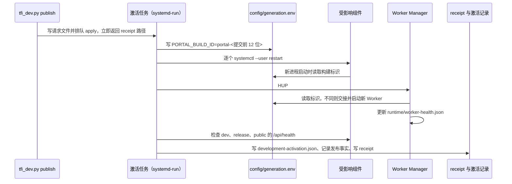

# Portal 运行状态与服务健康来源

Portal 启动、后台服务重启、发布激活或数据库暂时无法读取时，页面需要告诉用户应该等待、稍后重试，还是停止自动重连并联系运维；发布者和运维还需要知道各进程实际加载了哪份代码、最近一次激活是否成功。Portal 不另外维护汇总状态，读取方直接使用下面五类来源，每类只有一个写入者：

- **数据库运行状态**（runtime status）：用户路由器读取数据库结构标记，报告数据库能否读取、标记是否与当前代码一致。
- **服务实时健康**（live health）：请求到达时直接询问 Web、ResourceService、SocietyService 和 ExecutionService “现在能否响应”的结果。
- **构建标识**（build ID）：每个进程启动时从环境变量 `PORTAL_BUILD_ID` 读取的代码标识。
- **激活记录**：配对运行时为每次发布激活写出的 receipt，以及最近一次成功激活的记录。
- **Worker 健康文件**：Worker Manager 持续写出的 ExecutionWorker 代际与交接状态。

本 Design 定义这些来源各自的含义、写入者和读取方式。浏览器怎样显示恢复遮罩和重试见 `decision_f25266e5a0e7`；发布与激活流程见 `decision_08bb2d9141f9` 和 `decision_ab9880dc4c9d`；Web 重启时连接和浏览器的处理见 `decision_37f98f8fcb4b`；Worker 换代见 `decision_075f66430606`。

## 用户看到什么

资源目录、代码仓库工作区和 Society 工作台依赖后台服务。服务不可用时，这些页面通过共享的恢复组件 `PortalComponentRecovery` 在对应区域上显示一层恢复遮罩，并禁用区域内的操作控件：

- SocietyService 仍在线但暂时无法回答时，标题为“<服务名> 正忙，正在等待”。
- 其他暂时不可用的情况，包括计划内重启和意外断线，标题都是“正在重新连接 <服务名>”，说明正在后台自动重试、Portal 其他页面不受影响，并显示第几次重试。
- 服务报告不可恢复，或有限次数的自动重试（默认 24 次）用完后，遮罩显示错误标题和“重新检查”按钮，自动重连停止。

服务恢复后，遮罩消失，控件恢复可用，页面重新加载所需数据。用户菜单显示当前 Web 的构建标识；构建标识为缺省值 `development` 时改为显示实例名。

## 基本概念

- **数据库结构标记**（schema marker）：AgentData（保存 Agent 对话和执行数据的数据库 schema）中表 `agent_store_meta` 里 `key = 'schema'` 的一行，值是数据库结构的版本名。当前结构版本由 `management_common/agent_data_schema.py` 的 `AGENT_DATA_SCHEMA` 定义。AgentData 存储新建 schema 时写入它；打开已有 schema 时，标记或表结构与当前代码不符就拒绝打开。
- **运行状态**：用户路由器接口 `/__portal_router/status` 的返回内容，schema 为 `tfi.portal-runtime-status.v1`。它只检查数据库结构标记，因此在 Portal Web 不可用时也能回答。
- **实时健康**：Portal Web 处理状态请求时调用服务健康检查得到的结果。组件状态接口调用 SocietyService 与 ResourceService 的客户端检查，各自最多等待 2.25 秒。
- **组件状态接口**：`GET /lineage/api/service-status` 和 `GET /resource/api/service-status`，schema 为 `tfi.portal-component-status.v1`。它们只由实时健康得出，交给页面的恢复组件使用。
- **构建标识**：环境变量 `PORTAL_BUILD_ID` 的值，进程启动时读取一次；未设置时为 `development`。它用于显示和诊断；组件是否加载了新代码，以重启后的健康检查为准。
- **实例安装根目录**：已安装实例的根目录，下文的 `config/`、`runtime/` 都相对于它。
- **激活 receipt**：一次发布激活的结果文件 `runtime/tfi-pair-publish-<id>-result.json`，由配对运行时 `scripts/tfi_development_runtime.py` 写出；`runtime/development-activation.json` 保存最近一次成功激活的结果。
- **Worker 健康文件**：`runtime/worker-health.json`（路径由 `PORTAL_EXECUTION_WORKER_HEALTH_PATH` 指定），schema 为 `tfi.execution-worker-manager-health.v2`，由 Worker Manager 写出。
- **`terminal` 与 `retryable`**：状态中的两个布尔字段。`terminal` 为真表示页面应停止自动恢复；`retryable` 为真表示稍后再读取可能得到不同结果。页面按这两个字段决定恢复策略。

## 设计点

- **每类来源只有一个写入者，读取方不改写。** 路由器只读结构标记；Web 只探测服务；构建标识由组件的启动环境决定；receipt 和激活记录只由激活任务写出；Worker 健康文件只由 Worker Manager 写出。状态接口不运行迁移、不回收租约，也不改写这些文件；修复由服务初始化、维护任务、重新发布或重启完成。
- **运行状态只读取数据库结构标记。** 它执行一条查询，不检查其他表，不执行迁移，也不探测 ResourceService、SocietyService 或 ExecutionService。
- **结构标记与期望值不同时，运行状态仍报告数据库可用。** 数据库可以读取，因此返回 `ready: true`，同时以 `retryable: true` 和提示要求核对数据库版本与部署版本。
- **结构标记无法读取时，运行状态报告暂时不可用。** 数据库暂时无法连接或表不可读时返回 `unavailable`，`retryable: true`，页面继续重试。
- **路由器无法取得运行状态时，报告不可恢复。** 读取运行状态的过程本身出错时，路由器返回 `blocked` 和 `terminal: true`，页面停止自动重连，等待运维处理。
- **组件状态只看实时健康。** 健康检查成功时返回 `ready`；SocietyService 抛出忙碌异常时返回 `busy`；其他失败一律返回 `unavailable`。计划内重启与意外断线在组件状态中没有区别，页面都按暂时不可用处理并自动重试。
- **页面在组件状态不就绪时再查询一次运行状态。** 运行状态为不可恢复时，页面以它为准停止自动重连；否则按组件状态继续重试。
- **构建标识跟随进程启动。** 激活先把新标识写入 `config/generation.env`，再重启受影响的组件，新进程启动时才读到它；本次没有重启的组件继续报告原来的标识。
- **激活结果以 receipt 为准。** 发布命令在激活开始前就返回 receipt 路径，激活任务结束后才写出 receipt。Git 推送成功或 receipt 尚未写出，都不说明服务已经加载新代码。

## 运行状态

### 接口

用户路由器提供 `GET` 和 `HEAD /__portal_router/status`，无需登录，其他方法返回 `405` 并带 `Allow: GET, HEAD`。响应始终是 HTTP `200`（使恢复页面总能解析同一种格式），带 `Cache-Control: no-store`；`HEAD` 只返回响应头。

路由器只公开以下字段：`schema`、`ok`、`ready`、`state`、`code`、`terminal`、`retryable`、`title`、`message`。读取过程内部还产生 `agent_data`（期望与实际的结构版本及是否一致）和 `detail`（异常文本），这些内容不出现在公开响应中。

### 四种结果

| 情况 | `ok` | `ready` | `state` | `code` | `terminal` | `retryable` | 标题 |
| --- | --- | --- | --- | --- | --- | --- | --- |
| 标记与期望一致 | true | true | `ready` | 空 | false | false | Portal 数据库已就绪 |
| 标记与期望不同 | true | true | `ready` | `agent_data_schema_marker_mismatch` | false | true | Portal 数据库可用 |
| 标记无法读取 | false | false | `unavailable` | `agent_data_schema_unreadable` | false | true | 数据库状态暂时不可用 |
| 路由器读取运行状态出错 | false | false | `blocked` | `runtime_status_unavailable` | true | false | 服务状态无法确认 |

`message` 用中文说明具体情况，例如标记不同时写明“数据库标记为 vX，当前运行版本为 vY。请核对数据库版本与部署版本。”

### 读取方式

期望的结构版本默认取共享常量 `AGENT_DATA_SCHEMA`，与 AgentData 存储使用同一来源。调用 `portal_runtime_status(expected_agent_data_schema=...)` 可显式指定期望值；路由器按默认值调用，`PORTAL_EXPECTED_AGENT_DATA_SCHEMA` 不再作为配置入口。比较 AgentData 标签时，实际完整的 `tfi.agent-data.vN` 标签（`N` 表示版本号）必须与期望值精确相同；其他标记继续按状态矩阵报告。读取通过 Portal 的共享数据库层连接 `PORTAL_DATABASE_URL` 指向的 PostgreSQL，在 AgentData 所在的 schema 中执行：

```sql
SELECT value FROM agent_store_meta WHERE key = 'schema'
```

共享数据库层在进程第一次使用时建立连接池（最多等待 15 秒），并确保对应 schema 存在。连接失败、等待超时、表不存在都归为“标记无法读取”。

## 服务实时健康

### Web 健康接口

`GET /api/health` 无需登录，返回 `ok`、`instance`（实例清单中的 name）、`deployment`（当前 Web 部署 ID）、`build_id`、`port`、`started_at`（当前 Web 进程的启动时间）和 `now`，并附 `execution_layer`（ExecutionService 健康）与 `society_service`（SocietyService 健康）；下层检查失败时对应字段为 `ok: false` 和错误文本，接口本身照常返回。登录后的 `/api/me` 同样返回 `portal_deployment` 和 `build_id`。Web 不读取发布清单，这两个接口都不提供发布时间或源码提交字段。

### 组件状态接口

两个接口都需要登录，由 Portal Web 提供。响应字段为 `schema`、`component`、`service`、`state`、`ready`、`message` 和 `retry_after_ms`（建议多久后再查询，毫秒），成功时另附 `health`（服务健康检查的原始结果），失败时另附 `detail`（异常文本）。

| 实时健康结果 | `state` | `ready` | `retry_after_ms` | 提示 |
| --- | --- | --- | --- | --- |
| 成功 | `ready` | true | 0 | “<服务> 已就绪” |
| SocietyService 抛出忙碌异常 | `busy` | false | 750 | “SocietyService 正忙，正在等待当前操作完成” |
| 其他失败 | `unavailable` | false | 750 | “<服务> 暂时不可用，正在重新连接” |

ResourceService 没有忙碌状态。

### 运维查询

在 `code/` 目录运行 `./scripts/portal_services status` 或 `health`（可加 `--instance dev|release`），或调用 ISA `GetPortalStatus`，都经配对运行时读取每个 Web 的 `/api/health`：Web 可连接、`ok` 不为假且报告的实例名与所查实例一致时，该实例的 `ok` 与 `runtime_ok` 为真。结果同时给出 Web 的健康内容、它运行的源码目录、共享源码目录，以及共享后台服务的单元名 `<service_prefix>-resource.service`、`-execution.service`、`-society.service`、`-worker.service`。

没有配置 Dev 的独立安装实例返回 `supported: false`，其状态由 `scripts/install_tfi_release status --root <实例安装根目录>` 读取：它要求各服务单元处于运行状态、Web 健康接口报告正确实例且 ExecutionService 与 SocietyService 健康，并要求 Worker 健康文件为 `ok` 且在 60 秒内更新过。

## 构建标识

| 进程 | `PORTAL_BUILD_ID` 的来源 |
| --- | --- |
| Release Web、ResourceService、ExecutionService、SocietyService 和 Worker Manager | `scripts/tfi_release_install.py` 为组件生成启动环境时读取 `config/generation.env`；安装时写入本次安装的运行 ID，每次发布激活改写为 `portal-<Release 提交的前 12 位>` |
| Dev Web | `scripts/tfi_development_runtime.py web` 启动时设为 `dev-<Dev 工作树 HEAD 的前 12 位>` |
| ExecutionWorker | Worker Manager 每次启动新 Worker 时读取 `PORTAL_EXECUTION_WORKER_GENERATION_ENV` 指向的 `config/generation.env`，Worker ID 中包含该标识 |

Worker Manager 收到 HUP 时重新读取标识：与当前 Worker 相同就保留当前 Worker，不同才按交接协议换代。因此只改写 `config/generation.env` 不会让任何组件换代，必须重启组件或通知 Worker Manager。

## 激活记录

`python3 code/scripts/tfi_dev.py publish` 在 Release 工作树提交并推送后，调用 `request_activation`：先把请求写入 `runtime/tfi-pair-publish-<id>.json`（`commit`、`paths`、`receipt`、`parent_commit`、`requested_at`），再用 `systemd-run --user` 启动同名的一次性单元执行 `apply`，命令随即返回 `activation.receipt`。激活任务持有 `runtime/development-activation.lock`，按改动文件选出受影响组件，写入新的构建标识，逐个重启 `<service_prefix>-<组件>.service`（Worker 收到 HUP），每完成一个组件在单元日志中输出一行 `{"activated": <组件>}`，最后检查 Dev、Release 和公共路由三个入口的 `/api/health`。

| 文件 | 写入时机 | 内容 |
| --- | --- | --- |
| `runtime/development-activation.json` | 激活成功结束时 | `ok`、`commit`（激活时 Release 工作树的 HEAD）、`components`（本次重启的组件）、`health`（`dev`、`release`、`public` 三个健康结果） |
| receipt `runtime/tfi-pair-publish-<id>-result.json` | 激活任务结束时，成功或失败都写 | 成功时为上述内容加 `requested_commit` 与 `release_event`；失败时为 `ok: false`、`error` 和请求的 `commit` |

激活成功且 Release HEAD 与上一份 `development-activation.json` 的提交不同时，激活任务调用 `management_common/portal_release_events.record` 写入一次发布事实，供 Lineage 的 `portal.release_published` 事件源读取（`decision_4adcc1ff2f2c`）；写入结果放在 receipt 的 `release_event` 中，写入失败不撤销已生效的激活。

激活只检查 Web 入口的健康，不等待 Worker 换代完成。新 Worker 是否已经接手，以 Worker 健康文件中 `current.build_id` 是否等于新标识为准。PostgreSQL、NATS 和 Provider 账号服务不因代码激活重启。

## Worker 健康文件

Worker Manager 在状态变化和周期检查时原子替换这个文件。主要字段：

| 字段 | 含义 |
| --- | --- |
| `ok` | Manager 没有停止，且当前 Worker 进程存活 |
| `state` | `running`、`degraded` 或 `stopping` |
| `instance`、`manager_pid` | 所属实例与 Manager 进程号 |
| `current` | 当前 Worker 的 `worker_id`、`build_id`、`pid`、`state`、`active_executions`、`handover` 等 |
| `draining` | 仍在交接或排空的旧 Worker |
| `recovery` | 连续失败次数、最近错误和下次重试时间 |
| `updated_at` | 写入时间（Unix 秒） |

读取方：安装器的 `status` 用 `ok`、`instance` 和 `updated_at` 判断 Worker 是否健康；显式重启 `./scripts/portal_services restart <实例> --component execution-worker` 向 Manager 发 USR1，并等待出现新的 `current.worker_id` 且 `updated_at` 晚于请求时间，最多 270 秒。

## 一次发布激活时各来源的变化



激活期间，页面访问正在重启的组件时得到 `unavailable`，按建议间隔重试；Web 自身重启时，路由器连不上 Web 就最多等待 90 秒再转发请求，浏览器的恢复处理见 `decision_f25266e5a0e7`。

## 故障与恢复

| 情况 | 状态表现 | 恢复方式 |
| --- | --- | --- |
| 数据库结构标记与期望不同 | 运行状态可用，`retryable: true`；AgentData 存储拒绝打开该 schema | 核对数据库版本与部署版本 |
| 数据库暂时无法读取 | 运行状态 `unavailable` | 页面继续重试；运行状态不执行迁移 |
| 路由器读取运行状态出错 | `blocked`，`terminal: true` | 页面停止自动重连，由运维修复 |
| 组件正在重启或意外退出 | 组件状态 `unavailable` | 页面按建议间隔重试，服务恢复后自动就绪 |
| SocietyService 忙碌 | 组件状态 `busy` | 页面继续重试 |
| 激活中组件重启失败或健康检查超时 | receipt 为 `ok: false` 和错误；`development-activation.json` 保留上一次成功激活 | 修正后重新发布，或用 `portal_services restart` 重启对应组件 |
| receipt 一直没有写出 | 激活任务仍在运行或被强行中断 | 查看 `journalctl --user -u tfi-pair-publish-<id>` 中已经激活的组件 |
| Worker 健康文件 `ok` 为假或超过 60 秒未更新 | 安装器状态报告 unhealthy | 查看 Worker Manager 日志和 `recovery` 字段 |
| 组件报告的构建标识仍是旧值 | 本次激活没有重启该组件 | 确认它是否属于受影响组件，需要时单独重启 |

这些来源各自只回答一个问题：运行状态说明数据库标记能否读取以及是否一致，实时健康说明服务此刻能否响应，构建标识说明进程启动时加载的代码标识，receipt 与激活记录说明最近一次激活重启了哪些组件、健康结果如何，Worker 健康文件说明当前 Worker 代际与交接，路由器的 `/__portal_router/health` 只说明路由器进程在运行。ExecutionService 的租约恢复、资源索引的来源协调和浏览器事件流重连由各自的 Design 负责；各领域数据的数据库归属见 `decision_86aed2f0e8c7`。
