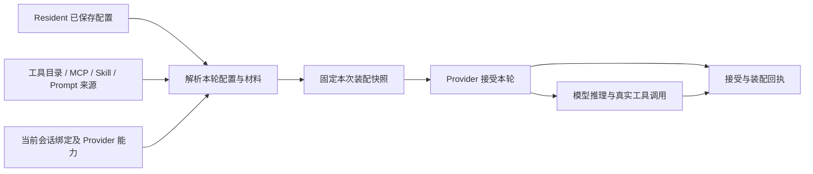

# Resident 能力配置、会话装配与账号切换协议

> 状态：accepted。weihao 于 2026-10-27 批准按本协议实施；2026-10-28 已完成实现、发布及本文列出的真实会话验收。
>
> 本文定义已批准并实施的协议。当前交付包含主发布 901532faaa99、能力观察修正 5f2149edb649、fresh 懒建集成 932c19a9aa0b 与上下文状态修正 45e7450ac17e；发布激活与服务健康检查均已通过。相邻 Design、SPEC.md 及共享/源码/seed 的上下文规则已同步。自动工具登记检查触发会话重建继续保持关闭。

## 1. Resident 使用能力，Session 承载一次连续对话

Resident 是长期存在的工作身份。它选择执行账号、可以使用的能力，以及给模型的指令；Session 是某个 Provider 承载对话的执行资源。

用户应当能够分别完成三件事：配置 Resident、向它发送任务、切换它使用的账号。这三件事不应被混成一个需要理解 Fork、工具清单、压缩摘要与初始化步骤的操作。

**“注册 Resident”只建立身份与配置，不隐含模型推理。** 它可以校验引用、检查权限、准备工作目录；首次真实输入到来时，再按配置建立或续接模型会话。界面若提供创建时的首条任务，必须显示并记录这条真实输入，不能把它藏在注册流程里。

**能力配置变化不自动替换会话。** Portal 只在后端明确支持时，把变化应用到现有会话的后续轮次；不支持时显示待生效项，由用户选择是否另建会话。查询失败、记录缺失和版本未知都不能成为自动重建理由。

**账号切换是一个独立动作，优先保留当前有效上下文。** 账号切换表单根据后端 context_options 自动选用可用的完整保留方案；无法完整保留且支持 compact 时，展示摘要交接的范围、可能遗漏细节与工具过程的影响，主按钮显示“交接并切换”。用户无需选择底层策略，点击按钮才提交；选账号本身不执行操作。不支持完整保留或摘要交接时禁止切换，不自动使用 visible 或 fresh。完整保留提交 operation=switch_account、context_strategy=preserve；已说明影响的摘要交接提交 operation=restart、context_strategy=compact。两者默认 wait，准备失败均保留原会话；失败后不得静默降级。更换目标重新计算方案并更新说明，刷新不覆盖编辑。跨 Provider 仍须明确选择目标模型。空白开始只在独立“重新开始会话”入口明确选择。

本协议负责能力定义、配置引用、实际装配、更新和账号切换之间的边界。执行排队、权限判定、资源内容与会话历史仍由现有领域拥有，不新增第二个 Resident 配置服务、账号库或会话历史库。

## 2. 先分清这些对象

| 对象 | 表达什么 | 典型来源 | 不承担什么 |
| --- | --- | --- | --- |
| MCP 连接 | 如何访问一个提供能力的服务 | 已登记端点或启动定义、凭据引用、允许使用的能力范围 | 不等于工具本身，不决定模型会话是否重启 |
| 工具定义 | 可以调用的动作、输入格式、输出格式与执行入口 | Portal 内置接口、MCP 服务、Provider 原生工具 | 不等于 Markdown 里的使用说明 |
| Prompt 部分 | 本轮希望模型遵守的文字指令或需要知道的事实 | 核心规则、resident.md、业务指令、运行身份、本轮输入 | 不负责安装工具或授予服务端权限 |
| Skill | 某类任务的工作方法及其说明材料 | SKILL.md 和它引用的文件 | 不因被列出就自动启用所需工具 |
| 资源与记忆 | 可读取的项目知识、文件、历史与长期资料 | ResourceService、MCP resources、Workspace | 不自动变成高优先级指令，也不必全部塞入上下文 |
| Harness 扩展 | 轮内工具调度、输出留存和上下文处理能力 | 已声明的运行组件及其配置 | 不私自添加用户任务、替换会话或改变授权 |
| Provider 运行参数 | 模型、推理强度、速度、沙箱及原生审批设置 | Resident 统一执行配置与 Provider 能力目录 | 不代替 Portal 对实际对象的权限检查 |
| 会话绑定 | 当前 Resident 使用哪个 Provider、账号和原生会话 | SessionManager 与 AgentData | 不作为可独立编辑的第二份配置 |

MCP（Model Context Protocol）是访问能力的一种协议。同一个 MCP 服务可以提供 tools、resources 和 prompts；Portal 分别把它们接入工具、资源和模板处理。MCP 工具有结构化定义，资源通过 URI 标识和读取。参见 [MCP Tools](https://modelcontextprotocol.io/specification/2026-07-28/server/tools) 与 [MCP Resources](https://modelcontextprotocol.io/specification/2026-07-28/server/resources)。具体协议版本与通知机制由适配器协商并记录，不把某一版传输状态当成模型的对话 Session。

工具定义中的名称、说明和参数结构会交给模型运行时。模型可能在上下文里看到相应描述，但这与在普通 Prompt 中写“你可以使用某工具”是两个独立输入。

MCP prompts 在 Portal 中按“可选择的提示模板”处理：使用时展开成有来源、有参数的材料。连接成功或发现模板不等于自动把模板提升为 system/developer 指令。

## 3. 配置只保存意图，执行记录保存实际结果

**Resident 当前配置沿用现有统一设置 owner，新增内容以有约束的引用接入。** 不再创建一个可独立编辑的 runtime/settings.json、工具名缓存或账号配置副本来竞争当前事实。

统一读取时提供三个视图：

1. **已配置**：用户希望这个 Resident 使用什么，包括能力引用、Prompt 来源与时机、Skill 选择和运行参数。
2. **本次装配**：Execution 实际解析并准备交给 Provider 的版本、工具定义和文字内容。
3. **已确认的运行事实**：Provider 接受了什么，哪些信息只能确认已发送，哪些仍未知。

三个视图由各自 owner 提供事实，页面组合呈现；不会因为“已配置”里勾选了工具，就把它标成“当前会话已具备”。

来源只有一份权威：
- 工具实现及其结构化声明由工具提供方拥有，能力目录负责引用和发现。
- MCP 连接定义与凭据引用由接入配置拥有；凭据正文不进入 Prompt、导出清单或审计摘要。
- Resident 的选择由统一设置 owner 保存。
- resident.md 的正文继续由 Resident 身份说明文件拥有，页面编辑也保存到这个来源。
- 业务 Prompt 正文、注入策略沿用当前配置 owner；Family 指南沿用其业务配置来源。
- SessionManager 保存会话绑定，AgentData/Execution 保存这轮实际使用的装配记录与执行事实。

可以提供可读的导出格式，例如 `tfi.resident-setup.v1`，用于解释或迁移配置引用。它是受控导出/导入协议，不是新的常驻可写配置文件。导入先预览差异并按当前权限校验，不能携带旧实例的凭据、运行身份或强制覆盖会话绑定。

## 4. 工具与 MCP 的登记协议

### 4.1 每项工具必须能追溯到唯一执行入口

工具的稳定身份使用“提供方 + 连接或包身份 + 本地名称”，而不是裸名称。MCP 服务 A 和 B 都提供 search 时，两者保持不同身份；适配器为模型生成确定且符合 Provider 限制的名称，并保存反向映射。名称碰撞、非法 schema 或无法映射的定义在启用前报错，禁止静默覆盖。

工具声明至少包括：
- 稳定身份、显示名称、用途。
- 输入 schema、输出形式或输出 schema，以及契约版本/内容摘要。
- 提供方与执行入口引用。
- 声明的读写性质、所需权限、超时和取消能力；这些是执行规则的输入，服务端仍独立校验。
- 可用的接入方式，以及是否支持在现有会话更新。

只发现到的工具仍属于目录项。用户或获授权的配置模板为 Resident 选择范围后，才形成它的期望工具集合。新发现的服务能力默认不扩大既有选择；显式“跟随服务全部工具”的策略必须能被看见、修改和审计。

### 4.2 应用工具显式登记

已安装应用通过 `resident.tools` 声明工具，稳定引用为 `application:<应用>.<能力>`。目录发现不等于 Resident 注册；工具实现由应用服务拥有，不进入 HATG ISA，也不通过通用动作指令包装。Paper、Pulse、Telepus 分别提供自己的工具包。

认证入口 `GET /api/application-tools` 返回已安装工具的引用、名称与输入 schema。Resident 使用既有 `UpdateResidentSettings`、`expected_revision` 更新 `capability_config.tools`，例如 `{"ref":"application:pulse.read","enabled":true,"required":false}`。每项应用工具须逐项显式选择；未列出、删除或 disabled 均不装配，不随应用安装自动启用。既有 Portal 内置工具的缺省选择保持原合同。配置不安装代码，也不授予业务权限。

应用服务接收 `POST /api/application-tools/execute`，信封为 `{"schema":"tfi.application-tool-call.v1","tool":"application:pulse.read","arguments":{"user_id":"目标User"}}`，另可带 `idempotency_key`、`expected_version`。返回 `tfi.application-tool-result.v1`，含 tool、call_id、status、replayed 与 result 或 error。网页按认证 User 直接使用应用入口；Resident 的服务器入口回读其当前配置，确认引用仍启用，再按真实调用者检查应用权限和资源范围。模型参数不能替换调用身份。

模型所见的单项应用工具参数含必填 arguments 对象，以及可选 idempotency_key、expected_version；arguments 只承载应用业务参数，版本和幂等控制放进调用信封。省略幂等键时沿本次工具调用 ID 稳定生成，模型不能传入 caller 或更换声明绑定的工具引用。

Worker 使用既有签名传输的 `application.tools.list`、`application.tools.execute` 访问 Web 应用服务；Execution 只负责装配与传输，不导入应用业务。选中引用、工具声明摘要与恢复依赖记录在本轮能力快照。required 缺失或 Provider 不支持时在调用模型前拒绝，optional 缺失单独记录。固定工具目录 Session 新增能力沿 pending_session 合同，不自动重启。每次调用重核当前配置，撤销阻止旧会话中的旧工具调用；业务权限、资源 owner、版本比较、幂等及执行审计保持独立。

### 4.3 MCP 接入按 Resident 的身份与范围隔离

MCP 连接保存端点或结构化启动定义、允许传入的环境项、凭据引用、版本兼容范围和可发现能力范围。账户级共享只共享可安全共享的连接资源，不共享 Resident 的调用授权。

每次调用绑定真实 Resident、Execution、工具调用 ID 和当前授权上下文；模型填写的 actor、owner 或消息作者不能替换实际调用者。连接复用必须按身份、凭据及权限范围分区，不能只按 URL 缓存。

目录读取、连接健康和真实调用是不同事实。发现列表成功只能证明服务宣告了工具；Provider 接受定义只能证明该接口被接受；只有相应调用结果能说明该次业务动作的结果。不为“验证工具”执行有副作用的探测。

服务支持目录变化通知时，通知使对应目录观察失效并触发受控刷新；不支持时按显式刷新或有界缓存处理。目录刷新不更改对话历史，也不启动模型推理。

### 4.4 Portal 的 HATG 只有一套业务执行语义

`hatg_instruction` 的参数定义与执行处理来自代码中的正式 ISA 接口。Markdown 中可以强调和说明其使用方式。Provider 原生工具、MCP 桥或正式命令行客户端可以承载同一能力，但都进入同一身份检查与 ISA 执行 owner。

同一模型轮次默认只展示一个首选 HATG 调用入口，避免同义工具被重复调用。命令行兼容入口若启用，必须是明确的配置结果和可观察的调用路径，不能用“工具看似缺失”自动修改会话来恢复它。

Provider 自带的 shell、浏览器、搜索等工具单独标明来源。Portal 无法查询或控制的原生工具标为“由 Provider 管理/可用性未知”，不伪装成 Portal 已确认注册，也不承诺关闭 Prompt 就关闭这些能力。

## 5. Prompt、Skill 和资料怎样进入模型

**一份 Prompt 部分只表达一类内容，并能查看其来源、版本、发送时机和实际位置。**

沿用现有注入类别，不另建同义类别：

| 内容 | 正文来源 | 配置含义 |
| --- | --- | --- |
| Portal 核心规则 | 共用 Skill 与角色规则文件 | 是否发送及首轮、压缩后、每轮策略 |
| resident.md | Resident 自己的长期身份说明 | 身份正文与注入时机 |
| 运行身份 | 当前运行事实生成 | Resident/Lineage 身份说明；不能反向修改实际身份 |
| 授权上下文 | 服务端当前授权与发送来源 | 告知模型边界；隐藏文字不撤销或增加权限 |
| 业务指令、Family 指南 | 已有业务配置 owner | 当前任务职责与业务约束 |
| 任务 Skill | 显式选择的资源及版本 | 发送目录/引用，按配置读取正文 |
| 本轮输入、引用和资料 | 原始消息及已鉴权资源 | 作为本轮任务和资料，保留作者、来源与边界 |

每部分具备稳定 part_id、来源引用、内容摘要、期望指令层级、发送策略和最终 Provider 放置位置。可选策略沿用关闭、首轮、首轮及压缩后、每轮；“关闭”指停止未来注入，不从原生历史中抹除已经送达的文字。

Provider 无法保留原指令层级或无法在同一会话更新时，预览明确列出限制与差异，不能把放入普通用户消息的文字声称为已经替换原生 system prompt。适配器可采用已声明的续轮注入方式，但必须记录真实位置。

**保存 Prompt 修改不偷偷发起一轮模型调用。** 后续发送是否生效按既定策略判断。首轮专用内容改了而当前 Session 已经过首轮时，显示“后续新会话生效”；可另行提供显式“下轮发送更新”的动作，并说明它追加说明、不会删除旧指令。发生矛盾时不得声称已经完成系统指令替换。

Prompt 预览显示“准备发送什么”；实际发送记录显示“该轮交给 Provider 的是什么”。两者分开。Provider 内部未披露的系统提示、注入与缓存只能标为不可见，Portal 不声称掌握模型完整输入。

Skill 的选择、目录送达、正文读取是三件事，分别记录已有证据。选择 Skill 不自动安装软件、添加 MCP 连接、授予权限或执行其步骤；缺少依赖时报告给任务或配置入口。

资源与长期记忆默认按需读取。外部文档、MCP 返回内容、历史引用中的指令仍属于其原始来源，不能凭文本里的角色标签取得更高指令层级。关闭 Portal Prompt 的“纯原生”预设也不能暗中改变工具与 MCP 开关；页面分别显示这两类选择。

## 6. 一次输入的装配与执行



1. 普通消息按原输入身份受理；真正开始执行前，解析当前配置及现有绑定，固定本次装配快照。已经开始的一轮不因用户保存配置而被重新装配。
2. 同一次失败恢复复用已固定快照与接受回执；是否允许另一次尝试采用新配置由正式重试操作决定，不能悄悄改变已接受输入。
3. 只解析本轮涉及的资料和已选择的能力。不逐轮遍历所有 MCP 服务、不反复导入全库 Skill，也不查询旧工具名集合来决定是否替换会话。
4. 适配器把结构化工具定义、Prompt 各部分、用户消息及媒体分别转换为 Provider 接口；内部传输形式可以不同，来源和语义保持可追踪。
5. Provider 接受、拒绝或返回不确定结果时，分别保存事实。提交超时不等于未接受，不盲目再发一次。
6. 正常推理从真实任务输入开始。创建身份、登记能力、打开连接和建立空会话都不产生“请整理并确认初始化”的隐藏任务。

运行快照只记录实际需要的引用与摘要：配置 revision、绑定身份及版本、工具契约和别名映射、MCP 目录观察范围、Prompt 来源与最终内容引用、Skill/资源引用、Provider 与适配器版本。正文沿既有受控内容存储保存，不在多个日志复制凭据或全部上下文。

能力状态分维度记录，避免一个含糊的“已注册”：
- 选择状态：启用/停用。
- 目录观察：发现/确认缺失/未知/过期，并附来源与时间。
- 交付状态：未发送/已发送/后端确认接受/后端拒绝/未知，指明对应 Session 或轮次。
- 业务结果：具体调用成功/失败/结果未知，不能据此泛化为所有调用都可用。

无记录统一解释为未知，不解释为确认缺失。一次旧成功也不永久证明当前可用。

## 7. 配置更新的生效规则

| 变化 | 默认行为 | 不支持原地生效时 |
| --- | --- | --- |
| 模型、推理强度、速度与原生执行参数 | 校验本次改动，下一轮应用 | 保留当前有效配置，明确未应用项；不静默改模型或账号 |
| Prompt 正文或发送策略 | 按该部分发送策略影响后续轮次 | 标明待新会话或需要显式追加更新 |
| 新增、更新工具定义或 MCP 能力选择 | Provider 明确支持轮次更新时，在安全轮次边界应用 | 保存为待生效项，提供显式重启入口 |
| 连接暂时断开 | 原连接 owner 做有界重连，沿原会话继续 | 报告该能力故障；不生成摘要或另建模型会话 |
| 停用工具、移除授权 | 服务端立即拒绝后续新调用，并在支持时移出下一轮目录 | 旧模型可能仍记得工具，调用仍拒绝；进行中的调用按取消契约处理 |
| 切换账号或 Provider | 用户显式发起专用切换操作 | 明示上下文、模型和能力差异，等待选择，不自动降级 |

新启用且被明确设为运行前必需的能力，若装配失败，应在模型接受输入前报告具体缺项。可选能力失败仅影响该能力。已有会话缺少历史登记记录时保留现有绑定和工作，不把“未知”升级成全局停止条件。

并发保存通过配置 revision 防止旧页面覆盖新值；相同配置不制造新操作。目录/schema 变化保存独立版本，不能用工具名字相同来代替契约相同。

## 8. 换账号的正常路径只有一个动作

### 用户看到什么

运行设置是一张单页面板：上部选择账号，下部编辑运行参数，没有标签页。Chat 输入框底部的运行摘要、Family 成员入口和额度不足时的手动选择在弹窗中打开这张面板；Resident Menu 的 Settings 页直接内嵌同一面板。

- 账号选择器按 Provider 分组，选项写成“Provider · 账号”（例如“Codex · two”），默认选中当前账号。
- 运行参数区显示当前账号支持的 Model、Mode、Effort、Speed、执行沙箱与审批等字段。只改参数时主按钮为“保存”，从下一轮生效，不换账号也不重新开始会话。
- 选择另一个账号后主按钮变为“切换账号”，并说明等待当前工作完成后切换、失败保留原会话。目标只能摘要交接时主按钮为“交接并切换”，同时说明可能遗漏细节和工具过程；目标不支持保留或摘要时禁止提交。
- 同 Provider 切换时一并修改的参数先保存，再提交切换。跨 Provider 时参数区换成目标 Provider 的参数，须有目标模型。
- 没有改动时主按钮不可提交。相同 Provider、相同稳定账号 ID 的选择即为没有改动，不显示 zero → zero。
- 初始化处于 pending、running 或 failed 时，面板显示“继续当前初始化”，不显示账号选择。
- 弹窗的关闭按钮、取消、Escape 与点击卡片外区域均可退出并恢复页面交互；内嵌面板用“还原”放弃未保存的修改。关闭界面不取消已受理的操作。面板不显示绑定诊断。

界面不提供能力配置编辑和同账号“重新开始会话”。这两项仍由 `UpdateResidentSettings` 的 capability_config 和 `RestartSession` 的 operation=restart 承担，Agent 和脚本通过 HATG 调用。

“智能选择、原生 Fork、精简交接”不出现在正常换账号表单里。系统应当承担无损路径选择，只有遇到信息无法保留等真实取舍才让用户决定。

### 后台做什么

1. 验证目标账号能用、当前模型及其他参数是否兼容、工具及 Prompt 配置能否装配。跨 Provider 无法照搬模型时，要求选择目标模型；不能把别的模型默认为等价。
2. 记录一个具有操作 ID 的切换请求。当前工作尚未结束时显示“等待当前工作结束后切换”，默认不打断它。
3. 工作结束并取得切换顺序后，在短锁内固定源绑定与当前有效上下文边界；后续排队输入等待这次切换的明确结果，不能绕过操作在两边同时启动。准备和导入等慢步骤在锁外执行。
4. 优先使用可验证的原生完整复制；不可用时，仅在 Provider 支持时导入规范化的当前有效上下文。历史工具调用作为记录导入，绝不重新执行。
5. 核对目标会话、上下文保留结果与能力装配事实，然后以源绑定及配置版本为条件原子切换；若期间配置或绑定改变，拒绝提交过期候选并重新报告，不覆盖新状态。
6. 切换成功后，尚未开始的原输入继续使用新绑定；保留原消息 ID 和投递顺序。最近失败输入不因切换而自动重试。
7. 切换失败或提交前取消时，原账号、原会话及历史仍保留；显示具体失败阶段和后续输入实际使用的绑定。请求响应丢失时先查原操作，不再次创建切换。

用户需要立即切换时，可以在等待状态选择“停止当前工作并切换”。这会显式调用原有停止机制，必须等停止结果明确后再切换；工具业务结果未知时不自动重做。候选已提升且目标输入已接受后，不把“取消”解释成时间倒流；再次返回旧账号是新的切换操作。

切换会把上下文交给目标 Provider/账号。首次跨 Provider 或跨账号授权范围时，预览说明目标与数据范围，并按现有授权规则处理。已有授权范围内不增加重复确认。

### “保留上下文”的精确定义

保留的是这段会话当前有效上下文：已有压缩边界后的内容、有效摘要、消息、工具调用和对应结果、必要的媒体与来源。之前被清空或压缩掉的历史仍可作为审计记录存在，但不得擅自重新塞回模型。

保留不等于复制 KV cache、隐藏推理状态、服务端内部提示或保证输出相同。上下文导入本身不应触发额外的总结推理；下一条真实任务才产生后续推理。后端只能通过生成轮次建立候选时，这属于未满足默认切换合同，不在后台发送确认话术蒙混过关。

目标容纳不下、无法导入某类有效内容、缺少必要配对或媒体不可读时，不宣称完整保留。预检已知不能完整保留而目标支持摘要时，页面说明影响并提供“交接并切换”；用户点击才发起独立、可审计的 compact 模型操作。已提交的 preserve 执行失败保持原会话，不自动降级。空白新会话是独立明确操作，不作为任何切换的自动回退。

目标中旧工具历史仍按原工具身份解释，不能因新会话里同名工具不同而重映射历史；下一次真实调用使用目标当前契约。源端不可导出的 Provider 私有内容标为无法恢复，不伪造等价性。

## 9. 用户界面按目的组织

设置入口共用一个面板，每种操作各有明确结果；在同一面板里既改参数又换同 Provider 账号时，先保存参数，再提交切换：

| 用户目的 | 操作名称 | 结果 |
| --- | --- | --- |
| 改模型、速度、推理强度 | 保存参数 | 从适用的下一轮生效；不换账号或新建 Session |
| 换执行账号 | 切换账号 | 优先保留有效上下文；需要摘要时说明影响并由交接按钮提交，失败保留原会话 |
| 配置 MCP、工具、Prompt、Skill | `UpdateResidentSettings` 的 capability_config（界面不提供） | 记录已生效、下轮生效、待显式重启及失败项 |
| 在同账号重新建立会话 | `RestartSession` operation=restart（界面不提供） | 明确选择保留有效上下文或空白开始，不暗含账号切换 |
| 减少上下文长度 | 压缩上下文 | 独立且可见的压缩操作，说明方法与信息损失 |
| 继续失败任务 | 重试这条任务 | 指向具体原输入，先查是否已接受、执行或部分完成 |
| 排查故障 | 查看诊断 | 查看绑定、版本、回执和原错误，不改变工作 |

能力详情按“已选择 / 当前实际情况 / 生效时机”显示。普通用户不需要编辑结构化清单；开发者可以展开精确字段和实际发送内容。

提示描述当前结果，例如“账号切换失败，仍使用 two”，并显示时间。旧失败在之后成功操作后归入历史，不继续作为当前故障横幅。“当前会话在工作”也不能抹掉此前真实失败的记录。

Provider 的审批/沙箱设置与 Portal 资源权限分开命名；界面不能用一个 Full Access 暗示所有对象都被授权。

## 10. 状态所有权与接口边界

沿用现有模块分工：

| Owner | 唯一职责 |
| --- | --- |
| Lineage / Resident 设置 | 稳定身份、期望配置、用户操作意图与业务顺序 |
| ResourceService / 各能力提供者 | 资源及 Skill 解析、工具声明和 MCP 接入定义的各自事实 |
| Worker Harness | 按所选能力组织轮内调用、输出留存与运行限制 |
| Execution / Provider Adapter | 配置转换、能力观察、发送/接受事实及 Provider 差异 |
| SessionManager / AgentData | 会话绑定、条件替换、有效上下文及原始历史 |
| Scheduler | 原输入的排队、接受、停止和续接顺序 |
| 原生界面 | 展示上述事实与提交意图，不自行推断迁移策略 |

设置读取与保存继续通过正式 GetResidentSettings / UpdateResidentSettings；Prompt 预览复用 PreviewPromptInjection，实际发送复用现有查询。工具/MCP 扩展字段应进入同一有版本契约，不另造无约束 JSON 设置。

会话业务 owner 分别定义换账号、重启、压缩、恢复的操作意图，复用底层候选、等待与条件提交机制。界面自动选择支持的方案并提前说明影响，提交显式 preserve 或 compact；API smart 兼容值仍归一 preserve，不在执行层自动压缩。

配置写入返回 revision 及逐项生效状态。会话操作返回 operation_id、源/目标账号、当前阶段、实际绑定、上下文处理结果和错误。语义状态至少区分：等待当前工作、准备目标、核对保留内容、提交绑定、完成、失败、取消；重读同一个操作能收敛未知结果，不以重复按钮点击生成新请求。

## 11. 不变量与验收场景

- 无工具登记记录的旧 Session 收到消息，继续原绑定；不关闭接单、不创建替代 Session、不产生整理回复。
- MCP 服务断线、目录为空、鉴权失败分别显示真实情况；三者都不自动清空或摘要会话。
- 两个服务都有 search 时，模型目录与调用路由无冲突；禁用其中一个不影响另一个。
- 修改 resident.md 后，预览能说明正文来源、是否本轮发送和最终位置；旧历史不会被伪装成已删除。
- 选择 Skill 只增加对应材料；不存在“选 Skill 顺带安装工具并扩大权限”。
- 保存过程中已有一轮在运行，当前轮快照保持不变；下一轮按确定的配置 revision 运行。
- 相同账号选择没有迁移操作；不同账号选择只需一个明确按钮。
- 原生复制失败且历史导入可满足同等内容合同，可沿同一操作继续；导入也做不到时停在原会话，不静默改用摘要。
- 账号切换请求超时后重复查询得到同一操作和绑定；不产生第二个目标轮次或重复工具副作用。
- 撤销授权后旧 Session 即便仍能生成对应调用，也被服务端拒绝。
- 切换后的新任务确实在目标账号接受，且引用了可保留的原上下文；“服务健康”不代替这个业务验收。
- 本协议中所有不需推理的登记与装配流程，模型调用记录均为空；显式摘要有可追溯的独立记录。

## 12. 与现行设计的衔接

本协议以“配置意图、真实装配、会话连续性分开”组织责任，不采用“所有内容写进 system prompt”或“登记不一致就重建”两种模型：前者不能建立实际调用接口，后者把不确定的观察扩大成会话和上下文变化。

现行事实可从以下 Design 对照阅读：
- [Resident 统一执行配置](/r/decision_8b2fa224616b)：当前配置 owner 与运行参数。
- [Resident 上下文来源与组装](/r/decision_c616d197abbb)、[Prompt Context](/r/decision_ef1d6c925955)：文字来源、注入时机与 Provider 放置。
- [SessionManager 与 Provider Binding](/r/decision_91eb3626d323)：绑定及接受回执。
- [Session 重启、账号切换与上下文清空](/r/decision_c47a13e8b962)：现有操作及自动工具刷新关闭后的边界。
- [Agent Harness](/r/decision_5c62deb8253a)、[AgentData](/r/decision_b1ab45c4b3ec)：执行组件及有效上下文。
- [设计索引规范](/r/decision_ef80c6d3b5ee)：采纳后如何成为当前规范。

本协议规定：账号切换默认保留有效上下文；资料损失需要单独选择；配置更新不额外调用模型。以上设计已获 weihao 批准；不以设计获批代替上线与实际验证。

本协议拥有能力配置、装配与切换的共同边界；相邻 Design 继续拥有设置持久化、历史窗口及会话操作状态。旧工具名字记录只能作为历史观察，不能推导为确认缺失；旧失败及错误原件保留。运行支持范围以以下明确契约为准，不由界面选项推断。


## 13. 版本化配置与当前支持边界

`GetResidentSettings` 返回唯一配置 `settings`、内容版本 `settings_revision` 与生效预期 `application`。`UpdateResidentSettings` 在顶层接收 `expected_revision`，过期拒绝且保留页面草稿；同值保存不制造新操作。保存本身不调用模型，不创建会话或打开 MCP 连接。

`settings.capability_config` 的 schema 固定为 `tfi.resident-capabilities.v1`。tools、mcp、skills 均为数组，覆盖项只有 `ref`、`enabled`（默认 true）、`required`（默认 false）；mcp 另外有精确本地工具名称数组 `tools`。未知字段、重复引用、错误类型、required 且 disabled 均拒绝。省略类别表示没有覆盖，保持既有内置能力，但 application: 引用缺省不启用；省略 MCP tools 与空数组均表示不选工具，不发现连接。没有默认全选或自动跟随新增工具。

```json
{
  "schema": "tfi.resident-capabilities.v1",
  "tools": [{"ref": "portal:hatg_instruction", "enabled": true, "required": false}],
  "mcp": [{"ref": "已登记的连接资源引用", "tools": ["search"], "enabled": true, "required": false}],
  "skills": [{"ref": "共享 Skill 名称或 SKILL.md 路径或资源引用", "enabled": true, "required": false}]
}
```

内置工具引用选择现有 Harness 执行入口，不通过配置正文安装可执行代码。Skill 按 skills 区域与当前 Resident 资源权限解析，受既有 Prompt 注入时机控制；列表引用、正文发送、Provider 接受是不同观察。Markdown 可以说明与强调 `hatg_instruction` 的用法，实际参数和调用仍由正式 ISA 执行。

MCP 连接是可授权读取的 JSON 资源，schema 为 `tfi.mcp-connection.v1`，字段为 `protocol_version`、可选 `timeout_seconds` 和 `transport`。当前协议版本支持 2025-06-18；stdio 用绝对 command、argv、显式 env_allowlist，env 值是凭据资源 `{ref}`；streamable_http 用 url 与 headers 的凭据资源 `{ref}`。配置不写凭据正文。HTTP 支持 POST 的 JSON/SSE 响应，远程 HTTPS、loopback HTTP；不支持旧 HTTP+SSE、OAuth 获取刷新、GET 长订阅、自动重连重放或远端 schema 引用。prompts/resources 不自动注入。

每次执行把配置摘要、工具声明摘要、MCP 非秘密连接与完整工具定义摘要、别名和 Prompt 来源记录入现有 execution/checkpoint。恢复时，Resident 能力配置摘要或冻结的 MCP 连接与工具定义改变，拒绝沿原执行继续（`Resident capability configuration changed during execution recovery`）。Portal 内置工具的定义随代码发布改变时不拒绝：发布重启 Worker 时正在执行的轮次常会遇到这种情况，例如 `hatg_instruction` 的说明列出全部 ISA 指令，新增一条指令就会改变它的摘要。这时执行用新定义继续，checkpoint 保留原快照，并发出 `resident_capability_contract_changed` 事件，按别名列出新增、移除或改变的工具。凭据引用的权限与内容在调用时重新读取。已停用能力在实际 handler 入口拒绝；模型记住旧名称不构成授权。

配置保存、声明发现、适配器已发送、模型已接受、业务成功分别记录。无发送证据即 unknown；空会话操作成功不证明已发送工具，固定工具目录的旧原生 Session 不因记录缺失而重建。明确新增且后端不能原地装配的工具显示 pending_session；required 无法满足则在模型接受前拒绝。用户可以显式重新开始会话，系统不会代作此选择。

| 场景 | 当前契约 |
|---|---|
| 注册普通 Resident 或从来源有效上下文注册 | 保存身份、配置和不可变材料，首条真实输入懒建；不调用整理模型 |
| 同一稳定账号的 switch_account | unchanged，无操作，无新会话 |
| 同账号 preserve 重启 | Provider 声明并实现原生 fork 时使用；能力变化仍独立校验 |
| Codex 跨账号 preserve | 验证有效 AgentData 历史可完整表达后创建空线程并注入历史；不重执行历史工具，不调用整理模型 |
| 无法表达的历史、不可恢复推理材料 | 明确失败，保留旧绑定；不声称复制 KV cache 或隐藏推理状态 |
| 其它 Provider 跨账号、跨 Provider 保留 | 当前不支持完整导入时拒绝；不隐式采用摘要交接 |
| 显式 fresh | 清空有效上下文并保存配置，下次真实输入懒建；页面历史仍保留 |
| 显式 compact/visible 交接 | 独立的有损模型操作；不作为普通切换的 fallback |

`RestartSession` 复用既有状态 owner；operation 为 switch_account 或 restart（省略保持 restart），默认 context_strategy=preserve、active_execution_policy=wait、resume_failed_input=false。smart 仅兼容旧请求并映射 preserve，退出条件为旧客户端停止发送该值。switch_account 只允许 preserve；跨 Provider 要明确目标模型，原生运行参数按目标校验，Portal 能力与 Prompt 配置保留。返回 operation_id（restart_id 别名）、phase、context_result；GetSessionRestart 返回实际绑定。相同操作身份与请求重放复用，改请求冲突；等待、取消、后台恢复和提交前 CAS 沿现有生命周期，不另设状态库。

运行设置面板的形式见上文“用户看到什么”。压缩和具体失败输入恢复保留各自入口；未知状态不得标成失败或已生效。


## 14. 本次实施与验收记录（2026-10-28）

- 参数、能力、切换账号与显式重开会话按四个目的分开；能力配置通过现有 execution_settings 与 settings_revision 保存，旧版本保存明确冲突。Markdown 可以继续说明和强调 hatg_instruction 的使用；正式 ISA 是参数与执行处理的权威。
- 临时 Resident 的真实验收：注册后无原生绑定；保存能力配置仍无会话/输入；同稳定账号（含 codex_two/two、codex_one/one）返回 no_op。首次真实输入才建立原生会话。
- 实际 Codex two→one 切换完成，context_result=preserved、model_operation=false；随后新的模型轮次正确回答仅在切换前出现过的验证码。没有为切换添加模型整理轮次，也没有重试旧失败输入。
- 首次现场验收暴露收尾观察逻辑将未附加的适配器能力字段视作集合，模型回复完成后输入被误记失败。保留失败原件，修正为使用既有 capabilities_of 查询后发布 5f2149edb649；后续真实输入与跨账号验收成功，未篡改原失败状态。
- fresh 的真实验收：清空操作立即完成，model_operation=false、configuration_only=true，实际会话绑定为空；下一条真实输入才建立新 Codex 会话并执行。旧验证码未带入，新会话回复“不知道”，旧聊天原件保留。首次验收发现提前空 create，已修正并随 932c19a9aa0b 发布。
- 同次现场验收发现首条新输入前 in_context 状态滞后；查询现在同时遵守 canonical context_reset/provider_context_reset，45e7450ac17e 发布后再验，清空后立即为 false、绑定仍为空、旧回复仍可读。有效失败与修复日志均保留。
- MCP 使用显式工具名选择，省略或空数组不发现工具；恢复检查冻结的连接和完整工具契约摘要，调用时重新鉴权并检查当前禁用状态。Kimi 的空目录和发布失败不能记作已发送，必需工具缺失在模型调用前拒绝。
- 验证使用定向分段测试及复用原有效日志，没有全仓回归或把分段结果声称为单次全跑。MCP 测试是真实隔离 stdio/HTTP 通信，资源授权与模型边界有替身；实际会话验收是 Codex，未宣称所有 Provider、外部 MCP 或模型接受状态都已线上验收。
- 保留上下文能力受第13节 Provider 矩阵约束：不能完整保留时明确失败并保留旧绑定，不自动降级为摘要。显式 compact/visible 才允许可审计的模型交接；fresh 及配置保存没有隐藏初始化推理。

交付与原件入口：`/share/Projects/AI员工/knowledge_base/agents/lineage_8794980b1bb7/residents/resident_2e9ea0072551/workspace/resident-setup-20261027/report.md`。


## 统一账号选择

账号选择是 Execution 的独立策略，输入为后端、模型/推理强度、账号种类及计费范围和账号观察；不负责修改 Session。Backend 角色及 Resident 执行设置的 account_selection 只有 auto 和 fixed。 Runtime 参数界面的账号选择通过 UpdateResidentSettings 的 changes.account_selection 保存，只接受这两个字符串值；GetResidentSettings 从同一份持久设置回读，保存沿用 settings_revision 并发校验。此字段与 auto_switch_on_quota 独立，修改其中一项不覆盖另一项。auto 不代表某个优先账号，fixed 才是明确固定账号。旧角色迁移为 auto；已有明确路线且无角色/自动意图的 Resident 保持固定，已有 Session 不在升级时重建。

新会话的账号候选、监控观察和预防性迁移策略统一由执行账号协议 decision_d40f59f5508f 拥有；本协议不再以登录观察、额度或模型目录的新鲜度另设普通启动前提。能力装配仍使用已保存的平台配置：明确设为 required 的工具、MCP 或 Skill 无法装配时，按本协议在模型接受输入前拒绝；可选能力或旧登记记录未知不自动重建会话。预防性迁移与跨计费范围选择仍服从执行账号协议，跨 Provider 显式模型及完整上下文保留继续按本协议与 decision_c47a13e8b962 执行。

现有会话有效时保持实际绑定，不能因其他账号余额更大而迁移。自动模式额度不足时沿现有 RestartSession 幂等、等待在途工作、事务回滚流程保留有效上下文；自动路径使用 preserve，不能静默 compact、fresh 或重新投递结果不确定的业务。仅原有失败输入恢复规则可恢复已确认失败的输入。没有完整保留能力时保持原会话并报告等待原因。

Backend 角色以 backend_priority 持久化有序账号种类 ID，和 account_selection、模型偏好共同进行版本比较与保存。auto 新会话按该顺序寻找首个额度和模型目录有效的种类，再按公共额度策略选择同类账号；未显式设置额度自动切换开关的现有会话，耗尽时先寻找同类兼容账号，再按角色顺序切换。跨种类采用目标账号目录的默认模型并清除来源推理强度，保留上下文。未列入的种类不参与跨种类选择；API/服务账号需用户明确加入，API 种类包含计费身份，不隐式动用订阅附加付费 credits。省略 backend_priority 更新时保留原值；空数组保持参考账号同类范围，兼容已有配置。首次创建会话时，显式选择后端、账号路线和模型且未绑定 backend_role 的普通 Resident，auto 仅在该后端、账号种类及计费范围内选择支持所选模型的账号，不继承站点默认角色的跨后端排序。通过 backend_role 或省略后端而使用默认角色创建的 Resident，才按该角色排序选择后端。额度耗尽后的迁移继续遵循独立的 auto_switch_on_quota 和既有恢复策略，Family 的旧显式迁移策略仅在未启用统一自动模式时适用。新建表单默认手动固定账号，用户可显式选择 auto；编辑已有设置时回显持久值，缺少策略的明确路线显示 fixed，刷新页面不把它改成 auto。未显式设置额度自动切换开关时，fixed 忽略排序且不自动迁移。账号观察与模型目录由执行服务提供，UI 不猜测模型兼容性或挑选实际路线。

管理页说明为“不同种类 AI 后端默认选择/自动切换的排序可手动调整，同种 AI 后端的选择由当前额度自动选择”，旁置“默认帐号选择排序”按钮。卡片统一编辑自动/固定、种类上下排序、API/服务种类加入与移除及模型偏好；推荐顺序只包含订阅种类。保存前只改本地草稿，取消不写入，保存按角色版本比较；固定模式禁用排序，窄屏说明及按钮自然换行。手动切换账号建立固定账号选择意图，但保留独立的 auto_switch_on_quota 开关；修改策略不改写已有 native session 的身份。

### Resident 的额度自动切换

Resident Settings 提供“在当前帐号额度用完时是否自动切换”开关，以独立的 execution_settings.auto_switch_on_quota 布尔值保存。缺省沿用旧策略；显式开启只按站点 default.backend_priority，显式关闭禁止额度自动迁移，手动固定账号不会覆盖此开关。额度与迁移的唯一决策及状态所有权见 decision_d40f59f5508f。

关闭时，发送被受理且确认额度不足后直接打开既有账号切换卡片；开启但默认目标耗尽时提示“当前没有默认可切换的ai后端, 请手动选择”并提供同一卡片入口。手选列出所有可切换后端，不以默认排序过滤。自动迁移完整保留上下文，不能静默压缩、丢弃上下文或重投业务；取消卡片保留原消息和会话。同一发送不重复弹卡，历史浏览不自动弹卡，未知额度和非额度错误不进入本流程。
