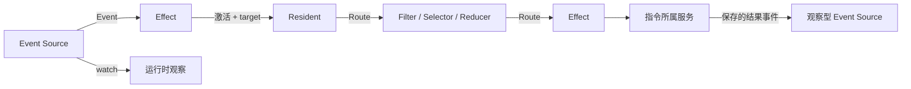

# HATG 的可组合对象模型、Packet 路由与可恢复 Program

HATG 是 Human–Agent Trajectory Graph 的缩写，中文叫"人机协同 Agent 轨迹图"。它是 Lineage 内部的协作图，用来描述三件事：
- 什么事实发生后由谁做什么；
- 多个结果怎样筛选、分支和合并；
- 下一步触发什么动作。

图由带类型的对象、端口和连线组成。图中的可执行定义在内部称为 Program，经过规范化、校验和编译后交给 Lineage 后台服务（SocietyService）运行。它随 Lineage 保存；用户直接编辑图，无需另外创建或管理 Program。这个模型让服务端明确事件要投递到哪里、动作需要哪些输入，以及中断后从哪里继续。例如，“A 完成后通知 B”会形成事件源、观察 A 的连接及向 B 投递的执行路线。

本篇规定 HATG 的对象、端口、连线、Event、Packet、Effect、编译、运行调度、Graph State、Workspace Handoff 和编辑页面（Workbench）。相关内容在以下规范中：
- Lineage 的成员、leader、删除与迁移：decision_6fc653d55c79。
- 指令格式与执行规则：decision_898b8911a2ff。
- Function Block 的定义、实例和升级：decision_5b5653c3eaa5。
- Trigger Path、投递与组件运行状态指令：decision_68215b3a825b。
- 定时与自动触发的工作：decision_5ff0cb51ed84。

## 基本概念

| 概念 | 含义 |
| --- | --- |
| 图对象 | 画布上有类型、配置和端口的对象：Resident、Event Source、Effect、Filter、Selector、Reducer、Loop、Seed 和 Function Block 实例 |
| 端口 | 图对象上带名称、方向和数据种类的连接点，声明对象能接收什么、输出什么 |
| 连线（wire） | 有向的激活路线或对象绑定；激活到输入端口，绑定到对象本身 |
| Event Source | 观察某类事实，事实发生时产生 Event 的组件 |
| Event | 已经发生并保存下来的事实，是一次运行的起点 |
| Packet | 沿 Route 传播的信息包，包含 Message、Events 或两者 |
| Message | 给接收者处理的文本、结构化数据和附件 |
| Effect | 运行一段脚本、调用一条或多条 HATG ISA 指令的组件 |
| Filter / Selector / Reducer | 筛选器、分支选择器、归并器，合称"算子"，处理 Packet |
| Loop | 记录一段往复交互进行了几轮的组件 |
| Seed | 尚未成为 Resident 的候选对象；采纳后才创建 Resident |
| Program | HATG 的可执行定义及其编译后的运行模型，随 Lineage 保存并由服务端执行 |
| 图代次（graph generation） | 每次编译产生的新编号；旧代次的迟到结果不能推进新 Program |
| Graph State | Program 可读写的少量键值数据（cell），在多次激活之间保存轻量状态 |
| Function Block | 可以反复放进 Lineage 的一段协作结构 |
| Workspace Handoff | 把一个 Resident 工作区中允许的内容交接给另一个 Resident |
| Trigger Path | 一次 Event 发生或独立 Effect 激活发起的流程，在 Resident 交付处截止 |
| Execution | Resident 接纳一组输入并完成一次工作的唯一执行身份 |

最短的运行链如下：

```text
Event Source ──Route──> Resident ──Route──> Filter / Selector / Reducer
      │                                                  │
      └──────────────────> Effect <──────────────────────┘
                              │
                  脚本中的 HATG ISA 指令
                              │
                      各指令所属服务执行
                              │
                   观察型 Event Source 产生新 Event
```

Program 连线共有三种类型：

| 类型 | 作用 | 是否触发执行 |
| --- | --- | --- |
| `route` | 传输 Packet，接收者处理消息、事件或混合内容 | 是 |
| `target` | 指定 Effect 的操作对象 | 否 |
| `watch` | 指定 Event Source 观察的对象 | 否 |

`route` 是激活连线，可以配置本次调用的参数（见"一次激活的输入"）。`watch` 与 `target` 是被动对象绑定。继承、吸收、交接和候选 Fork 继续保存各自的业务关系。

## 设计点

### Program 是唯一的流程模型

**所有自动推进都用 Program 表达。** 需要自动推进或人工介入时，显式组合 Event Source、连线、Resident、算子、Loop 和 Effect。Portal 不维护另一套流程子系统。Agent Loop、Leader Pulse、修订回流等常用组合以内置 Function Block 提供，由同一个 Program 运行。

**Resident Invoke 是 DeliverMessage 的图语法糖。** Event 直连 Resident 时，连线配置负责形成消息，运行器以当前触发身份、稳定消息 ID 和幂等键调用 ISA `DeliverMessage`。显式 Effect 调用相同指令时进入同一指令路由、权限检查、执行回执和 Resident intake；直连不另建底层消息投递通道。Packet 直连及由 Resident 执行的算子也遵守这条调用路径。图中保留用户编排的直连，Trigger Path 记录实际投递步骤，不凭空添加可编辑的 Effect 节点。

**直连投递按指令回执恢复。** 消息已提交而步骤登记尚未完成时，用同一幂等键取得成功回执，再补齐投递步骤，不重复发消息。到达指令 owner 之前的暂时故障保留待投递项；已保存的终态失败重放后结束该项，失败和诊断保留在 Trigger Path。已提交指令的可恢复投影仍通过原回执恢复。失败异常携带原指令回执的重放标记，队列依据这一事实区分恢复与终态重放。

**指令可以不经过流程直接调用。** `DeliverMessage`、`ForkResident` 等指令可以直接调用。只有当动作需要画进流程时，才用 Effect 调用它们；Effect 不是调用指令的前提。

**普通的自动推进用 `resident.work_finished`。** 用这个 Event Source 观察 Resident，再用 Event 连线激活下一个 Resident 或 Effect。要停用一条路径，就断开它的激活连线，没有第二套启用开关。

**人工入口是 `manual.triggered`。** 更完整的人工控制也通过扩展 Program 原语实现，不另建流程模型。

**成员操作不产生连线。** Resident 加入 Lineage 只建立成员关系（decision_6fc653d55c79），不产生连线，也不记录来源 Resident。以下三件事各自显式建模：
- 上下文派生：只由 Fork 表达。Fork 完成后只有一个普通 Resident 和一条派生关系，没有 Fork 专用的节点类型、状态或生命周期。尚未发生的 Fork 由候选 Fork 表达：从 Resident 指向 Seed 的关系，采纳 Seed 时兑现为 Fork（见“Seed”）。
- 工作区交接：由 Workspace Handoff 表达。
- 激活：由连线表达。

**可以引用其他 Lineage 的 Resident。** 实际执行时，仍按指令的范围、权限、能力和 leader 条件检查。

### 上下文读取

Resident 通过 HATG ISA 读取所需的其他 Resident 上下文和资源。需要在流程中先读取再处理时，用 Event、Effect 与读取、投递指令组合，常用组合可封装为 Function Block。图连接不隐式读取或注入上下文；读取时机、内容和失败处理由明确的调用步骤负责。

### 连接必须类型兼容

- **保存前校验每条连线。** 校验内容包括起点、终点、端口方向、端口用途和数据来源类型；不兼容的连接被拒绝。
- **编辑连接时校验整张图。** 组件端口修改使现有连接不兼容时，提交失败并保留当前定义。移除 Effect 的具名目标端点时，一并清理引用该端点的 target 连线。
- **不允许无外部事实的自激。** 编译器拒绝危险的自激循环和算子环。允许的反馈环必须经过有界队列、Event 边界或明确的状态条件。
- **同步链有深度上限。** 由 Effect 结果直接驱动的同步链最多 24 层，出现环时失败。
- **没有全局数量上限。** HATG 不限制组件、连线或 Function Block 的总数，各对象仍受自己的字段、队列、预算、历史和负载限制。
- **编辑时允许未完成的连接。** 图中可以暂时存在没有连线的对象，诊断会指出哪些问题阻止运行。

### 一次激活的输入

**一次激活由三样东西确定：** Packet 的因果身份、目标端口和当前图代次。

**激活连线为目标准备本次参数。**
- 激活连线用 `config.invoke_profiles` 为目标选择参数合同，在 `arguments` 中声明每个参数的来源（常量、引用或 `concat` 组合）。
- 连线参数映射覆盖传入的同名业务参数，待投递调用的人工修改最后应用。
- 目标是 Effect 时，这些参数成为脚本中的 `arguments` 变量；脚本再用它们与信封、具名端点和常量组装每次指令调用的参数（见"Effect：用脚本组合指令"）。

**给 Resident 发消息时，固定提示词在前、本次输入在后。** Effect 脚本每次调用 `DeliverMessage` 时，`message` 中写的文字是固定提示词，本次输入来自 invocation 的 `arguments.prompt`。组合规则：
- 两段都非空时，按"固定提示词、空一行、本次输入"组合；
- 只有一段非空时，直接使用这一段；
- 两段都为空时，使用"继续工作"的默认提示；
- 各段先去掉首尾空白；
- 展开后的 `message` 已经包含本次输入时（例如写成 `"固定任务：${event.payload.prompt}"`），不再在后面追加一遍；
- 脚本中多次调用 `DeliverMessage` 时，每次都按同一规则组合，附件也随每条消息投递。

**Message 在组合前按正式投递合同校验。** `DeliverMessage` 的 Message 对象只接受 `message_id`、`role`、`content_parts` 与 `quote`；`role` 省略时按 `user` 处理，其他角色被拒绝。`content_parts` 若提供，必须是对象组成的数组。Effect 与正式 Resident 投递入口共用这些字段和容器规则；顶层 `text` 等未声明字段不被兼容或静默丢弃。

Effect 仍可用字符串简写固定提示词，也可省略它或留空；通过校验后才按上述规则组合本次输入，输入只加入一次，两段都为空时才使用默认提示。合法的非文本 parts、`message_id` 和 `quote` 保留到正式投递入口，内容、身份冲突、引用和访问权限仍由既有领域检查。校验失败不会把错误消息替换成当前输入或默认提示继续投递。

**手动触发时由页面收集本次输入。**
- 页面把用户输入和业务对象信息组织成一个通用的 `prompt`，随 `TriggerEvent` 提交。
- 运行时把它保存在这次 Event 的 `payload.prompt` 中，再带入本次 Effect 调用。激活连线也可以用 `event.payload.prompt` 或 `concat` 重新组织本次输入。
- 输入只属于这一次触发，不写回 Effect、Event Source 或 Lineage 定义。
- 调用权限来自请求本身的身份，prompt 里的文字只是任务内容。

**附件以 `content_parts` 传递。**
- 只接受 `image`、`file`、`context_reference` 三种部件，最多 32 个；文字仍放在 prompt 中。
- 部件随 Event payload 和 invocation 传到 Resident 消息，排在组合后的文字之后。
- 附件进入 Resident 执行时，沿用 decision_c524c775e0be 的统一输入规则：本地文件经权限、路径和上传归属校验后，以 `[file: 绝对路径]` 引用交给模型，要求目标模型后端具备 `local_tools`；图片单独作为原生媒体传入（decision_6ad0384e020d）。HATG 不另设文件读取或下载规则。

**长度上限：**
- 本次输入和组合后的消息共享一个投递预算，最多 1,000,000 字符。
- 超出预算时这次调用失败，不投递截断的消息。
- prompt 以外的参数（包括 `content_parts`）编码成 JSON 后最多 64,000 字节。

**其他规则：**
- 一个 Effect 可以在脚本中用 `for` 向多个目标逐个调用指令；这些调用共享一次认领和一个结果事件，中断后从未完成的调用继续。每个目标需要独立的认领、结果事件和重试时，用多个 Effect。
- Event 连线可以设置目标 Resident 是否沿用长会话（decision_481dc4e6292c）：`config.context_policy: "session"` 让时间与文件事件触发的工作进入 Resident 的长会话。这个字段只接受这一个值，其他取值保存时被拒绝。每次投递都是 Resident 的一轮模型工作，连线没有选择执行方式的字段，带 `execution` 的配置保存时被拒绝。
- `include_envelope` 是激活连线的配置，默认为 true：目标除业务参数外，还能读到 Packet 的信封。设为 false 时只传映射后的参数。
- 引用连线（target、watch）不产生激活。

### 自动 Event 的运行身份

所有触发入口都允许没有 User。Lineage 顶层 `run_as_principal` 是可选的 User 委托配置，自动事件源不另设覆盖。未配置时 Portal 服务记录自动观察事实；任务投递到 Resident 后，以实际接收工作的 Resident 身份及当前有效权限执行。创建者、owner、Leader 与消息显示署名不提供隐式权限，`created_by_principal_id` 只记录创建者。有 User 发起者的运行中，Effect 以该 User 为调用者、按该 User 自己的权限检查；没有 User 的 Resident 后续事件以该 Resident 为调用者，保留原始因果来源。

通过 `UpdateLineage` 的 `changes.run_as_principal` 设置或清除可选 User，沿用版本 CAS、幂等与历史审计。设置非空值时只接受有效 User；调用者可以指定自身的 User；管理员可以按自身权限指定其他 User，同时通过现有 Lineage 管理校验。普通调用者不能把字段指向别人的 User。字段本身不授予权限。每次激活验证所配置 User 仍然有效，下游 Effect、RunScript 和每条 ISA 调用按该 User 当时的有效权限检查，撤回或停用在下一次检查生效。直接投递给 Resident 时以该 User 为发起者，实际执行者仍是接收工作的 Resident，按 Resident 自己的权限判定（decision_b820faf42218）。Trigger Path、脚本运行记录和消息来源保留真实运行主体与来源链。

显式配置的账号不存在、已停用、格式错误或权限不足时，激活明确失败并保留原因；不在失败后静默借用其他身份。未配置 User 本身是合法状态。Portal 服务负责内部观察和图调度，不能把内部服务的权限作为接收工作的 Resident 的委托权限。

更换或清除可选 User 不改变事件源合同，不重置暂停状态、计划时刻、事实游标和触发预算，也不制造补跑。已有的有效 User 配置继续生效；采用 Resident 自身权限时显式清除该字段即可。恢复已经接受的事件时仍使用事件保存的可信身份并重新校验，不用后来修改的配置替换历史发起者。

### Portal 发布完成 Event

`portal.release_published` 表示一次已经生效并通过健康检查的 Portal Release 发布。`tfi_dev.py publish` 快进 Release 后排队一次激活任务（`scripts/tfi_development_runtime.py` 的 `apply_request`）；激活任务重启受影响的服务，Dev、Release 和用户入口的健康检查都通过后，如果 Release 当前提交与上一次成功激活记录 `runtime/development-activation.json` 中的提交不同，就把发布事实写入 PostgreSQL。事实包含 `publication_id`、`commit`、`previous_commit`、`completed_at`、`source`，并分配稳定递增的 `sequence`：`commit` 是激活时的 Release 当前提交，`previous_commit` 是本次发布前的 Release 提交，`source` 为 `direct`，`publication_id` 由提交和发布请求时间计算。同一次发布请求的写入可幂等重试。激活失败不产生完成事实；Release 当前提交已在上一次成功激活中生效时，再次激活也不写新事实。发布日志文件不参与事件检测。

事件源首次订阅时以当前事实水位建立基线，此后读取游标之后的事实。SocietyService 停机期间的发布在恢复后继续读取。每个订阅源独立保存持久游标，接受事件时比较原游标并推进，重试同一事实使用相同事件标识，避免重复接受。暂停和恢复沿用事件源的基线规则。`misfire_policy=all`（默认）逐次补发；`coalesce_latest` 只接受当前积压中最新的一次，并将游标推进到该事实。改变积压策略会使旧投递合同失效，但保留事实游标、暂停状态和触发预算。

事件 payload 保留以上全部事实字段。发布事件可同时连接确定性 Effect 与 Resident，例如 Effect 通过 `RunScript` 核对发布提交的模块地图，另一条 Route 提示汇报成员执行具名工作项《整理进展摘要》。两条路线共享同一次发布事实，独立处理各自结果。自动激活使用 Lineage 的显式运行身份，沿用本 Design 的身份和权限规则。

事实写入失败记录在激活 receipt 的 `release_event` 中（`ok: false` 与错误信息）；事件核对失败、脚本失败或下游投递失败均不撤销已生效发布，也不阻止发布完成。`TriggerEvent` 只触发 `manual.triggered`；人工补跑通过单独的手动事件源连接同一核对流程，不能伪造发布完成事实。开发投影中的消费方式见 decision_13e1a748cf04。

### Event 的投递与恢复

**触发预算在分发前扣除。**
- Event Source 每接受一次事实就计一次触发，没有可用路线也计数；同一次触发分发到多条连线只计一次。
- 预算（`max_fires`，0–100000）耗尽后不再接受新的事实，最后一次已接受的事实照常分发。
- `ResetComponentRuntime` 重置触发预算。它推进的是预算自己的代次，不产生新的图代次，也不重启周期调度。

**卡片显示最近一次分发的结果。** Event Source 的运行记录保存最近一次真实分发的摘要：已送达、排队、丢弃、失败的数量。预算耗尽、重复事实和只读刷新不会覆盖摘要；显式重置会清除它。摘要不复制 Prompt、Event 内容或 Resident 回复。

**Event Source 与 Effect 都有持久运行开关。**
- 暂停期间不产生新的 Event。到期的定时触发被跳过，恢复后从下一次计划时间继续，不补发。
- 观察型 Event Source 恢复时重新建立观察基线，暂停期间发生的变化不补发。
- 暂停和恢复由 `PauseComponent` 控制（`paused: true` 暂停，`paused: false` 恢复），属于运行状态，不改变 Lineage 定义和版本。
- Event 和 Effect 配置抽屉顶部显示“已打开 / 已关闭”开关；点击立即保存运行状态，保留抽屉中的未保存配置。画布标记关闭节点，Event 关闭时禁止手动触发。保存失败显示原因，开关维持服务器状态并允许重试。
- 状态来自 `program_event_source_runtime` 和 `program_effect_runtime`，随原有订阅刷新；从未执行过的 Effect 同样显示开关状态。开关的 PostgreSQL 持久状态、指令参数及并发语义见 decision_68215b3a825b。
- Event 关闭后，手动触发、定时触发、观察回调和积压重放均受同一运行检查约束，不产生新触发。Effect 关闭后禁止新指令准入，脚本后续指令与待投递项等待打开；已经准入的外部调用可以完成，已有副作用保持原样。打开后继续时复用已经完成指令的结果。

**目标暂时不能接收时，按连线的 `unavailable_policy` 处理：**

| 取值 | 行为 |
| --- | --- |
| `drop`（默认） | 丢弃这次 Event |
| `latest` | 只保留最新一条，替换旧的待投递项 |
| `queue` | 排队，容量 `queue_limit` 默认 10、最大 100；满了返回 `queue_full` |

每条连线最多保留 100 个待投递 Event。`expires_after_seconds` 设定排队的存活时长，最长 7 天，0 表示不过期；过期项记为可诊断的事实，不再激活目标。目标的一轮工作结束后（完成、失败或取消都算），等待它的 Event 立即投递，不等下一次对账。

**运行状态有上限，运行记录没有：**
- 认领租约默认 120 秒；
- Event 游标和触发游标历史各最多 256 条，用于去重；
- 运行状态只保存未结算的 Resident 调用和尚未发出通知的过期投递；每次投递、调用、过期和 路径收尾都写成永久的运行记录（见“Trigger Path、Execution 与运行恢复”）。

**观察型 Event Source 根据当前观测建立基线。** `all_idle`、队列压力和状态条件采用边沿触发：条件从不满足变为满足时产生一次 Event，持续满足不会反复触发。工作开始、工作时长和上下文压力在新建后的首次观测已经满足条件时也可触发；暂停后恢复的首次观测只重建基线。状态条件的首次触发由 `fire_on_initial_match` 配置。

**Effect 失败会释放尚未派发的认领，并产生 `effect.failed`。** 重试保持同样的因果身份和幂等键。

### 触发次数耗尽后的自动删除

**这是所有 Event Source 共用的开关，默认关闭。** 配置项为 `auto_delete_on_exhaustion`。HATG 和 Function Block Studio 都在最大触发次数旁提供"次数耗尽后删除自己"选项。

**删除条件：**
- 只有有限的 `max_fires` 耗尽时才会删除。`max_fires: null` 表示不限次数，不会删除；设为 0 时不产生事件，在下一次对账时进入清理检查。
- 打开或关闭这个开关不重置计数。调低上限时，按当前计数判断是否已耗尽。

**删除前先收尾：**
- 耗尽后先停止接收新事实；最后一次分发和相应的 `budget.exhausted` 通知照常处理。
- 实际删除要等以下工作完成：受影响的待投递调用、算子和 Loop 的在途工作、周期调度中待提交的计划。服务不取消这些工作来加快删除。
- 等待期间，Inspector 显示"已耗尽、等待清理"。

**只删自己：**
- 只移除这个 Event Source 及其关联或悬空的连线，并同步更新折叠 Function Block 的成员引用。
- 不删除下游的 Resident、Effect 或其他 Event Source，也不动 Resident 的身份、会话和工作区。
- 观察它的其他 Event Source 失去 watch 绑定后保持未绑定。

**可以阻止或撤销资格：** 删除之前关闭开关可以阻止清理；重置触发预算会取消清理资格。已经删除的 Event Source 不能被旧事件或回调复活，恢复它需要重新创建。

**删除由服务端执行。** 删除复用普通的图修改和运行清理，不依赖浏览器轮询、Resident 或额外的执行循环。重复对账不会重复删除。

### Packet、Message 与路由算子

**Packet 是沿 Route 传递的统一信息包。** 结构为 `tfi.hatg-packet.v1`，包含 `key`、可选的 `message`、`events` 数组、`priority` 和 `parent_packet_ids`。包至少包含 Message 或一个 Event，可以同时包含两者。Message 包含文本 `text`、结构化对象 `data` 与附件 `content_parts`。运行器增加包 ID、产生者、产生连线和触发关联；转发保留身份，合并产生新包并记录父包。

**Resident 产生消息包，Event Source 产生事实包或混合包。** Resident 回复中的 `<packet>{"key":"result","message":{"text":"结果","data":{}},"priority":0}</packet>` 块分别成为消息包；普通回复作为一个消息包。Resident 不能通过该输出格式伪造 Event。Event Source 将已发生事实放入 `events`，手动触发的文本、结构化数据与附件同时进入 Message。Resident 完成等生命周期事实仍由对应 Event Source 观察和产生。

**Resident Output 与工作入口无关。** 用户直接聊天、ISA 投递以及上游图调用触发的 Resident，在成功完成本轮工作后，都沿当前 Output Route 投递本轮最终回复；不要求存在上游 Event 或 HATG Invocation 记录。普通文字直接成为消息包，不需要添加标签，也不会打包整个 Context。需要选择结构化消息内容时使用前述 Packet 格式。连续回合各自产生独立输出；同一完成事实重复消费时，不重复向下游投递。

**Route 发送消息次数上限。** 指向 Resident Invoke 的 Route 支持 `config.max_messages`：缺省或 null 表示无限次，0 表示停止发送，正整数表示这条边最多成功投递的消息数。Portal 以目标接收 `DeliverMessage` 的确认记录计数，不等待目标模型执行结束；排队、过滤、明确未提交的失败均不计数，重复投递确认只计一次。达到上限后丢弃后续消息，保留这条边；队列重放同样检查上限。界面显示已发送数、剩余数和重置按钮，ISA 使用带 `wire_id` 的 `ResetComponentRuntime`。修改配置与服务重启保留计数；重置只清零计数，不改变图版本、上限或历史去重记录，不补发已丢弃的消息。已有边默认无限次，计数从该能力启用后开始，不回算历史消息。

发送预算与投递回执分别保存在 `wire_delivery_budgets`、`wire_delivery_receipts`，以 Lineage、wire 和确定性消息身份关联。事务占位后才调用 DeliverMessage，发送时不持有数据库锁；成功后确认回执，明确未提交则释放占位，结果未知时保留占位供同一消息恢复。重置不清除未知发送的占位。图定义编辑保留同一 wire 的计数；删除 wire 同时清理预算与回执，移动 wire 时随对象迁移。Function Block 图模板只保存上限配置，不携带运行计数。

**消息包内容边界由 JSON 解码确定。** 字符串中的标签与花括号只是数据。最后一个完整 JSON 对象后只有空白时，可以省略它的 `</packet>`；其余块必须闭合。JSON 不完整、闭合位置含有其他内容、重复 key、超过包数量限制或包含 Resident 伪造的 Event 时，整份回复不作为结构化包拆分，保留原文作为普通消息包；不截取其中的有效子集。需要结构化字段的接收者负责报告缺失字段并进入相应失败恢复。

**所有包沿同一种 Route 传播。** Route 不区分消息边和事件边；接收端的参数映射可读取 `packet.message.text`、`packet.message.data.*`、`packet.events.0.type` 等字段。`event` 仍表示本次执行的触发关联，携带的事实集合以 `packet.events` 为准。普通输出端口为 `output`，普通输入为 `invoke`；Selector 使用 `branch:<id>`，Loop 使用 `continue`／`stop` 与 `invoke`／`done`。包内容、连线、运行参数与被动引用各自承担独立职责。

**三种算子都处理 Packet：**
- **Filter**：按条件或 Resident 判定保留包，最多 16 条条件，支持 `all`／`any`；不改写包内容。
- **Selector**：按规则或 Resident 判定把包送到声明的分支；2–12 个分支，不改写包内容。
- **Reducer**：冻结本轮输入后按 `join`、`first` 或 `highest_priority` 产生一个新包。join 合并文本、结构化数据和附件，并按 Event ID 去重事实；同 ID 的不同事实被拒绝。由 Resident 执行时允许生成合并消息，事实集合仍由运行器从输入保留。无输入包时不产生包，也不唤起 Resident 执行者。后续输出由新的传递批次处理；迟到输入不能隐式重建已取出的批次。

一批最多 24 个包，key 最长 64 字符，priority 最大 100；一个包最多携带 256 个不同事件与 256 个父包 ID。文本与结构化数据分别使用已声明的容量约束，排队持久化不把大文本再次按小型 JSON 元数据限额裁剪。

**算子可以按规则执行，也可以交给 Resident 判断。**
- 交给 Resident 时，算子把判定请求发给这个执行者，并从回复中解析 `<filter-result>`、`<selector-result>` 或 `<reducer-result>` 块。
- 执行者是普通 Resident，在成员列表中可见，也可以做其他工作。
- Lineage 中任何 Resident 都可以担任执行者。专门为某个算子创建的执行者不能被其他算子共用。删除执行者后，算子保留为未绑定，并报告缺少执行者的诊断。

**屏障与传递批次：**
- Event Source 的一次触发、Resident 的一次 Output、Loop 的一轮输出分别建立独立的传递批次。输出分发前，运行器从本次实际激活的 Route 出发，遍历可达算子，冻结每个算子本轮应接收的输入边集合。
- 遍历贯穿 Filter、Selector、Reducer，在 Resident、Effect、Loop 边界停止。Resident 回复与 Loop 下一轮各自建立新批次，不继承上一批次的等待集合，也不在启动事件中预留未来 Resident 回复的空等待状态。
- 算子输入必须进入预先准备好的屏障，且来源 Route 必须属于冻结的输入边集合。缺少屏障或来源不符时明确拒绝，不临时创建单输入屏障。已取消批次的迟到输入被消费且不重新执行。
- Selector 的各分支属于同一输出批次；即使某一分支没有匹配的包，也必须提交空输入以结束该分支。Reducer 收齐被冻结的输入边后只合并一次，保留所有通过分支的包；全部为空时不产生输出。
- Effect 投递触发的 Resident 回复遵循同一 Output 批次规则。不同 Resident 的独立回复不因连接同一个 Reducer 就自动归入同一批次。
- 被显式取消的屏障会消费这次 Event，为它暂存的投递随之结束，不再重试。

**Loop 记录往复的轮数。**
- 输入端口：`invoke`（一轮）、`done`（完成信号）。输出端口：`continue`、`stop`。
- 每收到一轮输入，轮数加一，从 `continue` 输出。达到 `max_rounds`（最多 1000）或收到完成信号时，从 `stop` 输出。
- Loop 从 `continue` 或 `stop` 转发输入 Packet，保留消息与事实；运行关联记录当前轮次，来源追踪保留原产生者与经由组件。
- `completion` 为 `complete`（默认）时，停止后保持停止；为 `rearm` 时，下一次外部触发重新计数。
- 轮数、代次、待投递调用和暂停状态保存在算子运行状态中，由 `PauseComponent`（`paused: true|false`）和 `ResetComponentRuntime` 控制。

**评审、提问、构思、监督和固定提醒都用普通组件组合表达。** 用到的组件是普通 Resident、写明任务的激活连线、Loop 和算子。例如固定提醒：
1. 一个调用 `DeliverMessage` 的 Effect 写好固定提示词，不读取其他对象，也不调用模型。
2. 由 `resident.work_finished` 驱动，每轮工作完成后发送相同的提示。
3. 由 Loop 限制轮数。
4. 需要判断是否已完成时，由一个评审 Resident 给出完成信号，接到 Loop 的 `done` 输入。

常用组合作为内置 Function Block 提供。

### Effect：用脚本组合指令

**一个 Effect 运行一段脚本，脚本按顺序、条件和循环调用一条或多条 HATG ISA 指令。** 脚本采用 bash 的最小子集：每条命令是一次指令调用，`if` 与 `for` 把多次调用串联起来，前一次调用的结果可以保存在变量中供后面的调用使用。只调用一条指令时，脚本就是一行调用。

- **Effect 不分类型。** 任何非流式指令都可以在脚本中调用；新增指令后，脚本不需要其他改动就能使用它。
- **脚本只能调用指令。** SocietyService 解释执行 Effect 脚本，所有动作都经过 HATG ISA。运行程序通过 `RunScript` 指令（decision_8b510cbd9c58）：该指令在独立沙箱中异步运行 Python、JavaScript 或 Bash 文件，Effect 随即继续，程序结束时产生 `script.finished`。
- **Function shelf 中只有一种 Effect 原语。** 检查器提供脚本编辑器；从“插入指令”中选择一条非流式指令时，编辑器在光标处插入一行调用：必填参数写成空值参数（文字为 `名称=""`，对象与列表为 `名称:={}`、`名称:=[]`），可选参数名列在行尾注释中。保存时显示诊断。
- **一组动作写在同一个 Effect 中。** 只有某个中间步骤需要出现在图上，例如要被其他组件观察，或需要独立的认领与重试时，才把它拆成单独的 Effect。

**配置：**

| 字段 | 含义 |
| --- | --- |
| `script` | 脚本正文，最长 20,000 字符；超过时保存被拒绝。尚未写完、有语法问题的脚本也可以保存，问题以诊断报告 |
| `endpoints` | 具名目标端点，最多 8 个，名称为小写字母开头的 `a-z0-9_`，最长 40 字符。每个端点通过一条 target 连线指向一个对象，脚本用 `${endpoint.<名称>}` 读取它的 ID |

**脚本可以读取的输入：**

| 变量 | 内容 |
| --- | --- |
| `arguments` | 激活连线参数映射产生的本次参数，例如本次输入 `${arguments.prompt}` |
| `event` | 激活本次运行的 Event 信封，例如 `${event.payload.prompt}`；上游 Effect 的输出位于 `${event.outputs.<字段名>}` |
| `packet` | 本次 Route 携带的包，含 message、events、key、priority 和来源信息 |
| `endpoint` | 各具名端点所指对象的 ID |

这四个名称只读。激活连线设置 `include_envelope: false` 时，脚本读不到 `event` 与 `packet`。

Function Block 实例展开时，脚本中的 `{{...}}` 模板（decision_5b5653c3eaa5）写在双引号文字里：替换进来的值按双引号文字转义，`\`、`"`、`$` 与反引号前加 `\`，参数中的文字因此不会改变脚本结构。需要保留列表或对象类型的参数，写在激活连线的参数映射中，脚本以 `${arguments.名称}` 读取。

**语法：**

| 写法 | 含义 |
| --- | --- |
| `指令名 参数=值 …` | 调用一条指令。值经变量展开后是文字；值只由一个变量引用组成时，保留该值原来的类型（数字、列表或对象） |
| `参数:=JSON` | 以 JSON 给出列表或对象。JSON 中处于值位置的 `${变量}` 替换为该变量值的 JSON 编码，不做文字拼接；JSON 字符串中的 `$` 保持原样。JSON 可以直接书写，范围按括号与字符串配对确定；跨行的 JSON 写在单引号中 |
| `变量=$(指令名 …)` | 调用一条指令，把结果对象保存到变量 |
| `变量="文字"`、`变量:=JSON` | 保存文字或 JSON 值；变量名以小写字母或下划线开头，由 `a-z0-9_` 组成，最长 64 个字符 |
| `$变量`、`${变量.字段}`、`${变量.列表.0}` | 读取变量、对象字段或列表元素。字段不存在时展开为空值；在双引号文字中，非文字的值展开为紧凑 JSON |
| `${变量.字段:起点:长度}`、`${变量.字段:起点}` | 取值文字的一段，起点和长度是非负整数，按字符计数，与 bash 相同；非文字的值从它的紧凑 JSON 中截取。例如 `${r.request:0:200}` 取请求开头最多 200 字（TFI portal 10-10） |
| `if 条件; then …; elif 条件; then …; else …; fi` | 条件分支 |
| `for 名称 in 列表; do …; done` | 逐项处理一个列表值，或空格分隔的多个值 |
| `[ 表达式 ]` | 测试：文字比较 `=`、`!=`，空值判断 `-z`、`-n`，整数比较 `-eq`、`-ne`、`-lt`、`-le`、`-gt`、`-ge`；多个测试用 `!`、`&&`、`\|\|` 组合 |
| `output 名称=值 …` | 设置 Effect 的输出字段 |
| `exit` | 提前结束，按成功处理 |
| `fail "原因"` | 以失败结束，原因写入失败输出 |
| `# …`、行尾 `\` | 注释；续行 |

`if` 的条件可以是测试，也可以是一次指令调用（包括 `变量=$(…)` 形式）：调用提交成功时条件成立；调用失败时条件不成立，脚本继续执行。

脚本不支持 `while`、`until`、`case`、函数、管道、重定向、后台执行和算术展开，`$(…)` 中只能是一次指令调用。脚本没有时钟、随机数或外部输入，控制流只取决于本次激活的输入和已经完成的调用结果，因此重新执行同一次激活时会走同一条路径。

例如，先 Fork 再派活：

```bash
child=$(ForkResident source_resident_id="${endpoint.source}" title="评审 · ${arguments.topic}")
DeliverMessage resident_id="${child.resident_id}" message="请评审来源 Resident 的最新方案。"
output resident_id="${child.resident_id}"
```

给一组 Resident 逐个派活，跳过正在工作的成员：

```bash
for rid in ${arguments.resident_ids}; do
  st=$(ListResidentStates resident_ids:=[$rid])
  if [ "${st.states.0.state.work_state}" = "idle" ]; then
    DeliverMessage resident_id="$rid" message="继续上一轮工作。"
  fi
done
```

**执行规则：**
- **按顺序执行，调用失败即停止。** 与 bash 的 `set -e` 相同：一次调用失败时脚本立即结束，Effect 产生 `effect.failed`；作为 `if` 条件的调用除外。已经提交的调用保留结果，不回滚。几项修改需要同时成立或同时不成立时，放进一次 `ApplyLineageChanges` 调用。
- **每次调用都经过完整的指令流程。** 调用者是本次运行的发起者，权限系统逐次检查，Effect 不能获得发起者没有的权限。调用不提供 `expected_version`，直接作用于目标的当前状态。
- **每次调用有自己的幂等键。** 幂等键按 Lineage、Effect、激活 Event、本次调用的身份，以及调用在脚本中的位置（语句位置和所在各层循环的序号）计算，格式为 `effect:` 加哈希。第一次调用（位置 `c1`，不在循环中）沿用激活本身的键，同一次激活重放时不会重复执行。
- **中断后从未完成的调用继续。** 运行器保存每次已完成调用的完整结果后才继续执行。重新认领或重试时，脚本从头解释，已完成的调用直接使用保存的结果。`effect_script` 是每次激活的临时恢复日志。单次结果超过 256 KiB，或放入日志后超过 2 MiB 时，完整 JSON 存入 `ArtifactStore`（本安装 `staging_root` 下的 `shared/effect_artifacts`，可用 `PORTAL_EFFECT_ARTIFACT_ROOT` 指定其他绝对路径），日志保存引用，恢复时校验作用域、字节数和 SHA-256 后读取；不得省略结果并因此重复调用。引用包含 Lineage ID、激活键、用途、摘要、字节数和内容类型；文件不暴露绝对路径，读取内容前必须按所属 Trigger Path 检查权限。
- **临时失败保持续跑日志。** `retryable: true` 的已确认失败保留恢复日志和原幂等键，重新认领后只重试未成功调用。提交状态为 `unknown`、业务已提交但投影仍待确认、或恢复结果 artifact 不可读取时，调用记录为未确认，激活保持可恢复，不伪造成功或最终失败，也不清理恢复依赖。明确取消或超时的终态要求提供实际原因与发生时间；仍有未确认调用时拒绝终结。已保存的终态失败按终态消费。
- **人工处置结束结果未知的激活。** 具有该 Lineage admin 权限的调用者可用 `ResolveEffectActivation` 标记成功或失败，并附说明。执行与处置共享每个激活的进程间互斥，正在执行外部调用时拒绝处置；互斥连接不持有数据库事务或 Lineage 定义行锁。处置在短事务中保存 Effect 步骤终态、移除恢复日志、登记清理任务并释放本次 Event/Wire 待投递项，同时结束同一 Trigger Path 上本次投递的等待步骤；路径只有在其余步骤也已结束时才终结。投递步骤由该激活的路径、连线和前驱关系唯一确定，不能仅按连线名称结束其他分支或后续 Event；关系歧义或仍在执行时拒绝处置，事务整体回滚。随后清理恢复依赖。终态永久记录处置人、结果、说明与时间，原调用保留未知状态。重复提交相同处置返回首次记录，并补齐同一次历史处置尚未结束的投递步骤，不改写处置时间或说明；不同结果被拒绝。人工处置过的步骤不再生成新的自动失败通知，同一路径中其他真实失败仍按原渠道通知。本次脚本到此结束，不继续剩余调用，不产生下游结果 Event；连线中的其他待投递项保留，删除不再受本次激活阻塞。运行面板通过 `GetTriggerPath.steps` 的 `resolution_required` 显示“标记成功 / 标记失败”。重试确认无法得到结果时，平台停止重试并请人处置（见“投递失败的连线单独等待重试”）。
- **调用次数有上限。** 一次激活最多执行 32 次指令调用，循环中的调用逐次计数；达到上限时 Effect 失败，已完成的调用保留。每次调用的参数与消息预算沿用"一次激活的输入"中的上限。
- **输出由 `output` 决定。** 脚本执行过 `output` 时，Effect 输出就是这些字段；没有执行 `output` 时，输出取最后一次成功调用的声明结果字段。Event 内嵌输出预算为 64,000 字节；超过预算的完整输出存为正式 artifact，Event 和长期记录携带 `artifact` 引用，不跳过字段。正式输出长期保留；恢复专用 artifact 仅在终态提交后清理。
- **脚本正常执行的结果产生 Event。** 成功时产生 `effect.succeeded` 并携带输出；失败时产生 `effect.failed`，不占用 Effect 的输出端口。失败输出包括 `error_code`、`diagnostic`、`retryable`、失败所在的行号 `failed_line` 和已完成的调用次数 `completed_calls`；`fail` 产生的失败不可重试；续跑时发现脚本已被修改，以 `effect.script_changed` 失败，不在新脚本上继续。两种结果 Event 都带 `call_count`（本次激活的调用次数）。
- **投递消息后登记 Resident 步骤。** 显式 Effect 或 Resident Invoke 语法糖执行 DeliverMessage 返回 message_id 后，记录同一路径中的 Resident 投递步骤；输入被实际 Execution 接纳时建立关联。关联以来源路径中已登记的 Resident 与 message_id 为准，覆盖跨 Lineage 投递以及 Resident 移动前产生的路径，不根据 Resident 当前所在 Lineage 推断来源。Resident 自身调用指令不加入原路径。
- **Effect 步骤保存调用结果。** 实际开始时保存步骤开始时间与恢复日志；结束时保存按实际顺序排列的调用摘要，包括指令执行 ID、行号、状态、时间、精简错误及关键结果 ID。完整请求与响应继续由各自领域保存。
- **终态校验失败不会因重放变成成功。** 同一次激活重放复用已保存的失败事实；后来修正脚本或校验实现不改写既有 Effect 步骤的失败结果，也不重新派发已经终结的调用。
- **先提交终态，再清理恢复依赖。** 同次激活再次到达复用已确认的长期 Effect 步骤终态，不重新执行指令。恢复 journal、`effect_recovery_cleanup` 持久队列、事务提交、独立清理 Worker 与比较后删除的完整合同见 decision_71aa039e3211；ISA 依赖释放见 decision_898b8911a2ff。清理继续使用各调用的原 caller 与同一激活键，Family 委托不能换用 system 身份。正式 output 保留，只清理 recovery 产物；产物归属与引用沿用本篇协议。

**保存与 `GetLineageDiagnostics` 使用同一脚本分析器。** 以下情况报告 error 级诊断；实际激活时，参数解析或指令内核校验失败会产生 `effect.failed`：
- 脚本为空、有语法错误，或使用了不支持的写法；
- 调用的指令未登记，或是流式指令；
- 调用写了指令没有的参数，或缺少必填参数；
- 字面量参数违反所调用指令声明中的类型、枚举、范围或对象字段约束。检查复用 `Param.check`；错误带 Effect ID、实际源行和参数名，`GetLineageDiagnostics` 以 error 级诊断返回这些位置与原因。含变量展开的参数在执行时解析后检查；数字字符串不会隐式转成数字，整数使用 `:=` 写法；
- 引用了未定义的变量或端点，或给只读变量赋值。
- `DeliverMessage.message` 是不含变量展开的作者常量时，编译使用同一 Message 校验规则；非法值报告 `effect.invalid_argument`，诊断带组件 ID 与脚本中的实际源行。含变量展开的值在运行时解析后、消息组合和投递之前校验，非法值形成结构化的 `effect.failed`，不派发这次消息；此前已提交调用的结果保留。

脚本或激活连线的参数映射读取 `event.payload.<字段>`，而激活这个 Effect 的全部 Event 类型都不带这个字段时，诊断报告 warning 级的 `effect.unavailable_event_payload`，并列出可用字段。目前登记了字段表的 Event 类型是 `resident.work_finished`、`resident.work_failed`、`resident.work_cancelled`（`message_id`、`job_id`）与 `residents.all_finished`（`resident_ids`、`resident_count`），另加每次投递都有的 `run_id`、`route_path`、`event_source_id`、`source_event_id`、`runtime_event_depth`、`wire_id`；激活来源中有未登记字段表的类型时不检查。

**配置接受 `script`、`endpoints` 与 `failure_recipients`。** `failure_recipients` 保存失败通知的 User 用户名清单，最多 20 位；新建时未指定清单，平台按创建操作的人类来源填入设立用户，Resident 代建时沿工作来源取得人类发起人。显式空数组关闭失败通知。已有 Effect 没有这个字段时处于“尚未配置”状态：失败时不通知任何人；保存脚本、端点或 Lineage 其他部分都保留这一状态，不把它改写成空数组，只有用户添加收件人或明确关闭时才写入清单。平台不为旧 Effect 推断设立用户，也不批量迁移。其他字段（例如旧格式的 `instruction`、`arguments`）保存时被拒绝。

**收件人在“失败通知”编辑器中修改，单个 Effect 与多个 Effect 使用同一编辑器。** Effect 检查器显示“失败通知”摘要：每位收件人显示为一个标签，带头像（无上传头像时用首字母）、显示名称和用户名；摘要区分三种状态，互不合并：有清单时列出收件人；显式空数组写“已关闭 · 失败时不提醒任何人”；已有 Effect 没有清单写“尚未配置 · 当前不通知”（虚线框），不显示成已关闭，也不显示成会通知设立用户；只有模板草稿尚未指定清单时写“新建时通知设立它的用户”。检查器、概览、内部对象行、问题卡片和编辑器预览使用同一判断。不是当前有效 User 的收件人标为“已失效”。点“修改收件人…”打开编辑器。在搜索框按用户名或显示名称查找有效 User（`ListUsers status=active`），用方向键加回车或点击添加；用 × 或在空搜索框按退格移除。“只通知我”把清单换成当前用户；“关闭通知”移除全部收件人，并把所编辑的 Effect（包括尚未配置的）明确写为空数组。编辑尚未配置的 Effect 时，编辑器说明它当前不通知，并提示添加收件人或选择“关闭通知”。编辑器底部实时写出保存后的结果，例如“保存后，失败时提醒：TFI portal、TFI portal”或“保存后关闭失败通知”。清单没有变化时不能保存；带着未保存的修改关闭编辑器时先确认。保存用一次 `ApplyLineageChanges` 只更新 `config.failure_recipients`，以打开编辑器时的定义版本做并发检查，与脚本、端点的保存相互独立：检查器中未保存的脚本草稿保留，之后照常保存，脚本保存不携带收件人。模板编辑器使用同一编辑器，确认后写入模板草稿，随模板一起保存。修改收件人与 Effect 的其他配置使用相同的权限，不重启或中断运行。收件人需是有效 User，投递时忽略已停用的用户。Effect 执行失败以及它启动的 RunScript 失败只使用这份清单，不追加项目或全局管理员；已有失败处理事件源时继续由它处理。清单为空、Effect 已删除，或旧 Effect 没有记录可核实的设立用户且未指定清单时不广播，用户可在检查器中指定收件人。


**常见写法：**

| 动作 | 调用的指令 | 常用参数来源 |
| --- | --- | --- |
| 给 Resident 发消息 | `DeliverMessage` | `resident_id` 来自 target 端点；`message` 写固定提示词，与本次输入组合 |
| Fork 一个 Resident | `ForkResident` | `source_resident_id` 来自 target 端点 |
| 先 Fork 再派活 | `ForkResident`、`DeliverMessage` | 第二次调用的 `resident_id` 来自第一次调用的结果 |
| 修改 Lineage | `ApplyLineageChanges` | 操作列表用 `${…}` 引用上游 Effect 输出，或本脚本中前面调用返回的对象 ID |
| 写共享状态 | `UpdateSharedState`；带 `expected_value` 时只在当前值相等时写入 | 键为常量，值来自 Event、上游输出或前面的调用 |
| 通知用户 | `CreateNotification` | 标题与正文为常量或带变量的文字 |
| 准备工作区交接 | `PrepareWorkspaceHandoff` | 来源与目标 Resident 来自两个 target 端点 |
| 触发手动 Event | `TriggerEvent` | `event_source_id` 指向 `manual.triggered` 事件源；`prompt`、`payload` 来自本次输入。其他类型的 Event 只由真实事实产生 |
| 停止接单、取消工作、清空队列或删除 Resident | `OpenIntake`（`open:=false`）、`ListResidentStates`、`CancelInput`、`ClearMailbox`、`DeleteResident` | `resident_id` 来自 target 端点；`CancelInput` 使用 `ListResidentStates` 读到的当前消息 ID；需要多步时由调用者组合 |

`ForkResident` 只创建新 Resident，`DeliverMessage` 只投递消息。"先 Fork 再派活"写成同一个 Effect 中的两次调用；只有这组动作需要在图上分别可见时，才画成两个 Effect。

### Graph State、Function Block、Seed 与 Workspace Handoff

**Graph State：**
- 最多 128 个 cell；单个 cell 最大 64 KiB；总量最大 512 KiB。
- 使用独立的 revision，与图的 revision 无关。

**Function Block：**
- 实例拥有按定义展开出的内部组件。
- 解除实例（`Unfunctionalize`；Family 用 `Unfamilize`）后，内部对象变成普通的 Lineage 对象。
- 其余规则见 decision_5b5653c3eaa5。

**Seed 是 Program 组件，不是 Resident。**
- 生成候选时先创建 Seed。声明了候选的 Function Block（如“扩展想法”“扩展方案”）运行时，从来源 Resident Fork 出一个探索者，探索者在自有工作区写候选 Markdown，系统同步到 Lineage 目录；Seed 记录类型与文件路径，不记录探索者，并和来源 Resident 之间建立候选 Fork（decision_5b5653c3eaa5“候选”）。
- **候选 Fork（`candidate_fork`）是 Lineage 中的一种关系，不是页面画的线。** 它从一个 Resident 指向一个 Seed，表示这个候选从该 Resident 的工作出发，采纳时 Fork 这个 Resident。它是唯一以 Seed 为终点的关系，一个 Seed 最多一条；Seed 的来源只记录在这里，Seed 组件本身不保存来源。
  - 建立：Function Block 创建 Seed 时一起建立；手动建立时，把 Resident 卡片上的“+”拖到 Seed 上（单击“+”仍是 Fork），或在 Seed 设置中选择来源 Resident；对应指令 `CreateCandidateFork`（decision_4637ca4a69e2）。换成另一个 Resident 时替换原有的一条。写入 Seed 的 `config.source_resident_id` 也在提交时记录为候选 Fork。
  - 删除：在关系检查器或 Seed 设置中删除（`DeleteCandidateFork`）；Seed 被删除时一起删除；来源 Resident 被删除时只删除这条关系，Seed 保留，等待重新建立。放弃 Seed 不删除它，它随 Seed 一起隐藏。
  - 画布：从 Resident 指向 Seed 的紫色虚线箭头，标签“候选 Fork”；点开标签查看来源、Seed 和候选文件，并可删除。
  - 存储：候选 Fork 与其他边共用当前事实表，保存关系 ID、类型和两端对象；不额外生成边的创建、更新时间字段。删除 Resident 时移除其相关候选 Fork，保留的候选 Fork 必须可以正常重新保存。
- Seed 的 Markdown 位于 Lineage 目录：`artifact_path` 相对于 Lineage 目录（`${share_root}/Agents/<Lineage ID>`），不在任何 Resident 的工作区中，所以删除写出它的探索者或候选 Fork 的来源后，Seed 和 Markdown 都保留。单击 Seed 打开它的卡片：预览这份文件，提供采纳、抛弃和设置；双击或卡片上的“设置”打开 Seed 设置（名称、类型、候选文件和候选 Fork）。画布上 Seed 显示文件的一级标题，每个 Seed 只画一次。
- `PromoteSeed` 从候选 Fork 的来源 Resident Fork 出待命的 Resident，这条候选 Fork 随之变成从来源到新 Resident 的继承关系（标签“Seed 采纳”，关系 ID 不变），并返回候选 Markdown 的绝对路径；它本身不发送任务。没有候选 Fork 的 Seed 不能采纳，卡片提示“先建立候选 Fork 才能采纳”。页面采纳时随后用 `DeliverMessage` 把所选的行动目的、补充提示和候选路径作为第一条任务发给新 Resident；投递失败时如实提示，新 Resident 保持待命。
- 放弃 Seed 时，用 `UpdateComponent` 把状态改为 `dismissed`，记录放弃时间、来源（owner 或 explorer）和可选理由，只改变这个组件的状态，Markdown 保留。探索者在自己的候选文件第一行写入抛弃标记时，它的下一轮工作结束后系统做同样的修改。

**Workspace Handoff：**
- 只能在两个不同的 Resident 之间进行。
- 不交接 secret、缓存和符号链接；最多 60,000 个文件、总计 2 GiB。
- 准备命令默认超时 5400 秒（90 分钟）。环境变量 `PORTAL_HANDOFF_COMMAND_TIMEOUT_SECONDS` 只有在是有限正数时才生效。
- 页面直接创建的交接只准备和绑定工作区，不自动启动接收方。后续工作要由 `workspace_handoff.ready` Event Source 接到激活连线或 Effect。

**删除 Resident：** 画布和调用 `DeleteResident` 的 Effect 使用同一条完整删除路径，规则见 decision_6fc653d55c79。删除 Selector、Reducer 组件只解除它与执行者的绑定，不删除执行者 Resident。

### Leader 与 Leader Pulse

**Leader 是 Lineage 的特殊全局身份。** 它的产生和接任规则见 decision_6fc653d55c79。

**周期检查由内置 Function Block Leader Pulse 表达。** Portal 不维护专门的脉冲设置、脉冲记录或调度子系统。

### 历史对象不进入现行模型

历史自动化对象的名称只出现在数据迁移代码及其输入夹具中。现行规范、领域测试和 UI 测试只验证 Program 的公开行为与结构，不依赖已删除的内部函数，也不把历史对象当作当前能力描述。

## 编辑页面：Workbench

Workbench 是 Lineage 页面里编辑 HATG 的工作区。页面只是能力的一个入口，Program 和指令的能力以指令目录、结构定义和权限为准。

### 页面区域

| 区域 | 内容与用途 |
| --- | --- |
| 顶部工具栏 | Lineage 名称、ID、设置入口，以及折叠、Context/Workspace 视图切换、新节点、轨迹分支（Fork）、选区操作（Functionalize 封装为 Function Block、Familize 封装为 Family、存为模板、做成改写模板、批量删除、迁移选区、取消多选）、工作交接和全局 Stop |
| 画布 | 可平移、缩放的视口；卡片表示 Resident 和 Program 组件，SVG 线条和箭头表示连线；空图时显示创建入口 |
| 节点卡片 | 图标、名称、对象类型、状态摘要和端口；颜色与标记区分 Event、Packet、Effect 和异常状态 |
| 检查器 | 选中对象或连线后显示字段、诊断，以及保存、删除和手动触发控件 |
| 视图控件 | 总览、操作、检视三档信息密度；放大、缩小、适配、导航器、搜索、关系筛选、自动整理、深度重排、跳转到 Leader 和邻域聚焦（选中 Family 门面时只显示这个 Family，卡片保持原位置；门面卡片的“+”效果相同，“−”折叠并回到点“+”之前的画布）。未接线时，点击 Resident 卡片打开它的 Chat，包括画布已经选中的卡片（例如加载时选中的 leader） |
| 辅助区 | Seed 检查器、小地图和图例 |
| 底部 Function shelf | 可拖拽的 Event、Loop、Filter、Selector、Reducer、Effect、Seed 及 Function Block 原语库 |
| Function Block Studio | 单独的编辑界面，包含子图原语库、画布和检查器 |

检查器随所在 HATG 面板宽度排版。窄面板中的表单使用可收缩的单列网格，字段、下拉控件和保存按钮保持在面板内；长文字换行，不以横向裁切隐藏操作。宽度不超过 360 像素时，Program 检查器使用面板全部宽度，排在导航、连线提示和一小段画布下方；宽度为 361 至 520 像素时，检查器靠右显示，上限 300 像素。表单内容超出高度时沿纵向滚动。面板宽度不超过 720 像素时，检查器顶部按完整导航栏的实际高度留出空间。导航因面板缩放、语言切换或控件换行改变高度时，预留位置同步调整，Fit、缩放、搜索、Leader、邻域和关闭入口均保持可操作。连线提示条排在完整导航栏下方；窄面板中的检查器继续排在提示条下方，宽面板中的提示条使用检查器左侧的画布空间，保持操作和提示可见。

### 工具栏的响应式布局

**Lineage 身份区始终可见。** 布局按 HATG 编辑区自身的可用宽度调整。空间不足时：
- Lineage 名称和设置入口保持可见，Lineage ID 可以截断；
- Context/Workspace 切换移到下一行；
- 次要动作压缩为图标，或收进统一的"更多"菜单。

重新变宽后恢复单行排列。

**多选时，选区操作单独占一行。** 画布进入多选状态后，封装、批量删除、迁移和取消多选成为主操作。它们占用独立的整行点击区域，可以随宽度换行，不与 Lineage 身份区、视图切换或覆盖层重叠。

Family 嵌套、折叠或关系更新后，如果当前邻域焦点被外层 Family 隐藏，画布退出邻域并适配当前可见图。仍然存在的内层节点不应触发“没有节点”的空图提示；当前 Chat 的 Resident 保持不变。

**窄画布会收拢导航控件。** 画布宽度不超过 520px 时，导航控件收拢在画布内，关系图例隐藏。缩放、适配、搜索和邻域按钮按剩余宽度换行，保证窄面板中的所有可见控件仍位于画布边界内且可以操作。用户可以平移画布，或用小地图浏览。

### 底部组件库布局

底部组件库由“原语”和“功能”两组组成，默认等宽分配 HATG 面板的可用宽度。两组之间的竖向分隔线可用鼠标左右拖动；获得键盘焦点后，左右方向键调整宽度，Home / End 调整到两端，双击恢复等宽。分隔线在悬停、键盘聚焦和拖动时提供可见反馈。

分栏比例由 HATG 编辑界面负责，保存在当前用户的 Workbench 页面偏好中，刷新或重新打开后恢复，不写入 Lineage、Program 或节点布局。拖动和键盘调整复用 Portal 的分栏交互机制；一次操作结束后才保存比例。每组至少保留 116 像素，面板窄到无法同时满足时平均分配剩余宽度。面板变窄只约束当前显示，不覆盖用户保存的比例；重新变宽后按原比例显示。分栏只调整组件库，不平移或缩放画布，不移动节点，也不创建组件。

每组的标题和创建入口固定可见，条目列表独立横向滚动。条目保持可读尺寸；空间不足时通过组内滚动访问全部条目，不压缩条目，也不把整个页面撑宽。两组继续使用原有的点击、拖到画布和创建操作。

Function Block 在组件库中的条目和画布上的实例使用同一套鸽子图标；同一个定义在两处显示相同图样，画布上的实例只有这只鸽子，不带组件库中表示持续的 ∞，也不写字，缩小到总览模式时仍保留鸽子（decision_5b5653c3eaa5）。内置模块各有固定图样（Family 是肥肥鸽子，TFI portal 10-10）；自定义模块根据稳定的 Block ID 选择图样，改名和排序不改变图标。图标只承担视觉识别，不定义角色、执行方式或另一套分类；组件库中名称仍是明确区分模块的标签，画布上的名称在鸽子的提示、实例按钮的无障碍名称和 Menu 中，拖拽和实例化继续遵守 Function Block 的同一套交互。

Function Block 实例的单击、右键和悬停时显示的菜单按钮都打开同一个实例菜单，双击继续支持该入口。菜单提供配置、展开、解除封装与删除操作；Ctrl／Meta 等修饰键的选区操作仍只改变选区。显式按钮包含实例名称，便于键盘、读屏和自动化定位。 折叠实例的展开按钮贴近鸽子图标右上角；存在手动触发入口时，播放按钮位于右下角，悬停菜单按钮位于左下角。各入口随图标实际尺寸、拖动和语义缩放同步定位，保持可点击且互不重叠，不使用大卡片的固定偏移。

### Resident 节点设置

**弹窗显示成员归属、名称和运行控制。**
- 标题区只读显示所属 Lineage 的名称和 `lineage_id`，分行显示 Resident 的 ID 和后端。
- 归属来自当前加载的 Lineage 权威状态，不从节点名称、工作区路径或页面 URL 推断。成员迁移后，弹窗按目标 Lineage 的状态显示新归属。
- Resident 不保存创建时目标、长期目标或产物标准；具体任务由消息、Event、Effect 或调用在执行时携带。

**删除和迁移：**
- 所有节点都可以删除。删除 Leader 时，确认框说明系统会从其余 Resident 中随机选出新 Leader。
- 迁移按钮对 Leader 禁用，需要先指定新 Leader（与 `MoveResident` 的规则一致）。
- 迁移选区后页面切换到目标 Lineage。迁移自动断开了跨边界关系时，提示条写明断开的条数，并保留到用户关闭；没有断开关系时提示 7 秒后消失。

### 节点搜索与候选浮层

打开的候选列表随当前 Lineage 的结构更新重新计算。节点删除、转移或改名后，已有候选立即反映当前图；结构更新不重新打开用户已关闭的搜索浮层。

输入框在当前 Lineage 内查找 Resident 和活动 Seed，输入本身只更新候选列表，不改变画布选择。点击候选或在搜索完成后按 Enter，才选中并缩放到对应节点；Resident 同时打开 Chat Workspace，候选列表立即关闭，不等待 Chat 加载。

- 本地匹配即时执行，忽略大小写，按名称、显示名称、摘要、资源路径和 Resident ID 做子串匹配。
- 输入至少两个字符并停顿 320 毫秒后，调用当前 Lineage 的 Resident 检索服务，补充向量、词法等匹配结果。新的查询使旧查询的迟到响应失效。
- 完整 Resident ID 或唯一 ID 前缀优先；远程结果完成后，其余候选按远程结果、本地结果的顺序去重，最多显示八项。当前没有单独的“只用字符串”模式。
- “深度”是显式执行的模型重排动作，至少需要两个字符；完成后自动聚焦排序首项。它与普通输入时的检索分别触发。

候选列表由当前 HATG 实例拥有，通过共享 PortalOverlay 挂到页面顶层，定位在搜索框附近并限制在浏览器可视范围内，不受画布的裁剪和局部定位容器影响。位置、层级和关闭交互统一交给浮层组件；HATG 负责查询、结果和选择，不能通过全局重复 ID 查找其他实例的候选面板。

候选浮层即使挂在页面顶层，也保留 HATG 的独立样式作用域，根元素与内部条目都由同一组件样式负责。列表采用紧凑的窄幅卡片：名称独占一行并在过长时省略，摘要使用次要文字颜色、最多两行；条目左对齐，悬停和键盘焦点有明确反馈。列表内容单独滚动，高度同时受组件上限和可用视口限制，不把整页撑宽，不用长摘要改变候选条目的宽度。

Esc 或点击外部关闭候选时保留输入，取消待执行的检索与渲染，并忽略正在进行的查询后续返回；关闭或销毁 HATG 时清空搜索，销毁时释放浮层。迟到响应不能重新打开已关闭的列表或改变另一个 HATG 实例。

### 跳转到 Leader

**这只是视图导航。**
- 入口从当前 Lineage 的 `leader_resident_id` 找到目标，并确认它仍是当前 Lineage 中可见的 Resident 节点；找不到时入口禁用。
- 点击后，Workbench 在需要时先从 Workspace 视图切回 Context 视图，再用节点搜索的聚焦方式选中 Leader，并把它居中。
- 这个操作不修改 Leader 配置或图的 revision，不产生指令，不启动 Resident，也不打开额外面板。

### 加载、修改顺序与视图

**加载：**
- 模板加载最多等待 360 秒。成功后 Workbench 才可操作；失败时显示错误界面和重试按钮。
- 冷启动时 HATG 的脚本并行下载、按依赖顺序执行。读取 Lineage 目录不等待宿主页面的首轮加载（Resident 侧栏、对话列表等）；只有这次读取失败（例如 SocietyService 仍在启动或恢复）时，才等待服务就绪后再读一次。
- 宿主页面在运行时载入期间重复设置同一个打开目标时，共用正在进行的那次应用，同一个 Lineage 不读两遍。
- 新建 Resident 时，动态模型目录尚未返回的账号可以暂时没有模型选项，表单其余字段照常渲染。目录返回后，按当前所选账号填充模型与推理档位，保留用户明确选择的账号；不借用其他账号的模型列表。
- 可操作内容或错误界面出现后，加载才算完成。
- 离开页面时取消未完成的加载，并清理计时器、错误标记和视图更新订阅。

**修改按顺序提交。**
- 同一页面的图修改请求按提交顺序逐个执行，每次读取最新的 Lineage revision。
- 图是否接受修改，最终由服务端的乐观并发检查决定。
- 批量删除走同一条流程。删除失败时，选中对象保持选中，并用提示条说明原因。
- 删除成功后，画布不选中其他节点；被删除 Resident 的 Chat 显示它已删除，不改为打开 Leader。

**图内 Resident 的身份变化会刷新成员集合。**
- 收到当前图成员的身份变更通知时，页面重新读取当前 Lineage，并按返回的图更新节点与连线，无需刷新整页。
- 通知只触发读取；节点是否仍属于图，由同一权限下的 Lineage 读取结果决定。已删除身份保留历史，不作为当前节点继续显示。
- 被选中的节点从返回图中移除后（被删除，或当前用户失去访问权限），画布清除选择，不改选 Leader 或其他节点。Chat 仍停在这个 Resident 上，并按当前用户重新读取它：已删除时显示“该 Resident 已删除。”，无权读取时说明没有访问权限。当前用户从 Menu 把它转移到其他 Lineage 时，画布跟随它进入目标 Lineage 并继续选中它（decision_6591e7793116）。
- 其他 Resident 的身份通知和仅运行状态的通知不触发成员集合重读。

**视图适配：**
- 已选中节点时，切换操作或检视镜头以该节点为中心，并按扣除遮挡后的画布宽高限制缩放。窄面板不强行套用固定倍率，保证卡片及端口保持可达；无选中节点时保留视野中心。
- Function shelf 点击创建组件时，可视候选区域也扣除导航栏与 Inspector 的遮挡，不在被工具栏覆盖的区域选取候选位置；提交位置仍由服务端空间放置器按现有对象避让。
- 创建组件完成后，按服务端返回的实际位置检查卡片与端口是否完整可见。若避让后落到视口外或被 Inspector 遮挡，自动调整镜头使新卡片完整显示；已经可见时保留镜头与拖放位置。
- 缩放与搜索导航组采用相同的外框最小高度，单行并排时上下边缘对齐、内部控件垂直居中；窄面板按可用宽度换行，允许内容自然增高，保持控件完整可达。
- 选择节点时等待布局完成的聚焦不得覆盖随后发起的画布导航操作；用户点击适配全部、缩放或拖动画布后，较早的待执行聚焦取消。
- 适配与聚焦按画布扣除导航栏、连线提示条和 Inspector 实际遮挡后的区域计算。面板宽度超过 360 像素时，侧栏保留至少 74 像素的侧边画布；宽度不超过 360 像素时，Inspector 使用全部面板宽度，上方保留一段画布，表单沿纵向滚动。聚焦和适配使用实际剩余的侧边或上方区域，卡片、端口与导航控件保持可达；不能为强留侧边画布而把表单压到不可读的宽度。
- "适配全部"必须完整容纳当前图，在受限面板中允许缩到 0.05，以容纳大型图；不能沿用 0.35 的近景下限而裁掉节点或端口。总览用于定位，选中节点后仍可放大阅读卡片。
- 工作台栏位变化时，保留用户当前的中心和缩放。如果变化前整张图完整可见、变化后会被裁切，只缩小到刚好容纳全图；用户已经平移成局部视图时，不自动适配。
- 不同连线的标签由统一的图几何层避让，交接、target、Event 标签不会在同一中点互相遮挡。
- 运行反馈提示条不遮挡底部 Function shelf。
- Inspector 的保存、删除与运行操作区通过公共避让标记声明点击区域；浮动消息入口在操作区滚动进入或尺寸变化时临时移开，保持按钮边缘可点击。操作区离开后恢复用户原有入口位置，不改写拖动偏好。

**卡片状态：**
- Program Event 创建 Resident 后，面板立即按新的成员集合重新绑定 Resident 状态。卡片的运行状态只取这个集合的规范投影，不在视图中推测或改写。
- Family 在画布上默认折叠为一张门面卡片；展开、折叠和展开后显示的对象见 decision_44cf587c1721，展开状态与复合 Resident 的展开一样保存在查看者的 HATG 视图偏好中。
- 节点消息数：已确认为零时显示 `0 messages`，尚未取得统计时显示 `— messages`。消息统计的缓存标记包含每个 Resident 的会话进度位置，所以即使图的 revision 不变，追加消息后计数也会更新。

**手动触发：**
- 用户手动触发前，页面弹出对话框收集本次 Prompt，确认后通过 `TriggerEvent` 投递；取消对话框即结束。
- 对话框的标签关联到当前可见的输入框，键盘和读屏工具都能定位。

**配置校验：** 配置问题随具体对象的检查器呈现，Effect 编辑器在保存后显示该脚本的诊断；画布工具栏不提供独立的整图诊断面板。编译和校验规则由服务端统一执行，`GetLineageDiagnostics` 继续供脚本检查器、Agent 和自动化检查使用。保存时的结构校验和运行时校验照常生效。

### 碎片编辑入口退役

HATG 画布不再提供碎片捕获、编辑、分层待办、保存或拖拽发送入口。提交 `f82e767476642676a46210b2824408075e726c5d` 删除了碎片编辑器、浏览器 Lineage 客户端的 `saveFragments` 方法，以及相应模块登记和发布单元；原生 HATG 界面不再加载或展示该组合器。

这次退役范围是画布交互及其浏览器客户端。SocietyService 的 `UpdateLineage` 仍接受 `changes.fragments`，并校验数组和规范化数据；不据此宣称已有碎片已删除，或服务端碎片字段与写入合同已撤销。原碎片交互说明保留在本 Design v131 及以前版本，不再作为当前界面要求。

### 新增对象放在哪里

**新增对象在目标附近找空位，已有节点不动。**
- SocietyService 的空间放置器计算新对象的避让位置；浏览器负责把鼠标位置和卡片尺寸换算成画布坐标。
- 空间上相邻不会产生成员关系、上下文继承或任务投递。

**已经接入放置器的入口：**
- **Resident：** 普通 Resident 的创建、加入、Fork，以及走同一派生流程的 Function Block 新建 Resident。期望落点空闲时保留；被占用时，以期望落点为中心选最近的空位。
- **Program 组件：** 新建 Event Source、Effect、Filter、Selector、Reducer、Seed 时，在提交图修改前统一分配位置。单个创建、克隆、图补丁、批量修改和初始提交都走这一步。Function Block 实例的内部组件画在实例卡片里，不分配位置，也不算障碍物；实例中的 Seed 显示在画布上，同样分配位置并占位。
- **原语拖拽：** 提交鼠标松手处的画布坐标和尺寸。空闲落点保持不变，冲突时由服务端局部避让，最终以服务端坐标为准。

**批次内依次占位。** 同一批组件每放好一个，就加入本批的占用集合，后面的组件避开它。已有组件始终是障碍物，同一请求中的新对象不会共用一个空位。

**没有明确落点时，按以下顺序选择空间锚点：**
- 普通 Resident：指定的邻近 Resident → Leader → 第一个成员；空图使用初始落点。
- Fork：来源 Resident。
- Program 组件：Seed 先取它的候选 Fork 来源（采纳时从这个 Resident Fork）；其余依次为请求指定的邻近 Resident → 连线相连的已定位对象 → 组件记录的创建者 Resident → Leader → 第一个成员。批次中与已定位对象相连的组件优先放置。
- 指令入口：可以把经过认证的调用方 Resident 作为默认锚点，自动化调用方不需要伪造来源关系。某条指令是否传递锚点，由它的公开参数决定。

空间锚点只用于布局，不记为成员来源。

**避让不重排整个图。**
- 刷新、改名或改配置、建立连线、运行状态更新都不会移动已有节点。
- 用户拖动和"整理"是独立的布局操作。
- 普通读取不会自动修复历史上的重叠。

**坐标与尺寸：**
- 坐标以 1280 × 900 为基准：横向 100 单位对应 1280 像素，纵向 100 单位对应 900 像素。
- 坐标表示节点中心，可以为负数或超过 100；视口大小、平移和缩放不限制坐标范围。
- 鼠标坐标先经过画布逆变换，DOM 尺寸按未缩放尺寸换算后再交给服务端。

**`placement` 是可选的几何输入：**
- 只包含按对象 ID 索引的 `node_sizes`，以及本次新对象的 `child_size`。宽高必须是有限正数，坐标必须是有限数值。
- 尺寸取输入值和类型标准值中的较大者。
- 标准卡片尺寸：Resident 154 × 94、组合 Resident 174 × 108、五类矩形原语 142 × 76、Seed 74 × 74、Function Block 实例 176 × 84 像素。
- 浏览器可以提供实测尺寸。纯自动化调用只能得到标准尺寸的保证。

**避让怎样计算：**
- 已有的 Resident、Program 组件和折叠的 Function Block 实例都是矩形障碍物，矩形之间留出 24 像素间距。
- 普通 Function Block 内的成员位置继续参与避让，并为其展开后的矩形边界、标题和端口留出空间；嵌套块逐层计算。新建外部节点不会占用普通块内空隙。封装既有成员时排除新块自身包含的对象，成员原位置保留。隐藏的算子执行者不占用外部空间。
- Family 不画包围成员的整体外框，也不把成员之间的空白保留为实心障碍。Family 图标、门面、成员卡片及内部普通块继续各自参与避让；嵌套 Family 沿用同一规则。普通块内含 Family 时，普通块仍按其展开后的实际内容保留完整边界。新对象优先使用锚点附近的真实空位，不移动既有成员。
- 连线和连线标签不参与避让，所以节点不重叠不代表连线不交叉。
- 放置器在障碍物边界上找最近的可用中心，坐标保留两位小数。
- 没有固定的试位次数或坐标范围，也不会在找不到时退回到已占用的位置。
- 几何输入不合法时，这次写入失败，不会丢掉尺寸继续创建。

**提交时机：**
- Program 新组件的放置发生在规范化之后、提交图之前。
- 新建顶层 Function Block 同样经过放置器；Unfunctionalize 后新显示的组件和内层块重新检查可用位置。既有可见对象保持原位置。
- 折叠块的交互按钮直接提供悬停摘要，内容包括标题、来源模板与元素数量；无障碍名称保留块标题。
- 已有对象和同批已放好的对象共同构成占用状态；已有对象按稳定 ID 识别，不会因为标题或数组顺序变化被当成新对象。
- 图修改照常遵守 revision、授权和幂等规则。已有对象的拖动位置由独立的布局 revision 保存；图请求的排队或冲突重试不能代替尚未提交的布局保存。

**布局保存与依赖布局的创建按顺序执行。**
- 编辑器以 Lineage ID 为队列键，统一调度布局保存、Program 修改和 Resident 创建。原语创建和走同一入口的 Function Block 操作，要等前面的布局写入确认后才提交。
- 图的 revision 在请求真正轮到时读取。服务端放置读取已提交的布局，不使用画布上的临时坐标。
- 布局保存期间到达的新位置按对象 ID 合并，保留每个对象最后一次移动。当前批成功后，继续提交待存位置，再放行后续依赖布局的请求。

**布局保存失败时：**
- 保留待存位置，恢复失败批次时不覆盖更新的移动。
- 当前视图中排队的和新到的依赖请求明确失败，不按旧障碍物继续创建，也不显示成功。
- 用户之后触发布局保存并成功，才解除失败状态；创建入口不自动重试。

**队列绑定一次具体的 Lineage 视图。**
- 切换 Lineage、重新进入同一 Lineage 或销毁编辑器，会使旧视图的编辑意图失效，未发送的旧创建不再提交。
- 已发送的请求可以在原 Lineage 完成，但晚到的结果不写入新视图，也不触发新视图的后续动作。
- 再次进入同一 Lineage 时，新请求排在该 Lineage 已发送的请求之后；其他 Lineage 不等待。
- 这组调度只负责布局和创建的先后，不扩大布局存储的范围（不保存视口或折叠偏好）。

**尚未接入放置器的入口：** 以下入口仍有各自的布局行为，不能认为所有入口都保证不重叠。

| 入口或变化 | 当前行为与限制 |
| --- | --- |
| 采纳 Seed | 新 Resident 直接使用 Seed 的中心坐标，不按更大的 Resident 卡片重新检查间距 |
| Function shelf 点击候选位置 | 浏览器在有限网格中选点，网格满时可能返回已占用的位置；服务端放置会再避让，但候选可能离当前视口很远 |
| 创建后卡片变大 | 长内容、运行状态条、组合显示等可能使卡片变大；新增时的避让不负责后续变化，也不重排全图 |

**扩展入口的要求：**
- 新增对象或让隐藏对象重新显示时，统一由空间放置器找空位。
- 接入时要完整传入期望位置、对象几何、当前布局和本批已占用的位置，并删除入口自己的固定网格选点和占用时的后备处理。
- 折叠块外壳、展开子图、Seed 转为 Resident 时，都要明确何时重新计算位置；只检查新增对象 ID 无法覆盖重新显示或尺寸变化。
- 每个入口要说明是否已接入放置器。一类节点的测试通过，不能证明所有创建路径都已覆盖。

### 主动整理与 Leader 的位置

**"整理"是用户主动发起的布局操作。** Context 视图的"整理"把当前可整理的对象和关系交给共享的分支布局器，并传入当前的 `leader_resident_id`。

**Leader 单独占一列。** Leader 在本次对象集合中有效、且还有其他对象时：
- 布局器先排好不含 Leader 的工作子图，再把 Leader 放在旁边的独立一列。
- 列的方向按流向判断：指向 Leader 的关系多时放右侧，由 Leader 发出的关系多时放左侧；两者相等且有指向 Leader 的关系时放右侧。按不同的相邻对象计数，重复连线不加权。
- watch 观察引用不参与方向判断；只有观察引用或没有关系时放左侧。
- 列的纵坐标取 Leader 直接关联对象纵坐标的中位数，减少反馈连线的纵向跨度。只有观察引用时用这些对象；完全孤立的 Leader 放在其余对象纵向范围的中间。
- 独立列与工作节点保留横向间距，整体只做横向居中，不为 Leader 额外加一行。
- 名称、角色类型或普通根节点优先级都不用来推断谁是 Leader。

**整理只改坐标。**
- Leader 的关系照常完整显示。整理不增删或改变任何边、连线、端口或执行语义。
- 没有有效 Leader 时使用普通布局；只有一个节点时使用单节点规则。
- Workspace 视图以工作区为主体，按稳定 Workspace ID 展示方形卡片；Resident 使用带名字和 ID 的小圆形标记，只表示使用关系，不打开会话或设置。每个实际绑定画一条关联线，同一工作区只显示一次，一个 Resident 的多个工作区分别保留；Resident Folder 和 Lineage Folder 不冒充工作区。单击工作区卡片在 Navigation 打开该 ID 对应的当前文件目录，窄屏同时切到 Navigation。
- 双击 Workspace 卡片打开配置菜单，复用 Resident Menu 的布局和样式；双击不同时打开目录，拖动不触发单击或双击。菜单只编辑显示名称，Workspace ID、路径及当前图中的使用者只读。打开时用 ResolveResource 读取当前标题和不透明版本，保存通过 UpdateResource 提交非空 title 与 expected_version；具体名称与原子版本合同见 decision_8838269736d3。取消不写入；失败保留草稿，版本冲突或提交结果未确认时先显式读回，再由用户决定是否保存，不自动覆盖重试。保存成功或确认读回后，失效相关 Resident 的工作区绑定读取，并通过正式 GetResident.workspaces 中的 title/label 更新卡片与菜单；无标题旧数据仍回退目录名，页面不保存另一份跨请求名称真值。
- Workspace Handoff 逐项投影到实际工作区两端，保留来源关系 ID 供查看详情；只有能从当前登记和绑定确认两端时才画边。显式 Workspace ID 优先于路径，不能以同路径的新身份替代旧身份；没有明确 ID 时只接受记录中的精确路径匹配。直接共享可以形成同一工作区上的自环，不从共享 Resident、Fork 继承或目录层级猜测工作区关系。
- Workspace 图自动排列卡片、Resident 标记和连线，不再使用包围 Resident 的区域。Workspace 卡片与 Resident 标记均可拖动，连线和缩略图跟随更新；拖动不触发目录打开、会话打开或节点吸收。手动位置按当前用户和 Lineage 保存在 HATG 个人视图偏好中，以节点稳定 ID 识别，切换视图和刷新后恢复；与 Context 持久坐标分开，不调用执行图布局写入。未手动调整的节点继续自动排列，Workspace 的“整理”清除当前用户的手动位置并恢复自动排布。位置保存与视口偏好写入按 Lineage 保序；失败保留当前调整并给出可见错误，后续拖动或整理可重试；搜索按工作区名称、路径、ID及Resident名字/ID定位，Resident搜索结果只定位，不打开会话。 布局按实际绑定将 Resident 就近放在关联较专属的工作区旁，公共工作区保持单一节点及全部真实绑定；邻近排布不新增分组对象或区域框。节点数量增长时必须同时利用横纵空间，不能将工作区与 Resident 永久各排成一列；共享工作区、多绑定、未绑定及交接环路均保持确定、无重叠的排布。验收使用接近当前团队规模的数据检查整图宽高、适配缩放及放大后的名字、ID与点击，不能以少量节点无碰撞代替大图可用性。

**保存与失败：**
- 本地坐标一改变，Workbench 就立即重建节点投影，再渲染和适配画布，保证显示位置与待保存位置一致。
- 持久化只提交布局坐标，不改变图的 revision。
- 保存失败时恢复整理前的坐标和邻域聚焦状态，提示错误，用户可以重试。
- 对已经整理好的图重复整理，不会继续移动节点或重复写入相同坐标。

## 实现说明

### 图对象与端口

端口的名称表达用户可执行的动作，内部连线仍使用既有类型和端点 ID。主 HATG、模板和 Function Block 子图编辑器共用端口定义、连接校验和画布交互。

| 对象 | 悬停、键盘聚焦或选中时显示的出端口 | 接线时按兼容性显示的入端口 |
| --- | --- | --- |
| Resident | 输出（`output`） | 调用（`invoke`） |
| Event Source | 输出（`output`）；需要观察对象时显示“观察对象” | 无常驻入端口 |
| Effect | 脚本配置声明的具名目标端点（`target`） | 执行（`invoke`） |
| Filter | 输出（`output`） | 输入（`invoke`） |
| Selector | 各分支的名称（`branch:<id>`） | 输入（`invoke`） |
| Reducer | 输出（`output`） | 输入（`invoke`） |
| Loop | 继续（`continue`）、结束（`stop`） | 推进（`invoke`）、完成（`done`） |
| Seed | 无 | 激活（`invoke`），接受 Route Packet |
| 折叠的 Function Block | 无；展开后连接内部原语 | 无 |

Graph State 是带 revision 的运行 cell，通过 HATG ISA 读取、写入或观察，不显示为独立激活节点。

**端口按操作阶段显示。** 默认收起端口；悬停、键盘聚焦或选中卡片时，仅展示该原语可发起连接的出端口。用户点击出端口或从出端口拖动后，只显示兼容的入端口，并高亮可连接的卡片或关系。隐藏控件不参与点击和键盘导航。鼠标、键盘和触屏选中均使用相同的连接规则；只读画布不显示可操作的端口。

**卡片可直接接线。** 目标只有一个兼容入口时，点击卡片或拖到卡片即可完成连接。Loop 同时接受“推进”和“完成”时，展示两个入口供用户明确选择。键盘聚焦卡片后按右方向键进入出端口，按 Enter 开始连接；左方向键返回卡片。接线期间点击目标用于连接；其他时刻保留卡片原有的选择和打开行为。点击起始端口、按 Esc 或点击画布空白处取消连接。拖动时显示预览线。

**观察绑定从 Event 发起。** “观察对象”由 Event 类型的 `watch_contract` 决定是否出现以及哪些对象可选。手动、时间等无观察对象的事件不显示此入口；Resident 结束类事件采用 `lineage` 或 `system` 范围时也不显示。Resident 卡片不显示 Watch 出端口。用户从 Event 选择被观察的 Resident、Effect、Event Source 或关系；投递失败、过期事件可以选择 Packet 投递连线，工作区交接事件可以选择 Handoff 关系。单对象事件已有绑定时不再提供第二个目标，多对象事件仍遵守类型契约并排除重复绑定。

**画布、ISA 与数据库使用同一方向。** 激活边从产生 Packet 的输出端口指向接收者的输入端口，使用实线。对象绑定从使用对象的一方指向被引用对象，使用虚线：`watch: Event.watch → object`；`target: Effect.<endpoint> → object`。绑定边不设置 `target_port`，被引用对象没有 Reference 或 Watched 入端口。传输边统一保存为 `route`，画布使用“输出”和分支名称。继承、吸收、交接、候选 Fork 保留各自的业务语义和创建操作。

数据库的 `lineage_edges` 保存节点之间的关系。观察投递边或交接关系时，观察事件源仍在 `source_node_id`，被观察的关系由 `lineage_observation_targets.target_edge_id` 保存，`target_node_id` 留空。读取、编译、反向观察查询、草稿与模板使用相同语义；新写入不接受旧方向或 Reference 端口。v50 到 v51 的一次性事务迁移原位反转既有 Watch，移除绑定的目标端口，并迁移草稿、模板与匹配规则。关系 ID、Function Block 成员关系、事件消费进度、待投递记录和执行历史保持连续。Inspect 不属于当前关系集合。

Resident 的“输出”（`output`）端口固定在卡片右侧下半部，中部保留“＋”操作空间；端口控件与连线共用这一位置。

**锚点不依赖控件可见性。** 端口显示、收起和高亮不会改变已有连线的几何端点；输出端口保留固定几何位置，绑定的目标锚点取对象边界。观察关系本身时，Watch 线接在被观察关系的位置，并随该关系移动。重复连接、类型不匹配和不合法的算子循环不显示为可连接目标；最终提交仍经过服务端图校验。

### 程序结构与编译

- **结构名为 `tfi.hatg-program.v2`。**
  - `components` 包含 `event_source`、`effect`、`filter`、`selector`、`reducer`、`loop` 和 `seed`。
  - Resident 是 Lineage 节点，在 Program 中作为可激活的参与者被引用。
  - `wires` 保存连线。Function Block 不在 program 中，保存在定义顶层的 `function_blocks`（decision_5b5653c3eaa5）。
- **编译器把完成的连接编译成运行结构。** 诊断、保存校验和运行器都使用这份结构，ISA 不单独返回它。 运行结构包括 `event_sources`、`effects`、`invoke_routes`、`packet_operators`、`operator_executors` 和 `loops`。编译器解析对象 ID、端口和连线，校验激活、参数、端点引用、`include_envelope` 和派发配置。Effect 脚本在编译时解析为语句树，并按所调用指令的定义检查。
- **诊断帮助调用者检查待运行的路径。** error 和 warning 都显示给用户；保存时的结构校验决定提交能否成立，运行时按实际激活的对象校验并报告失败。其他可用路径可以继续运行。
- **`GetLineageDiagnostics` 返回去重后的诊断。** 每条诊断带 code、item_id、message 和级别，指出缺少的配置或连接。检查范围包括：
  - 缺少观察对象；
  - 缺少 Event、Effect 或 target 连接；
  - 算子输出问题；
  - 参数映射问题；
  - 图修改配置问题；
  - 不合法的循环。
- **诊断基于某个 revision 的快照。** 页面提示不拥有图状态。



### 当前 Event 目录

每类 Event Source 都支持两个通用字段：
- `config.max_fires`：总触发次数，0–100000，不填表示不限；
- `config.auto_delete_on_exhaustion`：耗尽后自动删除，默认 false。

新建 Event Source 的默认类型是 `resident.work_finished`。页面把类型分为五组：Resident 运行、时间与 Workspace、图与手动控制、投递状态、Effect 结果。

| Event 类型 | 何时产生 | 专用配置 |
| --- | --- | --- |
| `resident.work_started` | 目标 Resident 从空闲进入一个新的活动任务 | `watch.subject` |
| `resident.work_finished` | 目标 Resident 从运行变为空闲 | `resident_scope`；范围为 `watched` 时 `watch.subject` |
| `resident.work_failed` | 本轮工作以 failed 终态结束 | `resident_scope`；范围为 `watched` 时 `watch.subject` |
| `resident.work_cancelled` | 本轮工作被用户或系统明确取消 | `resident_scope`；范围为 `watched` 时 `watch.subject` |
| `resident.work_duration_exceeded` | 当前工作轮次超过设定时长；同一 message_id 只产生一次 | `watch.subject`、`duration_seconds` |
| `resident.state_changed` | Resident 接单状态变化 | `watch.subject`、`state_domain` |
| `resident.context_pressure_exceeded` | 会话上下文占用率首次采样即超过阈值，或从阈值以下升到阈值以上；持续偏高不重复产生 | `watch.subject`、`threshold_percent` |
| `resident.queue_pressure_exceeded` | 待处理队列长度或最早消息等待时长从阈值以下升到阈值以上 | `watch.subject`、`pressure_metric`、`queue_length_threshold`、`wait_seconds_threshold` |
| `resident.message_received` | 一条消息进入目标 Resident 的队列，每条消息一次；Event 的发起者是消息的发送者，payload 包含 `message_id`、`author_id` 与 `relay_depth`（这条消息已经经过的 Family 门面数，按投递时的 `business_ref` 链计算） | `watch.subject` |

| `residents.all_idle` | 全局仍有 Resident 在工作时开始等待，未完成工作数从非零变为零时产生 | `resident_scope` |
| `residents.all_finished` | 同一 Trigger Path 关联的指定 Resident 的 Execution 全部成功后产生一次新事件 | `resident_ids`、`trigger_path_id` |
| `time.reached` | 到达绝对时间、倒计时结束，或按周期规则到期 | 见下节 |
| `file.changed` | 目标 Resident 工作区内的文件发生变化 | `watch.subject`、`path` |
| `workspace_handoff.ready` | 所选工作区交接准备完成 | `watch.subject` |
| `workspace_handoff.failed` | 所选工作区交接准备失败 | `watch.subject` |
| `portal.release_published` | 已激活并通过健康验收的一次 Portal 发布 | `misfire_policy`（all 或 coalesce_latest） |
| `manual.triggered` | 用户在 HATG 中手动触发 | 无 |
| `lineage.changed` | 当前 Lineage 的版本变化 | 无 |
| `state.changed` | 某个共享状态键的值实际改变，不论由谁写入 | `key` |
| `state.condition_met` | 某个 Graph State cell 的条件从不成立变为成立；只读实时值，不创建快照 | `key`、`operator`、`expected_value`、`fire_on_initial_match`（可选） |
| `budget.exhausted` | 所选 Event Source 达到最大触发次数 | `watch.subject` |
| `event.delivery_failed` | 所选 Event Source 或它的一条 Event 连线投递失败 | `watch.subject` |
| `event.delivery_expired` | 所选 Event Source 或它的一条 Event 连线上的排队事件过期 | `watch.subject` |
| `effect.succeeded` | 所选 Effect 的脚本成功结束；`outputs` 是脚本的输出（执行过 `output` 时为这些字段，否则为最后一次成功调用的结果字段），另带 `call_count` | `watch.subject` |
| `effect.failed` | 所选 Effect 执行失败，payload 含 `error_code`、`diagnostic`、`retryable`、`failed_line`、`completed_calls` 与 `call_count`；失败不占用 Effect 的输出端口 | `watch.subject` |
| `script.finished` | 观察的一个或多个 Effect 启动的脚本结束，携带 `script_run_id`、状态、退出码、输出字段、路径和时长；产生独立 Trigger Path，起因指向启动脚本的 Effect 步骤 | `watch.subject`（Effect 多选）、`config.outcome`（any / succeeded / failed） |

观察 Family 门面时（decision_44cf587c1721），门面消息转交给成员后，`resident.work_started` 在该成员开始这项工作时产生，payload 带 `member_resident_id`，只检查最近 20 次转交。`resident.work_finished`、`resident.work_failed` 与 `resident.work_cancelled` 在这项工作结束时产生，payload 另带 `member_resident_id` 与 `member_message_id`。这些 Event 的 `subject` 都是门面，`message_id` 都是门面消息。只有门面记录过的转交才这样映射，只带转交标注的消息不算门面的工作。

观察 Resident 的事件源（`resident.*` 中除 `file.changed` 外的类型）可以同时 Watch 多个 Resident：任一 Resident 发生该事实就产生一个 Event，`subject` 是那个 Resident，下游提示词里的“事件主体”据此注明是谁。每个被观察的 Resident 各自维护观察基线，阈值类事件（队列积压、上下文占用、工作时长、接单状态）分别判断是否越过阈值，一个 Resident 持续偏高不会遮住或重复另一个 Resident 的事件；完成、失败、取消、开始与收到消息按各自的消息去重。增减被观察的 Resident 改变事件源的契约，所有被观察者重新建立基线；暂停后恢复时也逐个重新建立。检查器用 `watch_subject: {kind: "resident", ids: [...]}` 一次设定被观察的集合，画布上也可以直接增删 Watch 连线。`residents.all_finished` 仍表示同一个 Run 中指定 Resident 全部成功完成后产生一次；其他类型的事件源只观察一个对象。

完成、失败与取消三类事件（`resident.work_finished`、`resident.work_failed`、`resident.work_cancelled`）还可以按范围观察一个集合，配置 `config.resident_scope`（TFI portal 2026-10-05 确认）：`watched`（默认，观察 Watch 连线指定的 Resident）、`lineage`（本 Lineage 的全部 Resident）、`system`（Portal 的全部 Resident）。集合中任一 Resident 的一轮工作结束就产生一个 Event，`subject` 是做这项工作的 Resident；之后加入的成员自动包括在内，不需要为每个 Resident 连 Watch。按范围观察的事件源不接受 Watch 连线，检查器或 UpdateComponent 把范围改为 `lineage` / `system` 时同时删除原有的 Watch 连线。按范围观察时只报告做这项工作的 Resident，门面转交给成员的工作不再以门面名义重复报告。按范围观察的事件源不会因自己投递出去的工作再次触发：Program 的投递账本记录每次投递经过的连线，结束的工作若是经这个事件源的 Event 连线投递的（直接投递给 Resident，或经 Effect 的 `DeliverMessage` 投递），这次结束不产生 Event，避免自我循环。跨 Lineage 时，目录的反向观察索引同时列出 `system` 范围的事件源和以该 Resident 为成员的 `lineage` 范围事件源。设计目标是让 Lineage 能表达“集合中任一 Resident 完成工作就触发一次”的需求，防抖合并不在此列。

需要在全新上下文中处理事件时，不在 Event 连线上加选项：Event 连到一个 Effect，脚本先用 `ListResidentStates` 确认目标空闲，再 `ClearContext` 清空它的上下文，然后 `DeliverMessage` 把任务交给它（TFI portal 2026-10-05 确认）。`ClearContext` 要求调用者是目标的 Owner（Effect 以 Run 发起者身份调用），目标有排队或处理中的任务时会被拒绝，所以脚本在目标忙时 `exit` 跳过这次触发。时间与文件事件本来就在全新上下文中运行，不需要这个 Effect。

每次产生的 Event 由运行时保存，带有 event_id、时间、来源、内容和因果关系；目录只定义公开结构。

### time.reached 的调度

**计划方式（`schedule_mode`）：**
- `at`：在绝对时间 `scheduled_at` 触发一次。
- `countdown`：从启用时开始倒计时 `delay_seconds`（1–604,800 秒）后触发一次。
- `recurring`：周期触发，由 `recurrence_kind` 选择：
  - `interval`：固定间隔，`interval_seconds` 为 1–31,536,000 秒；
  - `calendar`：日历规则，按 IANA 时区（`timezone`）每日、每周或每月触发，相关字段为 `calendar_frequency`、`calendar_time`、`calendar_weekdays`、`calendar_day`。月度日期大于当月天数时，该月不触发，不挪到月末。

**两类策略：**
- 错过计划（`misfire_policy`）：观察时，当前计划的实际触发时间（含已保存的随机偏移）已经到达，且已有后续名义计划时间到达，则形成错过窗口。只有一次到期时照常触发，即使观察晚于计划时间；窗口内有多次时，`skip` 丢弃窗口内已到期计划，推进到下一次；最新计划的随机偏移尚未到期时，保留它等待。`coalesce_latest` 合并为最新一次，保存它的随机偏移并记录错过次数。
- 上一轮未结束（`overlap_policy`）：`drop` 丢弃、`queue_one` 保留一项，或 `latest` 只留最新。

调度状态持久保存，并带代次保护；重启后从已提交的窗口继续对账。

**随机偏移（`jitter_seconds`）：**
- 取值 0–86400 秒，默认 0。
- 规划每一次触发时，在 0 到 `jitter_seconds` 之间随机取一个延迟，与计划一起保存。实际触发时间是计划时间加延迟，进程重启不会重新抽取。
- 下一次计划仍按原规则计算，延迟不累积。
- 按固定间隔触发时，`jitter_seconds` 必须小于间隔。
- 多个定时工作使用同一计划时刻时，随机偏移让它们错开启动。

### Trigger Path、Execution 与运行恢复

**根与起因。** trigger_paths 保存一次 Event 发生或一次独立 Effect 激活的身份、节点、时间及起因，不另建重复的 Event occurrence 表。起因区分输入、定时器、Execution、ISA 指令、路径步骤和外部来源；同一个根发生身份只能建立一条路径。 Event 重试沿用首次登记的发生时间及其原始文本表示，不因数据库的时区或小数秒格式转换改写已接收的输入；其余身份、来源与 payload 仍必须一致。恢复使用原 occurrence、路径及投递身份，不以重新创建业务工作消除冲突。

**观察与恢复的身份边界。** 新建或重建的标量观察基线各有稳定身份，基线内的状态代数只在该身份内使用；重建不能复用历史 occurrence。已接收的观察事件以保存的事实和运行身份恢复，实时采样不得替换其 payload。若路径已经终结而观察确认尚未完成，只补齐观察确认，不重新调用业务 handler。旧基线的待确认 occurrence 在恢复确认前保持原 ID，确认后后续变化进入独立的基线身份。

**实际流程。** trigger_path_steps 保存 Event、Effect、算子和 Resident 投递步骤；trigger_path_step_edges 保存实际推进关系。分叉各自记录。空投递、过滤、错误及仅执行 Effect 的路径均有记录。路径在 Resident 交付处截止，Resident 后续发消息和调用指令不延长它；后续新 Event 创建新路径。Effect 完成事件也建立自己的路径，起因指向相应 Effect 步骤。

**统一执行身份。** agent.executions 是 Resident 一次工作的唯一记录，agent.execution_inputs 保存接纳的输入。Mailbox 中仅等待的输入不预建 Execution。trigger_path_execution_links 由步骤指向已接纳输入的 Execution，允许多个路径关联同一次 Execution。Execution 不保存路径字段。准备、传输和进程恢复沿用同一个 execution_id；终态后的显式重新执行分配新 ID。

**原输入的显式重试。** RequeueMessage 等原输入恢复入口完成原件、接收、成员与随行 info 校验后，若检查点指向已失败或按现有合同可恢复的已取消 Execution，保留其身份到新一轮预备。新 Execution 预留、primary/member 关联与 Agent 的 input_retry 不可变回执同事务提交；回执绑定原 Execution、新 Execution、Resident 与原主输入，校验同 actor、原 primary/member 身份及角色完整一致。原输入尚未预留 Execution 的合法 accepted orphan 不要求此回执。读关联时只按完整回执链识别新一轮独立重试，不把它追加到曾交付原 Execution 的历史 Trigger Path，不修改原路径、步骤、引用、失败或终态时间。一般终态路径仍不能增加 Execution；无回执、异 Resident、异 actor、错原输入、非允许终态或回执冲突一律拒绝。此规则不改变取消恢复的既有准入，也不自动复活任何取消任务；原输入恢复成功与报告等业务任务成功分别核验。

**从未启动输入的迁移交接。** Execution owner 在原子撤回未被 Worker 认领的队列时，可保存 `execution_handoff` 持久回执，绑定原 Execution、Resident binding、迁移操作与唯一 replacement_execution_id。这种内部 cancelled 只终结旧物理执行，不终结原业务输入；原 Execution 与路径引用继续保留审计。路径结算、待恢复输入查询和失败投影须使用同一交接解释：候选尚未预留时仍等待，候选存在后只跟随指定候选的业务结果，不按“最近一次执行”猜测替代。仅 active 路径中已经完成接纳的 Resident 步骤可凭有效回执增加续接引用；要求同 Resident、同 actor、保留原 primary/member 输入，原执行未启动，新关联候选也未启动且尚未终态。新 Execution 的预留、输入关联和路径引用同事务提交，故障重入沿用指定 ID；已存在的同一引用幂等返回。无回执、身份不符、已启动原执行或真正终态路径不得借此续接，不重开已结束路径，不重投业务。真正完成、失败或取消的候选按其实际终态时间结算原输入。

**收尾。** 自己的所有步骤以及关联 Execution 都有已确认终态时，路径完成结算。Execution 历史缺失时，按该 Resident 与 message_id 对应的持久化输入终态回执结算；没有终态事实时继续待确认，不推断失败，也不补造 Execution。路径完成时间取实际步骤与执行终态的最晚发生时间；恢复时读取输入终态时间，不能用对账时间改写历史。恢复遇到输入终态已超过 24 小时的交接时，只按回执结清交接和路径，不再发出 Resident 完成事件，也不沿连线投递输出。这和 residents.all_finished 的 24 小时窗口一致：那么晚的事件和输出已经没有人在等，而清空上下文以后 Chat 里也可能找不到那一轮。终态较新的输入照旧要在 Chat 里找到那一轮及其回复，再走正常的终态处理。下游新路径不参与原路径的收尾判断。循环表示为连续的新路径。completed 表示流程结束，业务产物仍需由相应领域验收。

**失败通知。** 只有路径首次进入失败终态才安排通知。已暂停 Event 的历史对账只保留运行事实，不补发失败通知，不启动 Family 失败处理，也不恢复 Event。正常通知从实际输入回执或步骤读取原因，以失败发生日期去重，并注明发生时间、节点和 Trigger Path 标识；不得将旧失败呈现为当前刚发生的执行失败。

**存储与恢复。** 运行推进与路径事实在同一事务提交。event_source_progress、operator_work、resident_delivery_profiles、pending_event_deliveries、pending_expiry_notices 保存尚需处理的工作；resident_execution_work 保存当前准备与恢复游标，resident_execution_release_work 保存终态后的待清理工作。结算后删除临时行，路径、步骤、Execution 与轨迹继续保存。Workspace 交接与上下文吸收使用各自工作表。

**恢复候选来自工作记录。** ExecutionService 按 execution_runtime.executions 中的执行状态与租约恢复进程；SocietyService 不通过遍历所有 Resident 来猜测是否有执行。Resident 的提交前准备、结果投递与确认由 resident_execution_work 发现候选，已确认但尚有投影意图的工作仍保留；终态清理使用 resident_execution_release_work。延迟重启、失败输入重试与配额策略分别查询各自记录。失败重试只检查最新输入、到期复查时间与人工接单/恢复开关，仍由原责任方核定是否允许重试。

**后台恢复不遍历全部 Lineage 或 Resident。** 启动和定时租约接管时，通过工作表和 Event Source 索引加载有待处理投递、过期通知、Operator 工作、活跃 Trigger Path、待结算吸收关系或未暂停自动事件源的 Lineage；新建但尚无游标的定时源也参与初始化。正常通知和到期唤醒只处理指定对象。每 30 秒的兜底只查询待处理工作，不扫描全部图定义或 Resident 目录，也不重新观察所有自动事件源。Program 恢复与 Resident 恢复独立调度，避免一方耗时阻塞另一方的定向通知。协调器状态把两种稍后再看分开列出：`retry_lineage_ids` 是失败或投递重试等待中的 Lineage，`wake_lineage_ids` 是等定时或文件事件源到期的 Lineage；后者只出现在持有定时租约的实例上。

**候选发现不改变业务状态。** 查询仅依赖原有权威记录，并通过索引缩小范围；不新增第二套运行状态账本。已接纳 Event 沿原保存身份恢复，暂停源不因此重新触发。显式配置的 residents.all_idle 等全局条件可以按其业务语义读取全局活动视图，这不属于恢复遍历。

**运行时读取只取当前的少量行。** 恢复和 Resident 输入读取各用一条 SQL：待处理交接只取未结束路径中仍开着的 Resident 步骤，最近窗口只取窗口内结束的步骤，两者都由部分索引缩小范围。窗口与输入状态的业务判断仍在读取后进行，SQL 只负责缩小候选。Lineage 之间的规模相差上百倍，待处理交接和最近窗口这两种读取每次按实际 Lineage 规划，不使用连接上缓存的通用计划。

**查询。** ListTriggerPaths、GetTriggerPath、WatchTriggerPath 读取路径、步骤、关系和关联 Execution。分页先筛选再截取，一次页面采用一致的数据库快照。Watch 空结果也返回观察检查点。待投递项使用 List/Update/DeletePendingDelivery。完整消息和模型轨迹只由 Agent schema 保存；路径保留引用与有限结果。Effect 正式输出通过步骤中的 artifact 引用显式读取，并校验路径归属及权限。

永久结果在删除 Resident、节点或 Lineage 后保留，公开读取继续经过权限检查。删除 Lineage 时，尚未结束的路径及其开着的步骤以删除时间标为 cancelled，恢复不再读取它们。历史路径以实际记录为准，不根据当前图补造。运行事务仅在内容变化且提交成功后发布通知，页面通过 Lineage 订阅刷新 Event、Effect 和 Trigger Path。

**进程中断后可以恢复。**
- 运行器按已编译的计划和图代次处理事件：Event 先落库，再由 worker 认领并推进每条路线的游标；Effect 的每次指令调用使用稳定的幂等键，结果保存后才继续执行下一次调用。
- 进程在提交前中断时可以重新认领；提交后中断时会读到已保存的结果。
- 旧代次的 worker 无法把结果写回新图。

**自动删除的资格与图代次分开记录。**
- Event Source 运行状态保存 `fanout_settled_generation`。只有回调带回的预算代次和触发计数都仍然匹配时，才标记"分发已收尾"。
- 接受新的触发或重置预算，会使旧标记失效。
- 清理在队列推进或周期对账的末尾重新核对：当前配置、预算、分发标记、待提交的周期计划和受影响的在途工作。之后复用图对象删除事务和运行代次保护。
- 旧代次的回调不能重新赋予删除资格；尚未确认收尾时，不能仅凭计数耗尽就删除。

### Graph State 的读写

- 结构名为 `tfi.hatg-graph-state.v1`，revision 与图的 revision 分开。
- 更新返回前值、新值、`changed` 和 revision。
- 带期望值的更新和删除用 `matched` 表示比较没有通过。正常的竞争不算系统异常。

### Event 分派与终态消费


**一条 Event 连线上的一次投递只有一个结算责任方。** 当场投递、积压重放与租约到期后的恢复共用 `lineage_event_delivery.deliver_and_settle`；屏障准备失败使用同一 `settle_delivery`。调用者负责选择与认领，唯一结算方解释投递事实、安排重试或等待处置。`lineage_program_runtime` 负责短事务内按 dispatch token 比较并保存，不另定失败策略。

| 投递状态或条件 | 保存的事实与处理 | 责任边界 |
| --- | --- | --- |
| 等待 | `pending_event_deliveries` 保留原 Event、身份、连线、cursor；同线 FIFO | `lineage_event_claims` 暂存，`lineage_program_runtime.claim_pending_event` 原子认领 |
| 已认领 | dispatch token、开始时间、attempt_count；未失效的 lease 不重入，旧 token 不能结算新认领 | 同一 claim/finish 存储边界；当场与恢复都调用共同投递结算 |
| 已投递或已确认不可重试失败 | 写 Trigger Path 终态并移除本次待投递项，不影响别的连线 | `lineage_event_delivery.settle_delivery` 判定，runtime 短事务保存 |
| 失败待重试 | 保存同一错误说明与 retry_at；第一次失败也等 retry_delay，不能被紧接着的 backlog 立即再试 | 唯一结算方；到期判断由 claim 执行 |
| 等待处置 | 请人处置成功后保存 `recovery_blocked.requires_resolution`，释放认领，不再定时重试；每激活一条通知 | 唯一结算方与失败通知 owner；`ResolveEffectActivation` 原子终结激活和该项 |
| 原身份永久失效或缺失 | 保留原 Event 与错误，`recovery_blocked.requires_reissue`，不换用当前调用者身份 | `lineage_event_delivery.block_unrecoverable_events`；与处置等待共用 hold 状态转换 |
| 来源或 Effect 暂停 | 不认领、不增加 attempt_count，原项保留；开启通知恢复调度 | route 选择及 claim 的 source→wire→operator 有序复核 |
| 目标忙 | 不算失败，不写 retry_at；按原连线策略处理，恢复可用时由通知推进 | 路由可用性判断，不由错误分支猜测 |
| drop / queue / parallel | drop 消费本次不可用事件；queue 保存有序项；parallel 按 occurrence 认领，Family 转交固定 parallel | `lineage_event_routing` / `lineage_event_claims` 的单一连线策略；不在积压结算另算 |

系统事件对账与 Resident 终态对账需要推进待投递项时，都使用上述 backlog→投递结算通路。持久身份阻塞属于此投递状态机，存储层只提供对象事务。Effect recovery worker 清理已提交终态的恢复 artifact 和 ISA pin；它不重新认领 Event，也不把清理失败变成一次业务重投。协调器继续分别表达定时到期的 `wake_lineage_ids` 和失败等待的 `retry_lineage_ids`。

**手动 Event 的锁只覆盖校验。**
- Lineage 锁只用于校验权限、来源类型和来源合同快照。
- Event 分派和 Effect 执行都在锁外进行，并用来源合同指纹拒绝校验之后被替换的 Event Source。
- 这样，工作区交接、Resident 生命周期操作和其他外部 Effect 不会在 Lineage 状态锁内执行。

**已终结的投递立即出队。**
- Event 连线上的待投递项在成功投递后，或产生 `retryable: false` 的结构化 Effect 失败后，立即出队。
- 只有尚未形成终态的投递错误可以保留并重试，防止图编辑后重放已经终结的旧 Effect。

**投递失败的连线单独等待重试。**
- 一次投递失败时，待投递项记下下一次重试时间：间隔从 5 秒起倍增，最长 60 秒。到时间之前，无论 Lineage 因为什么被再次对账，都不重新尝试这一项。
- 每条连线只按自己的顺序投递。一条连线的队首失败、在等重试时间或正由另一个实例投递时，这一轮跳过它，其他连线照常投递，不被它挡住。
- 目标暂时关闭或忙碌不算失败，不记重试时间；目标恢复后按通知立即投递。来源 Event Source 或目标 Effect 关闭期间，积压处理不认领它们的待投递项，尝试次数也不增加；打开组件会通知 Lineage，排队的 Event 随即投递。
- 结果未知的 Effect 激活（例如进程重启打断了一次调用）按上述间隔重试，直到重试确认不会有结果。
- **重试读回同一张终结回执时停止重试，请人处置。** 重试用原幂等键调用；执行方已经为这个键保存了终结回执时，直接返回这张回执（`replayed`）。回执仍说结果未知（`commit_state` 为 `unknown`，或业务已提交但投影恢复已经失败）时，以后每次重试都只会读回它，Effect 以 `effect.resolution_required` 结束这次尝试。
  - 这次待投递项改为等待处置：`recovery_blocked` 记下 `requires_resolution`、激活键、Effect、Trigger Path、指令和回执说明。积压处理不再认领它，不安排重试，后台恢复也不再因它查询这个 Lineage。连线不被它挡住，后面的 Event 照常投递。
  - 停止重试之前先请人处置：平台按失败通知的渠道（decision_15f7df737ed5）以 Leader 署名写一条消息，没有 Leader 或收件人看不到 Leader 对话时发 Lineage 通知。收件人是 Effect 的失败收件人，Effect 没有收件人时改为 Lineage 管理员。每次激活只发一条；发送失败时照旧按间隔重试，下次重试再发。
  - 回执说业务已提交、投影仍待补齐（`instruction.projection_pending`），或重试没有读到执行方的回执（例如调用没到达执行方）时，重试还可能改变结果，继续按间隔重试。
  - 用 `ResolveEffectActivation` 处置后，等待处置的待投递项随激活一起结束。

### 对象身份与面板目标

**图对象只用自己的 ID。**
- HATG 的 `node.id` 是对原对象 ID 的引用，不分配独立的节点身份。Resident、Event Source、Effect 等对象始终使用各自的唯一 ID。
- 以下地方都只用 `id` 引用 Resident，不同时携带同值的 `resident_id` 或 `node_id`：图定义、领域规范化结果、前端投影、Workbench 快照、Projection SDK 文档和测试夹具。
- 存储表 lineage_nodes 以 node_id=resident_id 表达当前 Resident 归属；节点最近调用由 Execution 与 Trigger Path 的持久关联读取，仅显示当前成员的观察，不复制到独立节点运行状态表；表归属见 decision_71aa039e3211。
- 连线端点、Packet 来源和布局直接使用原对象 ID。
- 返回 Resident 创建、调用、状态或投递结果的领域对象，仍按各自的合同使用 `resident_id`。
- 节点消息统计接口的 `sessions` 条目用 `resident_id` 指定对象，面板把它对应到节点的 `id`。

**面板的选择目标固定为四个字段。**
- HATG 面板和懒加载器内部的选择目标使用 `lineageId`、`residentId`、`programItemId` 和 `revealInGraph`。
- Workbench 在 `openResource` 边界把资源的 snake_case 字段一次性转换成这四个字段。面板、加载器、快照和上下文同步只接受这四个字段。
- 不带目标的 `openResource({})` 只激活面板，不清空已排队或正在生效的选择。调用方只有显式提供某个字段时，才会更新或清空对应的选择。

**端口投影字段固定。** 端口投影使用 `node_id`、`node_kind`、`port_id`、`type` 和 `direction`，统一由 `PortalLineageProgram.normalizePort` 处理，不接受 camelCase 别名。

## 定义提交与调用结算

Lineage 定义的可选 `expected_version`、首次提交比较、回滚、跨 Lineage 前提及并发合并统一由 decision_d918ebebc062 定义。Program 在提交成功后依据当前定义编译；共享布局使用独立的 `layout_revision`，不建立历史图版本。

所有有待结算路径步骤的 Lineage 都参与恢复，不要求配置完成事件源。对账通过输入成员关系连接到 agent.executions；Resident 移走或删除后仍可结算，未知终态继续待确认。已消费投递配置按实际输入结算清理。单个 Lineage 对账失败后按退避计划重试。

## 扩展约束

1. 新增原语时，先定义端口类型、内容结构、编译产物和恢复边界，再登记 Event 类型或组件。
2. 只有显示信息放在布局层，业务事实进入持久化的状态域。
3. 常用组合做成内置 Function Block，不新增平行的流程机制。
4. Function Block 的展开和运行复用 Program 与 HATG ISA，权限、幂等、版本和错误语义保持一致。

## 定义编辑的事务与返回对象

Event、Effect、Selector 等 Program 组件及连线的 HATG 编辑指令从本次提交的定义取得返回对象，不再为指令结果重新读取完整 Lineage 运行视图。Effect 的 script/endpoints/failure_recipients 局部修改在现有组件读取处合并配置。Lineage 成员集合未变化时，定义归一化沿用已经验证的 Resident ID，提交后不再安排空的成员凭证同步。Lineage 范围的 Function Block 定义在同一次受锁保护的编辑中读取现值、校验并写入；定义创建、更新、删除指令无需完整显示视图。实例升级和执行契约清理仍按实际变更执行。

### Route／Packet 数据切换

数据库版本 v52 将既有 event／proposal 传输边原位转为 route，普通源端口改为 output；同步转换模板、草稿、参数引用、Family 输出约定以及在途算子和排队包。转换保持对象、边、消息和历史执行身份；事务提交前编译校验所有受影响的有效 Lineage。新写入与运行只接受当前合同，旧语法仅存在于一次性迁移工具。

### 配置草稿与执行轨迹呈现

Packet 条件编辑器使用完整字段路径，例如 `packet.events.0.type`、`packet.message.text` 和 `packet.message.data.*`；界面提示和示例都保留 `packet.` 根路径。缺少根路径时在提交前提示，完整字段与条件合同继续由服务端校验。

原语配置提交期间保留表单内容并暂停输入。普通校验或请求失败后恢复编辑，保留名称、条件、脚本等草稿；成功后才用已保存定义刷新。版本冲突时读取最新定义但保留用户未保存的字段，更新该草稿下一次显式保存所用的版本前置条件。刷新失败时保留草稿，并在显式保存时先重新读取最新版本；读取未成功不得提交无版本修改。冲突后不自动重放，也不因点击连线端口自动保存；用户核对并点击保存后才再次提交。

Trigger Path 用组件或 Resident 名称呈现步骤，显示种类、状态和发生时间，按钮复用 Portal 共享控件。原始节点、消息和执行标识放在可展开详情内；长标识换行，不撑宽检查器。未知调用结果的处置入口继续可见，用户可按实际执行结果标记成功或失败。

### 原生画布适配与小地图

全图适配、节点聚焦和可用视窗查询须按实际显示的遮挡物计算可用矩形。图引擎负责测量右下角小地图与画布的交集，为适配保留小地图上方的空间与间距；小地图隐藏、未渲染或位于画布之外时不占用空间。检查器、导航栏等调用方提供的 insets 继续合并，已由 CSS 缩窄画布的面板不重复扣除。不能用固定小地图尺寸替代实际几何测量。

小地图的视窗框使用同一可用区域；点击或拖动小地图将目标移到该区域中心。适配仅改变镜头，不改节点布局。验收须同时检查节点卡片在画布及可用区域内、与小地图不相交，以及小地图导航与节点检查器仍可操作。窄窗通过不能替代宽而较矮的画布复现。

### Function Block 展开与视窗

Function Block 的展开、折叠是当前查看者的本地视图偏好，不提交定义变更。展开后等待本轮布局完成，按可见成员和包围它们的 Function Block 边界联合适配视窗；嵌套展开同时纳入外层边界，保持内部节点、标题和折叠入口可见。折叠后若鸽子入口离开视窗，将入口带回可见区域。视图切换不改变节点坐标、成员或连线。

验证展开结果时检查实际画布范围内的成员与边界，不以 DOM 存在替代可见性，也不等待不会发生的指令提交。窄视窗下两层展开及再次折叠都应保留可操作入口。


### 折叠模块的内部对象管理与问题确认（TFI portal 10-15）

Function Block 与 Family 实例菜单提供“内部对象”和“问题”页，不需要展开模块。内部对象页按成员关系递归列出内部组件，按 Effect、Event、其他组件分组；每行显示名称、种类、稳定 ID 和状态标签。Effect 行直接显示失败通知收件人，点击即打开失败通知编辑器；Event 行带暂停或恢复按钮。“设置”在列表下方打开现有原语检查器，保存与普通检查器使用相同的权限、定义版本和草稿保护；不改变折叠状态或全局画布选择。概览页的“失败通知”汇总模块内 Effect 的收件人，状态与清单都相同的 Effect 合为一行并注明数量，尚未配置的 Effect 与明确关闭的 Effect 分属两行；“修改 N 个 Effect 的收件人…”对模块内全部 Effect 打开编辑器。问题页的 Effect 失败同样列出收件人，并可从那里修改。

勾选对象后，顶部工具栏显示已选数量和“设置失败通知（N）”“暂停事件（N）”“恢复事件（N）”，全选框在部分选择时显示半选。批量设置失败通知打开与单个 Effect 相同的编辑器：所选 Effect 都有的收件人显示为普通标签；只在部分 Effect 中的收件人用虚线标签和覆盖数（例如 1/3）标出，可以“补到全部”或移除，不动则保持原有覆盖。新加的收件人加到全部所选 Effect。各 Effect 保存后的清单不同时，预览逐个列出，尚未配置的 Effect 写“尚未配置 · 当前不通知”，与“关闭失败通知”分开。保存以一次 ApplyLineageChanges 只更新清单有变化的 Effect 的 config.failure_recipients，保留各自脚本与端点。移除收件人会关闭原本有清单的 Effect；尚未配置的 Effect 只有在用户为它添加收件人或选择“关闭通知”时才写入清单，否则保持未配置。所选 Event 可以批量暂停、恢复，逐个调用 PauseComponent（暂停传 `paused: true`，恢复传 `paused: false`）；部分失败显示对象名称与原因，不把已成功操作回滚成未执行。

鸽子的红色数字表示当前查看者尚未查看的问题数量，点击直接打开问题页。清单列出内部 Effect 最新执行失败、组件配置错误和内部 Resident 最近错误（包括 Router、steward），显示具体来源、原因和时间。组件提供设置与运行记录入口，Effect 最近运行关联具体 Trigger Path；Resident 提供打开对话入口。取消的 Effect 不算失败。

打开“问题”页即自动将本次显示的问题记录为当前用户已查看，存入 Workbench PageState 的 functionBlockFailureAcknowledgements，不再要求点击“已知悉”；不修改错误、运行事实或其他用户的提示。查看按 Lineage、对象及失败发生标识匹配，新的失败重新提示。只打开概览或内部对象页不消除提醒；问题页打开后的后台刷新不自动将新失败标为已查看，再次打开问题页才消除新提醒。成功执行、修正配置或 Resident 错误清除后，该问题移出当前清单；已查看但尚未修好的错误仍可在问题页查看。

格式名与版本须精确匹配当前规范值，校验规则见 decision_86aed2f0e8c7；本篇同时校验各字段和结构版本，不接受历史前缀或其他版本。
