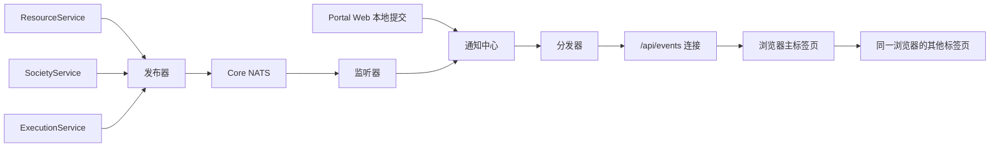

# Portal Core NATS 变化通知与浏览器实时刷新

用户常常同时打开资源列表、Resident 会话和执行状态页面（Resident 是长期驻留的人工智能协作者）。一个后台服务提交修改后，这些页面需要尽快知道“相关内容可能变了”，重新读取后显示新内容。

本篇说明这条通知路径：后台服务怎样发布变化提示，浏览器应用层 Portal Web 怎样收集提示、按登录用户筛选，浏览器怎样通过事件流收到提示并刷新。服务之间的命令和查询走内部 RPC（decision_96a887d83e8a）；资源、Lineage 和执行的数据仍由各自的领域服务保存。

## 必要概念

- **变化通知**：一条短消息，只说明某个对象或某类页面数据可能已经变化，不携带可以直接覆盖本地数据的完整对象。收到通知的一方重新向领域服务查询当前值。
- **Core NATS**：按主题转发短消息的发布/订阅系统。发布者把消息发到一个**主题（subject）**，即用点号分隔的地址，例如 `portal.lineage.changed.lineage_xxx`；订阅者按主题模式接收。它不保存消息，订阅者不在线时消息就丢失。每个 Portal 实例使用自己的 NATS 服务。
- **通知中心（NotificationHub）**：Portal Web 进程内保存最近通知的有界队列。每条通知得到一个只在本进程内递增的序号。
- **分发器（AsyncNotificationFanout）**：把通知中心的每条通知复制给各个浏览器连接的组件，每个连接有自己的队列。
- **SSE（Server-Sent Events）**：服务器沿一条 HTTP 连接持续向浏览器推送文本事件的机制，浏览器用 `EventSource` 接收。
- **重新读取（快照恢复）**：页面丢弃本地的增量判断，重新查询完整的当前视图。
- **页面数据**：浏览器为显示而持有的摘要、列表、详情和状态卡片。它是领域数据的显示副本，可以随时重新查询得到。

## 参与组件



| 组件 | 负责什么 | 位置 |
| --- | --- | --- |
| 发布器 `NatsNotificationPublisher` | 在各服务进程中把通知放进有界队列，由后台线程发往 NATS | `notifications/bus.py` |
| 监听器 `NatsNotificationListener` | 在 Portal Web 中订阅所有 `portal.` 开头的主题（`portal.>`），把收到的消息放进通知中心 | `notifications/bus.py` |
| 通知中心 `NotificationHub` | 分配序号，保留最近的通知，唤醒进程内的订阅者 | `notifications/bus.py` |
| 分发器 `AsyncNotificationFanout` | 把通知中心的通知送进每个浏览器连接的队列 | `notifications/async_fanout.py` |
| 实时连接登记 `RealtimeConnectionLifecycle` | 记录当前打开的事件流连接，在 Portal Web 重启前停止接纳新连接并等待旧连接结束 | `notifications/realtime_lifecycle.py` |
| 事件流接口 `/api/events` | 为登录用户筛选通知，生成浏览器事件 | `asgi.py`、`serve_management_portal.py` 中的 `_portal_change_payload` |
| 浏览器连接管理 `PortalEvents` | 在一个浏览器中只维持一条事件流，把事件转给其他标签页和内嵌页面 | `static/portal_events.js` |

页面收到事件后怎样合并、去重和重新读取，由刷新协调器负责，见 decision_6e230393221c。

## 设计点

- **先提交，后通知。** 服务只在修改成功提交后发布通知；发布失败不回滚已经提交的修改，页面会在下一次重新读取时看到正确结果。
- **通知只提示变化，不代替查询。** 页面收到通知后向领域服务重新查询；重复或乱序的通知不会让页面显示错误数据。
- **通知不触发业务动作。** 需要执行操作时，调用方通过领域接口发出明确的命令。
- **通知不保存历史。** 通知中心的序号、NATS 消息和浏览器事件只在当前运行期间有效；审计、会话记录和执行状态保存在各自的领域存储中。
- **发给浏览器前按登录用户重新判断可见性。** 后台通知可以带对象 ID；Portal Web 确认当前用户能读取这个对象后，才把 ID 写进浏览器事件。
- **可能漏掉变化时，要求页面重新读取。** NATS 重新连接、队列溢出、可见性查询失败、事件内容生成超时时，事件带 `snapshot_required: true`。
- **慢的浏览器连接只影响自己。** 每个连接有独立队列，一个页面处理不过来时只让它重新读取，不阻塞其他页面，也不阻塞服务提交修改。

## 谁在什么时候发布什么

主题中每个可变部分只能包含 ASCII 字母、数字、下划线和连字符，发布前用 `[a-zA-Z0-9_-]+` 校验，空值或其他字符直接报错。

| 主题 | 发布者与时机 | 载荷 |
| --- | --- | --- |
| `portal.lineage.changed.<lineage_id>` | SocietyService 修改 Lineage 结构后 | `{"kind": "changed"}` |
| `portal.lineage.runtime.<lineage_id>` | SocietyService 修改 Lineage 运行状态后 | `{"kind": "changed"}` |
| `portal.resident.changed.<resident_id>.<范围>` | SocietyService 修改 Resident 后；范围说明改了什么，默认 `runtime` | `{"kind": "changed"}` |
| `portal.resident.changed.<resident_id>.conversation` | SocietyService 的会话事件转发器，每条新的会话事件一条（decision_71aa039e3211） | `{"kind": "conversation_event", "event": {...}}` |
| `portal.execution.changed.<execution_id>` | ExecutionService 在执行状态变化后 | `kind`、`status` 和执行所属用户 `actor` |
| `portal.execution.activity.<execution_id>` | ExecutionService 记录一条执行活动后 | `kind: "activity"`、活动类型 `type` 和 `actor` |
| `portal.resource.changed.projection.<适配器>` | ResourceService 的某个资源适配器更新索引后（适配器负责扫描一类资源，见 decision_8dc6b3d03ca7） | `kind: "projection_updated"`、适配器名、新增和删除数量、变化的资源 ID `resource_ids`、`snapshot_required` |
| `portal.projection.changed.<页面数据名>.<目标>` | 服务或 Portal Web 更新某类页面数据后 | `kind: "changed"`，可带 `actor`、`actors`、`fields`、`details` |

补充规则：

- **SocietyService 在一次请求结束后统一发布。** 一次请求内产生的变化先收集起来，相同对象、相同范围的 `changed` 通知只保留一条；持有状态锁（decision_0e043d5f81be）时产生的变化推迟到锁释放后再记录。只有部署的 SocietyService 进程（`PORTAL_SOCIETY_SERVICE_PROCESS=1`）或正在收集变化的请求会发布。
- **ResourceService 按适配器发布，一次最多列 128 个资源。** 一次索引更新变化的资源超过 128 个时，`resource_ids` 为空并设置 `snapshot_required: true`，页面重新读取这个适配器的全部数据。只有部署的 ResourceService 进程（`PORTAL_RESOURCE_SERVICE_PROCESS=1`）会发布。
- **单个资源的主题目前没有发布者。** `portal.resource.changed.<资源类型>.<资源 ID>` 的格式和 Portal Web 的处理仍然存在，但资源变化目前都通过适配器主题发布。
- **经 NATS 发布的页面数据通知包括以下业务发布者。** ExecutionService 在有用量的执行结束后发布 `portal.projection.changed.token-usage.snapshot`；SocietyService 在任何 Resident 变化后发布 `portal.projection.changed.active-agents.snapshot`，`fields` 中是变化的 Resident ID；聊天室记录变化后，写入它的进程（Portal Web 或 SocietyService）发布 `portal.projection.changed.chatroom.<chatroom_id>`，`actors` 为聊天室成员，`fields` 为变化的部分（decision_a6bebf4ac283）。
- **Portal Web 自己提交的修改直接写进通知中心。** `publish_local_projection_change` 不经过 NATS，只通知同一个 Portal Web 进程内的订阅者。当前使用它的页面数据有：`knowledge-archive`、`notice-board`、`paper`、`property-maintainer`、`resource-discussion`、`restart-notice`、`review-solver` 和 `semantic-search`。它的 `actors` 在发布前去掉空值、去重并排序。
- **用户阅读变化跨 Portal 实例传播。** `agent-conversation-index` 与 `resident-view-state` 的阅读回执使用 `publish_projection_change`：提交后立即进入本进程通知中心，并经 Core NATS 送到其他实例。通知保留 actor 范围和受影响条目键，各实例仍按实际订阅用户过滤；NATS 回送的重复通知按失效提示合并，不累计未读。总线不提供持久事件保证，重新连接与快照校准继续有效。

## 发布器、监听器和通知中心

**发布器不阻塞调用方。** 调用 `publish` 只把消息放进队列就返回：队列默认 2048 条，最小 32 条；队列已满时丢弃这条消息，`dropped` 计数加一并返回 `False`。编码后超过 900 KiB 的消息直接报错。后台线程连接 NATS 的超时为 1 秒，连接失败后每秒重试，不限次数；每条消息发送后等待确认最多 1 秒，发送失败时把消息放回队列（队列满则丢弃）并重新连接。

**监听器每次连上都要求所有页面重新读取。** 监听器订阅 `portal.>`；消息不是 JSON 对象时当作 `{"kind": "changed"}`。每次连接或重新连接成功后，它向通知中心写入 `portal.gateway.reconnected`，因为断开期间的通知已经丢失。

**通知中心保留最近 4096 条通知。** 容量最小为 32。每条通知包含序号、主题、载荷和收到时间。订阅者的回调在通知中心的锁之外执行，一个回调出错不影响其他回调。除分发器外，Portal Web 进程内还有两个订阅者：侧栏缓存——会话通知使会话索引缓存失效，执行通知之外的其他通知使 Resident 侧栏缓存失效；等待 Resident 回复的请求按序号等待对应 Resident 的会话通知，序号已经早于保留窗口或收到重新连接通知时，重新查询 Resident 的当前状态。

**健康信息。** 发布器报告 `enabled`、NATS 地址 `url`、`connected`、待发数量 `queued`、已发数量 `published`、`dropped` 和最近错误 `last_error`；监听器报告 `enabled`、`url`、`connected`、已收数量 `received`、`last_error` 和通知中心当前序号 `cursor`。

**配置。** NATS 地址由 `PORTAL_NATS_URL` 指定；未设置时，`dev` 实例连接 `nats://127.0.0.1:4223`，其他实例连接 `nats://127.0.0.1:4224`。实例名取自 `PORTAL_INSTANCE`，默认 `dev`。`PORTAL_NATS_ENABLED` 为 `0`、`false`、`no` 或 `off` 时不连接 NATS，发布调用返回 `False`。

## 分发器与队列溢出

通知中心的回调可能在任意线程中运行，浏览器连接运行在 Portal Web 的异步事件循环中。分发器先把通知放进一个入口队列，再在事件循环中复制给各个连接。

- **入口队列最多 4096 条。** 溢出时丢弃积压的通知，并让所有连接重新读取。
- **每个连接的队列最多 64 条。** 溢出时清空这个连接的队列，只让它重新读取；在它取走“重新读取”标记之前，新通知不再放进它的队列。
- **分发器关闭时通知所有连接结束。** Portal Web 重启前的连接清空由实时连接登记负责确认（decision_ecf0f2b2de28）。

## 浏览器事件流 `/api/events`

**只有登录用户能打开事件流。** 未登录的请求被重定向到 `/login`。Portal Web 正在准备重启、分发器未运行时返回 503。

**请求参数决定订阅范围。** `domains` 从 `execution`、`resource`、`resident`、`lineage`、`projection` 中选择，省略时订阅全部五类。`resident_ids` 列出当前页面正在查看的 Resident：这些 Resident 的会话事件才会送到这条连接；其他 Resident 的会话通知只有事件类型为 `resident.state.changed` 时才送达。

**连接建立时要求页面先读一次。** 服务器先发送 `retry: 1500`（断开后浏览器 1.5 秒重连），再发送：

```text
event: portal-ready
data: {"snapshot_required":true}
```

**变化以批为单位送出。** 连接从队列取出一批通知后，在线程池中按当前用户生成事件内容；执行容量与超时上限由 decision_ecf0f2b2de28 的“线程池和容量”定义。超过上限时放弃这一批，改发重新读取的事件。筛选后没有可见变化、也不需要重新读取时，不发送事件。连续 10 秒没有事件时发送 `heartbeat`，内容为当前时间 `at`。

**可见性按领域判断：**

| 领域 | 当前用户什么时候能看到 |
| --- | --- |
| 执行 | 通知载荷中的 `actor` 与当前用户相同（不区分大小写） |
| 页面数据 | 载荷有 `actors` 时，当前用户在其中；否则有 `actor` 时与当前用户相同；两者都没有时对所有登录用户可见，页面随后查询时再按权限返回内容 |
| Resident、Lineage | 经统一权限系统按 `GetResident`、`GetLineage` 的当前读权限批量过滤；失败时隐藏这些 ID 并要求重新读取。会话事件还须通过 `GetConversation` 的读权限过滤，查询失败时隐藏会话事件并要求重新读取 |
| 资源适配器 | 变化的资源 ID 经统一权限系统按 `ResolveResource` 的当前读权限批量过滤，只保留可读的 ID；查询失败或通知本身要求整体重读时，把这个适配器列入整体重读名单，页面随后查询时再鉴权 |
| 单个资源 | 只标记资源领域有变化，不带 ID；资源类型为 `resident` 或 `lineage` 时，按 Resident、Lineage 的规则判断这个 ID |

**`portal-change` 事件的内容：**

| 字段 | 含义 |
| --- | --- |
| `domains` | 本批有可见变化的领域，已排序 |
| `changed` | 按领域列出的可见对象 ID（执行、Resident、Lineage、页面数据） |
| `projections` | 按页面数据名列出的目标 |
| `projection_changes` | 每个页面数据目标可能变化的字段 |
| `projection_details` | 每个页面数据目标的附加信息 |
| `resource_projection_changes` | 每个资源适配器中可见的变化资源 ID |
| `resource_projection_snapshots` | 需要整体重读的资源适配器 |
| `resident_events` | 当前用户可见的 Resident 会话事件 |
| `resident_changes` | 每个可见 Resident 变化的范围 |
| `snapshot_required` | 本批变化可能不完整，页面必须重新读取当前视图 |

只要求重新读取的事件为 `{"domains": [], "changed": {}, "snapshot_required": true}`。

## 浏览器怎样共享一条连接

**一个浏览器只让一个可见标签页保持事件流。** 浏览器支持 `BroadcastChannel` 和 Web Locks 时，可见的标签页争取名为 `tfi-portal-events-leader` 的锁，拿到锁的标签页打开 `EventSource`，通过名为 `tfi-portal-events` 的广播通道把事件转给其他标签页。标签页转入后台时交出锁并关闭连接，由另一个可见标签页接手。浏览器不支持这两项能力时，每个可见标签页各自连接。内嵌页面（iframe）不自己连接，接收顶层页面转发的事件。

**正在查看的 Resident 由各标签页汇总。** 页面调用 `PortalEvents.watchResident(residentId)` 声明正在查看某个 Resident；各标签页每 10 秒广播自己关注的 Resident，超过 45 秒没有更新的声明失效。持有连接的标签页汇总这些 Resident 作为 `resident_ids`，订阅范围变化后 150 毫秒内换一条连接。

**换订阅范围不让页面重新读取。** 新连接先打开，旧连接继续送事件，直到新连接的 `portal-ready` 到达才关闭；两条连接都覆盖的 Resident 没有漏掉的事件，已经读到的内容不重读。新加入范围的 Resident 在新连接之前已经读过一次，中间的事件可能没收到：页面收到 `portal:events-resubscribed`（`added_resident_ids` 列出它们），按各自的事件序号补读之后的事件，并重新读取它们的状态。重叠期间同一事件可能收到两次，页面按事件序号去重。新连接出错或 10 秒内没有就绪时，关闭两条连接重新打开，就绪事件要求重新读取。Resident 列表的状态订阅也计入订阅范围，所以列表增减或某个 Resident 开始工作时都会换连接；换连接不再触发重读，这样任何页面不会因为别处的 Resident 开始工作而重读打开的对话。

**连接静默太久就重建。** 30 秒内既没有事件也没有心跳时，持有连接的标签页关闭并重新打开事件流；这项检查每 5 秒进行一次。

页面通过窗口事件接收结果：`portal:change`（变化）、`portal:events-open`（连接打开）、`portal:events-ready`（可以开始读取，重新连接时 `reconnected` 为真）、`portal:events-resubscribed`（换了订阅范围，见上）和 `portal:events-error`（连接出错）。

## 故障与恢复

| 情况 | 结果 | 恢复方式 |
| --- | --- | --- |
| NATS 未启用或连不上 | 跨进程的即时提示暂停，已经提交的修改不受影响 | 发布器和监听器每秒重连；页面按刷新协调器的间隔重新读取 |
| 发布器队列已满 | 新通知被丢弃，`dropped` 增加 | 观察健康计数；页面在重新读取时看到最新数据 |
| 监听器重新连接 | 断开期间的通知丢失 | 写入 `portal.gateway.reconnected`，所有连接要求重新读取 |
| 分发器入口队列溢出 | 积压的通知被丢弃 | 所有连接要求重新读取 |
| 某个连接处理过慢 | 它的队列溢出 | 只有这个连接要求重新读取 |
| 可见性查询失败 | 无法确认当前用户能看到哪些对象 | 隐藏这些 ID；Resident、Lineage 要求重新读取，资源适配器列入整体重读名单 |
| 事件内容超过 ASGI 定义的生成时限（decision_ecf0f2b2de28） | 这一批被放弃 | 发送重新读取的事件 |
| 事件流断开或长时间静默 | 页面收不到提示 | 浏览器重新连接，`portal-ready` 要求重新读取 |

本地文件怎样产生变化线索，见 decision_f55bac7fc199；文件观察器把线索交给负责的服务更新数据后，再经本篇的路径通知浏览器。

### 事件流关闭诊断

每个 EventSource 实例生成一个不含业务内容的独立标识，通过请求中的 `portal_stream_id` 与 `PortalEvents.closedStreams()` 关闭回执中的 `stream_id` 对应。订阅集合与传输实例分别标识，交接新订阅时旧流继续服务到新流 ready，关闭原因及时间保留在旧实例的回执中。标识仅用于诊断，不参与认证、授权或订阅过滤。

诊断采集只在同一 frame、同一 document 中，该实例标识恰好对应一个已观察请求时关联请求。原生重连复用标识而产生多个请求时保持歧义；未知标识、缺少回执或上下文已销毁都不推断取消原因。请求失败事实与页面关闭事实分别保留，不能依据相同路径或相近时间豁免错误。
