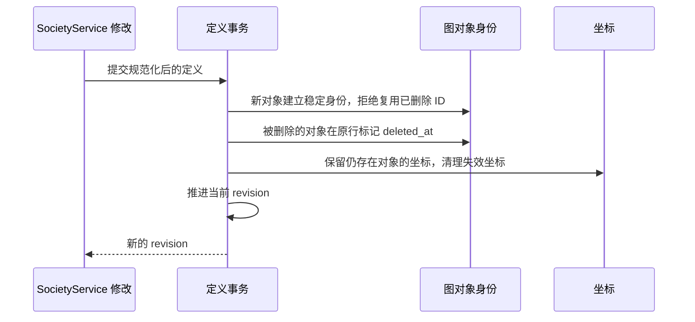
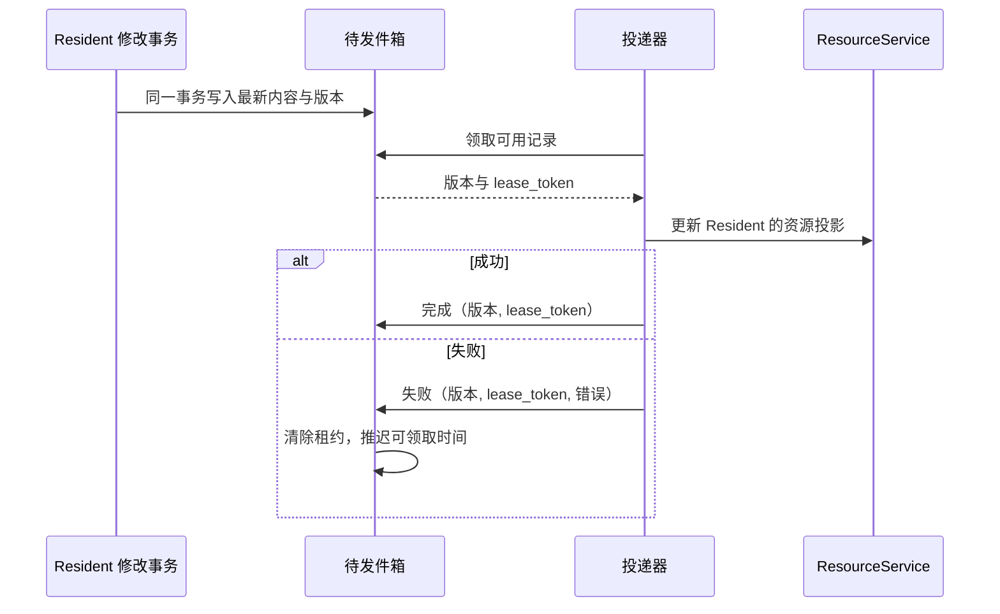

# LineageData：当前事实、领域工作与长期运行记录

LineageData 是 SocietyService（decision_1b2bdf5c33d6）的数据层：它把 Lineage 与 Resident 的当前状态保存在 Portal 统一的 PostgreSQL 数据库中。Lineage 是一组 Resident 及其协作定义，Resident 是可以跨多次模型会话持续存在的 Agent 身份。Society 页面上看到的团队结构、节点位置、组件的运行状态、Resident 的对话进度，重启之后仍然一致，靠的就是 LineageData。

本篇说明 LineageData 保存哪些数据、稳定身份和运行状态比较写入怎样挡住过时的写入、事务怎样保护跨表的一致性，以及对话事件与资源投影怎样可靠地送出去。Lineage 聚合在业务上包含什么见 decision_6fc653d55c79；页面怎样呈现见 decision_4adcc1ff2f2c；各服务的数据怎样划分见 decision_86aed2f0e8c7。

## 必要概念

- **当前事实**：系统现在采用的值。LineageData 保存当前的定义和运行状态，不保存每次修改的完整内容；订阅直接使用当前 revision，不保存编辑摘要历史；Trigger Path 保存触发起因、步骤和执行关联；Resident 的执行事实统一保存在 AgentData。
- **revision（Lineage 版本）**：Lineage 定义每次成功修改后推进的计数，用于页面失效、WatchLineage 游标及定义提交的可选版本前提。比较、并发合并与回滚合同统一见 decision_d918ebebc062。
- **layout_revision 与 runtime_revision**：节点坐标和运行状态各自的版本号。拖动节点只推进 `layout_revision`，运行推进只推进 `runtime_revision`，都不改变 revision。
- **图对象身份**：节点、连线和组件使用永久稳定 ID。已删除的 ID 不得复用；重新创建的对象取得新 ID。
- **删除标记**：组件和连线在原身份行保存 deleted_at；Resident 的删除只由 residents.deleted_at 表达。历史身份保留，移除跨 Lineage 引用只移除引用关系。
- **比较后写入（CAS）**：提交时核对当前运行状态与调用方读取的状态，并检查目标仍属于当前 Lineage 且未删除。
- **游标（cursor）**：Resident 对话事件的位置，每个 Resident 单调递增。读取方可以请求某个游标之后的事件。
- **待发件箱（outbox）**：与业务修改在同一个数据库事务中写入的“待同步”记录。后台投递器随后取出，把结果同步给另一个服务。
- **租约（lease）**：带截止时间的独占领取。领取时生成的 `lease_token` 证明完成或失败的回报来自当前领取者。

## 组件与所有权

| 组件 | 负责什么 | 拥有的数据 |
| --- | --- | --- |
| SocietyService 领域模块 | 校验 Lineage、Resident 和运行写入，组合查询结果 | Lineage 与 Resident 的业务规则 |
| `LineageDataStore`（`society_service/state_store.py`） | 把结构化的值映射到 PostgreSQL 表，提供事务、结构初始化与校验、健康信息 | LineageData 的表结构与当前记录 |
| Lineage 定义的写入者 | 创建、修改、删除 Lineage | revision、当前定义与对象删除状态 |
| 各运行领域的写入者 | 推进所属领域的待处理工作，并提交 Trigger Path 的进度和结果 | 各领域工作表与 Trigger Path 表 |
| Resident 对话流（`resident_conversation_stream.py`） | 提交对话状态、输入状态和对话事件 | 每个 Resident 的对话游标与事件；消息正文和模型对话记录归 AgentData（decision_b1ab45c4b3ec） |
| 对话事件转发器（`resident_conversation_event_relay.py`） | 把新提交的对话事件发布为变化通知 | 本进程已发布到哪里；不保存业务事实 |
| 资源投影投递器（`resident_resource_projection.py`） | 从待发件箱取出 Resident 的资源投影，同步给 ResourceService | 待发件箱的领取与重试状态；资源登记本身归 ResourceService |
| 指令内核（`hatg/store.py`） | 保存 SocietyService 执行的写操作恢复记录与过期请求防重栅栏 | `instruction_executions`、`instruction_retry_guards`；其他 ISA owner 各自拥有同样的契约 |
| Effect 恢复维护者 | 在终态提交后释放恢复依赖并完成清理；不依赖图仍然存在 | `effect_recovery_cleanup`；跨 owner 的释放通过受认证内部确认，不直接写对方表 |

## 设计点

- **LineageData 只由 SocietyService 读写。** 其他服务通过 SocietyService 的指令或 Domain RPC 访问这些数据，不直接连接这些表。
- **定义、布局和运行状态各自有版本号。** 调用方只刷新真正变化的那一层；拖动节点不会被当成 Lineage 定义的变化。
- **已删除的 ID 永不复用。** 旧页面或工作进程无法向已删除对象写入。Function Block 再展开保留仍存在的内部 ID；曾删除后重新出现的内部对象分配新 ID，client_key 只负责模板对应关系。
- **坐标只保存给当前存在的对象。** 批量保存坐标时，不存在或已删除的对象被跳过并在 `missing_object_ids` 中返回，其余坐标在同一事务中保存；数据库出错时整批回滚。
- **关系工作写入检查当前身份和并发状态。** 定义与交接、吸收工作写入使用 `lineages` 行上的 `FOR NO KEY UPDATE` 锁，串行提交对同一身份的修改；该锁允许独立 Program 和 Mailbox 进度插入时的外键检查，不阻塞它们。目标已删除、移出或被修改关系的当前值已变，比较写入整批失败。
- **运行状态只保存当前值。** 同一命名空间、同一对象的成功写入覆盖当前状态并推进代次；需要历史或审计的领域使用自己的日志。
- **对话事件与游标在同一个事务中提交。** 事件写入 `conversation_events` 的同时推进 `conversation_states.cursor`，读取某个游标之后的事件总能得到稳定、有序的结果。
- **Resident 的修改与待同步记录一起提交或一起回滚。** 事务成功后，即使 ResourceService 暂时不可用，待同步记录也保留下来，稍后重试。
- **每个 Resident 在待发件箱中只保留最新的目标状态。** 同一 Resident 再次入队时覆盖内容、推进版本、清除旧租约并恢复为立即可领取；旧版本的完成回报不能删除新记录。

## 数据位置与结构版本

LineageData 通过 `PORTAL_DATABASE_URL` 连接 Portal 统一的 PostgreSQL 服务，使用其中的 `lineage` schema；这个 schema 只包含 LineageData 的表。测试环境设置 `PORTAL_DATABASE_NAMESPACE` 后，schema 名加上这个前缀，例如 `<namespace>_lineage`。连接池大小由 `PORTAL_POSTGRES_DOMAIN_POOL_SIZE` 决定，默认 8。Dev 与 Release 两个实例共用同一份 LineageData。

`lineage_meta` 表中保存结构版本标识，当前为 `tfi.lineage-data.v60`。服务初始化时取得数据库咨询锁，然后：schema 为空时直接创建当前结构；已有结构时严格核对版本标识和表、列、索引、触发器与外键，任何不一致都使服务启动失败。结构升级由单独验证过的迁移脚本完成；运行中的服务不读取旧格式，也不在线修复结构。迁移脚本固定来源版本和目标版本，只随目标版本的代码运行，代码已是其他版本时拒绝执行；数据库越过该版本后，脚本在下一次结构升级时退役。

这个 schema 只放核心表，严格核对的也就只是核心表。可选功能的表放在功能自己的 schema 里，由功能首次使用时自行建表（`DomainDatabase`，decision_15aab18c0ab3）；打包时去掉哪些功能，lineage schema 的表都相同。v60 把原先按应用分开、在 CHECK 中写死 Paper、WALL、公告板分类器和 TAU 的七张配置表合并为通用表 `application_targets`（decision_6591e7793116），并把不属于任何 Lineage 的人类通知从公告板的 schema 移入 `portal_human_notifications`。

## 各类表保存什么

### Lineage 定义与布局

| 表 | 内容 |
| --- | --- |
| `lineage_meta` | 结构版本标识 |
| `lineages` | 名称、说明、所属 Project、成员类型、Leader、revision、layout_revision、创建更新信息及 deleted_at/deleted_by；不存自由属性容器 |
| `project_lineage_entries` | 每个 Project 唯一的入口 Lineage |
| `lineage_nodes` | Resident、组件和 Function Block 实例的统一身份；node_id 全局唯一，lineage_id 是唯一归属；非 Resident 对象在原行保存 deleted_at |
| `lineage_node_references` | Project 画布等对其他 Lineage 节点的引用，不改变节点归属 |
| `lineage_resident_nodes` / `lineage_components` | Resident 图信息与各类组件的明确配置；Resident 名称/backend 从身份表读取 |
| `lineage_edges` / `lineage_observation_targets` | 关系和 Program wires 的统一身份、端口、明确的 note 与有边界的调用配置；原行保存 deleted_at；观察其他边的目标单独保存 |
| `lineage_edge_observations` | Inspect 的有序观察项：资源、路径、读取方式、查询和数量限制 |
| `lineage_handoff_items` | Workspace 交接项：来源、目标、传输方式及方式所属参数 |
| `lineage_handoff_invocations` | 交接后的调用配置：启用、提示词、上下文引用、技能和工作目录 |
| `function_blocks` / `function_block_elements` | Lineage 自有的 Function Block：名称、来源模板和位置，以及块直接包含的 Resident、组件、连线和子块（decision_5b5653c3eaa5） |
| `families` / `family_residents` | 哪些 Function Block 是 Family（沿用 Function Block ID）、Family 参数，以及门面、steward、Router 和成员角色（decision_44cf587c1721） |
| `lineage_fragments` / `lineage_fragment_attachments` | 有稳定 ID 的文本碎片及其附件引用；附件保留展示顺序 |
| `lineage_layout_positions` | lineage_id、object_id、x、y；整张布局的版本由 Lineage.layout_revision 管理 |

图的数组排列不表示 Leader、执行顺序或权限。Program 由上述表批量组装为接口对象。运行代码不保存或读取 program_json、node_json、edge_json，也不提供旧表兼容读取。Family 保持 Function Block 实现，由 families 与 family_residents 保存专属事实；成员没有 ordinal。

各应用接收目标保存在 `application_targets`，每个应用一行，以应用名为键，目标填在 `resident_id` 或 `lineage_id` 中的一个。应用按自己声明的目标类型读取配置；摘要写入仍只接受配置的执行 Resident，并验证认领关系。

### 当前工作与长期记录

数据库保存重启后仍需履行的工作、人工控制、会话连续性和已发生的事实。工作表由对应领域独占写入，完成并写好长期记录后清理；接口可以批量组装多个领域的结果。

| 表 | 唯一职责 |
| --- | --- |
| `event_source_progress` | 每个 Event 源的消费位置与下一次触发进度 |
| `operator_work` | Operator 尚未完成的计算状态 |
| `resident_delivery_profiles` | Program 投递所需的 Resident 运行档案 |
| `pending_event_deliveries` | 尚待投递的 Event |
| `pending_expiry_notices` | 尚待完成的过期通知 |
| `workspace_handoff_work` / `context_absorption_work` | Workspace 交接与上下文吸收各自的未完成进度 |
| `effect_work` | Effect 的未完成执行检查点 |
| `lineage_drafts` / `lineage_move_operations` / `resident_creation_operations` | 草案、跨 Lineage 迁移、Resident 登记各自的工作 |
| `family_relays` / `family_quota_reviews` / `family_quota_migrations` | Family 转交、额度审查与迁移各自的当前工作 |
| `resident_mailbox_progress` | Mailbox 消费与输入组装进度；消息仍只在 Mailbox |
| `lineage_shared_state` | 显式共享状态单元 |
| `lineage_human_notifications` | 当前待处理的人类通知 |
| `portal_human_notifications` | 不属于任何 Lineage 的人类通知，整份保存在一行中 |
| `lineage_deletion_operations` | 删除操作的未完成进度 |
| `lineage_resource_projection` | 资源描述发布水位 |

不存在通用 namespace/record_key 存储入口，也不持久化整份 Program 快照。运行器按领域提交变化的对象行。

Program 工作状态按对象加锁和读取。每个事件源、连线、算子和投递档案各有一把事务级咨询锁，过期投递列表整体一把。一次事务只读取并锁定它实际用到的对象，提交时只写变化的行；同一 Lineage 中处理不同对象的工作互不等待，例如一个定时事件源在推进时，另一个事件源的投递照常提交。需要一组对象时一次性加锁，类别按“事件源 → 连线 → 过期投递 → 算子 → 投递档案”的顺序，同一类别内按对象 ID 排序，避免互相等待成环；违反这个顺序的加锁会记录带调用栈的警告。过期投递的清理按连线进行，处理积压时才扫过全部连线。只读的投递档案和算子状态查询直接读取单个对象，不加锁。Resident 最近执行从 agent.executions 读取，Effect 最近结果从 trigger_path_steps 读取，不保存第二份结果缓存。查询按 Lineage、Resident 或组件身份及发生时间索引定位，不能扫描全部历史。Lineage 的 runtime_revision 只用于当前运行状态的失效通知与并发控制，不表达历史图版本。

Program 工作对象在写入时规范化，读取时直接使用已存内容。规范化做的是：校验 ID，去重并截断游标列表，把计数限制为非负整数，按限额整理待投递内容。写入事务在加载和提交时对它触碰的每个对象都做一遍，提交的始终是规范化后的对象。规范化规则有一个版本号 `RUNTIME_NORMALIZATION`，`lineage_meta` 的 `program_runtime_normalization` 记录已存数据是哪个版本的规则写成的。只有两者相等时，`read_runtime` 和单对象读取才不再规范化；不相等时照旧边读边规范化。进程每分钟重新核对一次这个记录。

修改规范化规则（`_normalize` 及它调用的函数和限额）时，必须把版本号加一并更新测试里记录的规则摘要，`test_lineage_program_runtime_normalization` 会拦住漏改。发布后，Release SocietyService 启动时逐个 Lineage 用新规则重写已存对象，只写回有变化的对象，全部完成后再更新 `lineage_meta` 的记录。迁移完成之前，读取按新规则规范化。Dev 不执行这项迁移，因为它可能运行未发布的规则；Dev 规则版本与记录不一致时，它的读取也保持规范化。2026-10-19 上线时，现网 33 个有运行数据的非个人 Lineage 的已存对象都已经是规范化结果。

### Resident

| 表 | 内容 |
| --- | --- |
| `residents` | 结构化 Resident 身份、名称与 backend、已知 ACL 事实、登记阶段、人工输入开关 intake_open 及其转换 ID、创建与更新时间，以及 `deleted_at`、`deleted_by`、`historical_project_id`；已删除身份仍保留在同一表 |
| `resident_execution_configuration` | 当前模型设置、Harness 结构配置、Provider 路由与执行 profile 等明确配置字段；由对应配置 owner 显式提交 |
| `resident_derivations` | Fork 来源证明，包括来源 Resident、来源时间和历史方法；不以这些来源字段驱动运行分支 |
| `resident_workspace_bindings` | Resident 与 Workspace 的多对多绑定及用途说明；权限由权限系统负责，自有 Workspace 由 Workspace 身份表表达 |
| `families` / `family_residents` | Family 以 Function Block 实现，独立存储实例配置及成员关系 |
| `resident_sessions` | 会话连续性、上下文重置与压缩、重启和工具刷新进度 |
| `resident_observation_cache` | 最近错误、用量和时间等可更新的观察值，不作为调度权威 |
| `resident_recovery` | 工作恢复与 Project 初始化的当前进度 |
| `resident_execution_work` | 每个 Resident 至多一项未完成的执行协调工作：execution_id、准备请求、事件游标、停止意图与确认进度；执行事实归 agent.executions |
| `resident_execution_release_work` | 尚未确认完成的执行释放工作，确认后清理 |
| `resident_resource_projection_outbox` | 每个 Resident 最新的待同步资源投影：内容、版本、入队时间、尝试次数、可领取时间、租约和最近错误；`resident_resource_projection_outbox_available_idx` 按可领取时间和租约截止时间加速领取 |
| `resident_mailbox` | 等待执行、合并和重新排队的输入；接纳后的输入归属由 agent.execution_inputs 记录 |
| `trigger_paths` | 一次 Event 或独立 Effect 启动的身份、起因、时间与汇总状态，删除 Lineage 后保留 |
| `trigger_path_steps` | 本次触发中的 Event、Effect、Operator、Resident 投递步骤及其结果 |
| `trigger_path_step_edges` | 本次实际经过的步骤连接，支持分叉和汇合 |
| `trigger_path_execution_links` | Resident 步骤与 agent.executions 的多对多关联；Execution 不保存 Trigger Path 信息 |
| `resident_lifecycle_operations` | 每个 Resident 当前未完成的生命周期操作：操作 ID、步骤与进度、可重试时间和最近错误 |
| `resident_workspace_transfers` | 每个 Resident 最近一次跨 Lineage 迁移的操作 ID、源与目标 Lineage 以及发起它的指令 ID；下一次迁移覆盖，Resident 删除时移除 |
| `input_scopes` | 业务调用为某条 Resident 输入登记的发起者和授权描述，用于允许该发起者读取或取消这条输入；登记后不可修改 |

Resident 的当前归属以 `lineage_nodes.lineage_id` 为唯一事实，通过 node_id=resident_id 关联；当前 Project 与 Workspace 投影从各自负责者读取。来源、配置、绑定与运行观察分别持久化，Fork 初始化上下文由 Agent trace 保存，API 返回的聚合 record 不能整份作为 JSON 回写。普通状态保存保留数据库中最新配置，配置 owner 才显式提交配置修改（decision_8b2fa224616b）。删除字段只能由删除领域更新，未知历史字段保留为空，不凭缺失内容虚构身份或权限；旧独立删除表已退休，不提供恢复入口（decision_0f57656a2acd）。

批量状态与消息可见性读取使用当前身份、执行配置和 Family 角色，不组装 Workspace 路径、绑定投影或 Watchboard。Watchboard 安装由 Lineage 组件表达，清单、配置和状态属于自有工作区文件，页面由 Watchboard 读取入口投影，不进入持久 Resident 记录。完整 Resident 视图仍由相应读取入口组装；同一批成员共享的 Lineage 目录只解析一次。批量状态响应中的发送权限按当前用户在本次请求内判断一次，各 Resident 的删除状态仍单独检查；权限判断不跨请求缓存。

### Resident 对话

| 表 | 内容 |
| --- | --- |
| `conversation_states` | 每个 Resident 已发布到界面的游标、状态快照、当前活动和运行设置（等待队列读取时从 Mailbox 组成，decision_15f7df737ed5）；当前活动只保存在这里，不进入 `conversation_events` |
| `conversation_input_states` | 每条输入的状态（`queued`、`running`、`completed`、`failed`、`cancelled`）、错误和更新时间；`conversation_input_states_state_idx` 按状态读取。回复不在这里保存：读取时从 trace 的消息投影推出最终回复（AgentData `chat_message_positions` 按 `reply_to` 查找，decision_b1ab45c4b3ec、decision_c524c775e0be；LineageData v29 删除了 `reply_message_ids_json`，TFI portal 10-07） |
| `conversation_events` | 以“Resident + 游标”唯一的对话事件：事件类型、所指对象 ID、发生时间和内容；`conversation_events_type_idx` 按 Resident、类型、对象和游标查询。消息事件只保存消息头（ID、`role`、`reply_to_message_id`），正文在读取时由聊天服务从当前 trace 或运行通知填入（TFI portal 10-07；10-07 一次性去掉了旧事件中的正文） |
| `conversation_event_delivery` | 对话事件的全局发布顺序；`conversation_events` 每插入一行，触发器在这里追加一行。它是转发器的工作项：事件发生满 1 小时后由 SocietyService 例行维护删除，事件本身保留 |

### 指令记录

| 表 | 内容 |
| --- | --- |
| `instruction_executions` | SocietyService 执行的写操作恢复记录，新增 `recovery_key` 保存可信 Lineage 运行依赖；各 ISA owner 的同名表遵循同一契约 |
| `instruction_retry_guards` | 仅 `request_digest`（SHA-256）与 `expired_at`：拒绝已到期回收请求的旧幂等键，不保存可读执行历史 |
| `effect_recovery_cleanup` | 持久的终态后清理队列，列为 `lineage_id`、`activation_key`、`instructions_json`、`created_at`；以 `(lineage_id, activation_key)` 为主键，无 Lineage 外键 |

### ISA 恢复窗口与保护归属

各 ISA owner 在自己的分区保存写操作的 `instruction_executions` 和 `instruction_retry_guards`；LineageData 只拥有 SocietyService 的这两张表。只读调用不进入该全局写操作记录。活动锁、中断判定、投影恢复、保留期、终态 unknown 与旧键重试的完整合同统一见 decision_898b8911a2ff，本篇不另定义中断等待时间。

到期回收带键记录时，删除执行记录与写入防重栅栏在同一事务提交。栅栏只保存请求身份摘要和回收时间，不复制调用正文、响应或可读身份，不能作为永久审计。`recovery_key` 由可信运行上下文提供；Effect 的长期事实提交与依赖释放之间由下述持久清理队列衔接，不直接更新其他 owner 的执行表。

### Effect 清理队列的事务与维护

`effect_recovery_cleanup.instructions_json` 只保存 `{原 caller: [指令 ID, ...]}`，用于向原 ISA owner 释放对应激活的恢复依赖；不复制参数、结果、模型消息或 artifact 内容。重复入队在行锁内合并同一 caller 的指令 ID。激活键是恢复身份，Lineage ID 是保留的归属标识，不要求该 Lineage 当前仍存在。

已确认的 Effect 终态与必要调用摘要持久写入 `trigger_path_steps`、恢复 journal 清空、清理任务 enqueue 在同一 PostgreSQL 事务中提交。任一步失败，整笔回滚；仍未确认的指令结果不能被强行终结。外层投递事务仍未提交时，禁止提前释放 ISA 保护或清理恢复产物。

事务提交后，独立 `EffectRecoveryWorker` 按持久队列有界分页维护，不依赖新 Event、新 Effect 或现存图来唤醒；遇到失败任务仍推进本轮扫描，保留该任务供下一轮重试。维护者使用原 caller、对应 `recovery_key` 和指令 ID，通过受认证的内部 release ack 请求各 ISA owner 释放匹配保护，不能改用 system 身份或直接更新其他 owner 的执行表。跨 owner 确认与产物清理可重复执行；未完成时保留队列证据。

完成后以 `(lineage_id, activation_key, expected instructions_json)` 做比较后删除（CAS）；本轮处理期间若任务已并入新指令 ID，旧处理者不能把新任务删掉。该表没有指向 Lineage 的外键，不随 Lineage 删除级联移除；独立维护者仍可 drain 已删除 Lineage 的任务。该队列由 Effect 清理领域独立管理。

Artifact 使用正式 Lineage owner namespace；临时 recovery 产物与保留 output 的归属、引用与清理规则由 Effect 规范 decision_4adcc1ff2f2c 定义。本篇只规定队列和事务边界，不复制 artifact 文件协议。长期 Trigger Path 事实与 Agent trace 不受 ISA 恢复窗口清理影响，不要求引入历史图版本。Trigger Path 有自己的保留期：已结束的流程保留 30 天，SocietyService 例行维护分批删除更早结束的流程及其步骤、因果边和 Execution 引用，每个 Effect 最近一次结束的激活所在流程保留；进行中的流程不受影响（decision_68215b3a825b）。

## Lineage 定义、布局和删除

`put_lineage_definition` 在一个事务中按稳定 ID 比较并更新发生变化的记录，更新原行删除状态并推进当前 revision。未改变的行不做 DELETE/INSERT 或无意义 UPDATE。`remove_lineage` 在同一事务中标记原身份行的 deleted_at/deleted_by、移除当前入口关系并清除已完成的 `lineage_deletion_operations`，保留历史身份和长期 Trigger Path 事实。失败重试期间，删除操作记录继续保存。已经删除的 Lineage 不接受迟到的定义重写。 Resident 身份写入已经建立节点行时，成员投影仍须在同一事务中为缺少坐标的新节点分配初始布局；已有坐标保持不变，Fork 以来源节点作为布局锚点。为已有身份节点补齐初始布局只写入缺失的布局记录，不重复推进图定义 revision；后续位置变更由布局接口提交。

`upsert_layout_positions` 读取当前的 revision 与 `layout_revision`，只为仍存在的对象写坐标。至少一个坐标确实变化时，Lineage 的 `layout_revision` 加一。返回当前 revision、新的 `layout_revision`、更新时间和排好序的 `missing_object_ids`。

## 运行状态的比较写入

交接和吸收工作按关系 ID 比较写入。事务锁定 Lineage，核对目标仍有效及被修改关系的当前值；同一关系冲突时抛出 `RuntimeCASConflict`，不同关系的并发修改可以合并。只更新变化的行并推进 `runtime_revision`。节点观察是Trigger Path 与 Execution 的读取投影，不接受第二份状态写入。

Resident 的人工输入开关只由输入控制领域提交；普通记录保存必须保留数据库中最新的开关。工作状态由该开关、当前轮次、Mailbox 和 Execution Scheduler 组成，空闲无需建立工作行。停止先持久化当前轮次的意图，不依赖远端服务是否可达。

resident_execution_work 在终态投影与 Execution 确认完成后清理；未确认的释放工作保存在 resident_execution_release_work。执行的状态、时间和输入归属长期保留在 AgentData。工作行 CAS revision 使用全局递增值，事件游标按 execution_id 单调推进。请求正文与小进度分列保存，运行中的服务不读取旧轮次表。

`conversation_states` 是与事件游标配套的已发布界面快照。控制查询读取实际负责者，不能拿界面快照判定是否可启动或取消工作。Execution 批量控制读取最多 500 个执行，按提交者校验，不返回请求、结果正文或完整事件。

## 对话事件与通知

Execution 结束后，对话投影提交其输入的终态；重新排队与终态投影共用对话事务边界。输入状态统一关联 agent.execution_inputs 和 agent.executions，准备阶段失败也有执行记录。当前 Mailbox 或执行协调工作优先于旧的终态；迟到的 running 投影不能覆盖已完成执行。显式重新执行分配新 execution_id，传输重试沿用原 execution_id。单条输入、筛选、快照和通知使用同一规则，分页前完成状态合并；查询按输入与执行索引读取，不解析完整历史正文。

Resident 对话流在一个事务中提交状态、输入状态和新事件；事件游标取这个 Resident 当前游标加一。插入事件时，触发器同时在 `conversation_event_delivery` 中追加一行，得到一个全局递增的发布序号。

对话事件转发器在 SocietyService 启动时读取当前最大的发布序号作为起点，之后每 0.1 秒查询这个序号之后的事件，按序号顺序每批最多 500 条发布为 Resident 对话变化通知。启动之前已经存在的事件不再发布：浏览器建立实时连接时先读取对话快照，快照已经包含它们。Dev 与 Release 共用同一份对话数据，但各自使用本实例的通知通道，因此两个实例的 SocietyService 各自运行一个转发器。成员 Resident 的事件属于 Family 门面转来的消息（回复、输入状态、运行状态或活动）时，转发器同时向门面 Resident 发布 `portal.resident.changed.<门面 ID>.projection`（`kind: "facade_projection"`，带成员 ID 和游标），查看门面对话的页面据此重新读取（decision_44cf587c1721）。转发器出错时记录最近错误，至少等待 0.5 秒后重试。通知只让页面更快发现变化，页面仍以对话快照和游标补读为准（decision_abaedeefca6f）。

Resident 的当前活动（正在执行的命令、工具调用等）是观察数据，不是记录，不写入 `conversation_events`，也不推进游标。活动变化只更新 `conversation_states.activity_json`，并在同一事务中向 PostgreSQL 通道 `tfi_conversation_live` 发送 `<schema>:<Resident ID>`。每个实例的转发器监听这个通道，读取该 Resident 当前的活动列表，作为带 `live: true` 的 `resident.activity.changed` 通知发布，其中的游标是对话当前游标。页面收到后直接替换活动列表；快照加载期间收到的，在快照装入后应用；超过 64 KB 的通知省略内容，页面改为重新读取快照。游标补读和 `WatchConversationEvents` 不包含活动。

LineageData 保存事件的外层结构（类型、所指对象、时间和内容）与对话状态。完整的消息正文和模型对话记录归 AgentData 保存：事件记录发生了什么和先后顺序，模型内容正文以当前 trace 为准，纯 UI 通知归运行记录。转发器和游标补读在送出事件前，按消息 ID 一次批量通过聊天服务取当前的内容消息或运行通知填进事件，结束的输入同时填上最终回复；trace 中已经没有的消息，事件不带内容、标 `payload_omitted`，读取方改读快照（TFI portal 10-07）。

## 待发件箱的领取、确认与重试

Resident 已有待发布记录时，身份、配置或 Session 的保存必须在同一事务内合并当前完整事实并推进待发版本，旧版本的确认不能删掉新工作。领取时按身份行、待发件箱的顺序加锁，并从当前事实重建投递快照，使服务恢复后遗留的旧快照也能完成发布。投递之后仍须经过 ResourceService 的当前事实校验，标题、归属、作用域或生命周期不符时不得提交。没有待发记录的普通保存不新增发布任务。

资源发布时，Resident 的组织层级 `principal_hierarchy.level` 根据当前所属 Lineage 与 Leader 关系重新计算。成员迁移或 Leader 变更可能发生在投影内容入队之后，旧内容携带的层级不作为发布依据；类别、作用域、名称、归属和生命周期仍与当前事实严格核对。

- **领取**：每批最多 500 条（默认 50），生成 32 位十六进制的随机 `lease_token`，租约默认 30 秒；只选择已到可领取时间、没有有效租约的记录，并把尝试次数加一。
- **完成**：只有 Resident ID、版本和 `lease_token` 全部匹配时才删除记录。
- **失败**：条件相同；保存最近错误、清除租约，按“尝试次数 × 2 秒”推迟下次领取，最短 1 秒、最长 60 秒。
- **期间有新修改**：新的入队推进版本、替换内容并清除旧租约，旧领取者随后完成时删不掉新记录。

待发件箱保证“LineageData 提交之后，一定会尝试把结果同步给 ResourceService”，不把两个独立的服务当成一个原子事务。资源访问规则和最终的资源记录仍由 ResourceService 决定。

## 生命周期操作的持久恢复

- **Resident 身份提交之后，未完成的清理仍然可以继续。** 删除、清空上下文或释放会话需要跨文件、Provider 或服务执行时，先在业务事务中记录操作 ID 和待执行步骤，再由恢复者在状态锁之外执行。这条记录独立于 Resident 的身份行，删除身份不会连带丢掉尚未完成的清理。
- **同一 Resident 同时只保留一项未完成的生命周期操作。** `resident_lifecycle_operations` 以 `operation_id` 为主键，并对 `resident_id` 设唯一约束；步骤内容和下一步游标保存在 `payload_json` 中，`available_at` 决定何时可以重试，`last_error` 保存最近失败。成功完成后删除记录，失败时保留进度以便继续。

数据库保存的是当前的恢复意图，外部动作本身没有数据库事务的原子性。恢复者通过操作级的独占权（decision_0e043d5f81be）和可重复执行的步骤避免并发重复执行，并核对当时记下的会话身份，避免清理已经替换的新会话。`GetMoveOperation` 从 `resident_workspace_transfers` 与生命周期操作读取迁移进度，批量迁移还读取 `move_operation` 运行记录；生命周期记录完成删除后，仍可确认这次迁移已经完成。

## PostgreSQL 事务与并发

读取缓存仅在存取缓存条目时持有全局短锁。消息计数等需要访问存储的计算按读取种类、Lineage 和查看者分别合并；同一范围的并发读取复用结果，其他 Lineage 及定义缓存的读取不等待该计算。缓存有效性由当前 revision、Resident 游标和查看者范围的指纹决定；读进程池复用有效条目，不在每次 RPC 前清空。

资源描述发布在同一物理事务中锁定本次涉及的 Resident 身份行、当前成员归属行、Lineage 身份行及已有 Workspace 绑定行，再核对当前事实并提交描述与来源收据。Resident 的父 Lineage 同时受保护，因为它决定 Project 与组织层级。成员集合的写入通过所属 Lineage 身份行串行提交；Workspace 退役直接解除的既有绑定也与投影互斥。不存在或已删除的身份在发布前拒绝，不能靠描述重建身份。锁以稳定 ID 排序，重叠领域写入造成冲突时立即结束本次尝试并保留原发布工作重试，避免跨领域锁顺序形成死锁。此过程不取得全表共享锁；无关 Lineage 的图修改、同一团队其他 Resident 的独立身份修改及运行进度可以继续。目标身份和生命周期写入仍与描述提交互斥，防止已删除或已变更的对象被旧描述覆盖。

LineageData 通过显式事务、行锁和条件更新保护领域提交，外键、唯一约束和检查约束由数据库强制执行。公共连接池、嵌套事务和事务重试规则统一见 decision_86aed2f0e8c7；本域业务临界区与定义并发规则见 decision_d918ebebc062。

## 删除、恢复与健康

删除流程按数据职责清理当前可执行关系、配置、绑定和待运行状态，不以通用外键级联抹掉历史。Resident 身份在 `residents` 同一行标记 `deleted_at`、`deleted_by`，保留已知历史归属；删除后停止接单和调度，对话与 Agent trace、Execution 及长期 Trigger Path 事实仍按原稳定 ID 读取。需要表示删除的 ResourceService 投影由删除流程协调（decision_0f57656a2acd、decision_1b2bdf5c33d6）。

删除 Lineage 不删除长期 Trigger Path 表，也不删除无 Lineage 外键的 `effect_recovery_cleanup`；这些流程同样按 30 天保留期到期删除。待确认的 Effect 调用先核对结果，不能用删除动作逃过恢复保护；已经提交的终态清理继续由独立维护者推进，原 Lineage 不存在不构成清理完成。

进程重启后，服务从结构版本、当前表记录、未完成的待发件箱、生命周期操作与独立 Effect 清理队列恢复，不需要通知历史。

`health` 只返回结构版本标识和数据库显示名，只读 `lineage_meta` 一行，不报告任何表的行数。Portal 没有功能读取各表行数；需要了解数据量时直接查询数据库。

消息正文以 AgentData 当前 Segment 版本为准。Portal 包装只增加外层，不改写用户正文；Mailbox 保存包装后的待投递内容，交付后不保留第二份未包装正文。Harness 创建新版本、替换当前 trace 引用并另存转换关系。LineageData 的输入状态和事件头记录业务经过，不决定某条内容是否显示或是否发给模型。纯 UI 卡片、统计及清空动作由 AgentData 运行记录保存，不占据内容 trace。

自有 Workspace 的删除同时注销其中登记的子目录 Workspace，并在同一事务中解除对应绑定。Family Steward 的 `family_memory/` 属于此范围；外部共享路径不受影响，活跃 Resident 自有 Workspace 不允许被误删。受影响的存活 Resident 通过持久清理任务重新生成 Workspace 文档及资源投影，文件删除在注销完成之后执行。

## 当前定义与通知

Lineage 配置只保存当前值；不建立编辑历史表。WatchLineage 以当前 revision 合并发送 `{lineage_id, cursor}` 失效通知，客户端重新 GetLineage，不承诺逐次提交回放。Trigger Path 的起因、步骤、执行关联与 Agent trace 仍由各自记录表保存。

v47 / AgentData v15 → v48 / AgentData v16 使用一次性迁移。先将一致性备份恢复到独立 PostgreSQL 并验证转换，再隔离所有旧结构写入者，在单事务中转换并校验。保留原执行、消息、Segment、Payload、Sequence 与输入身份；旧 Run 事实按 Event 或独立 Effect 起点重建 Trigger Path，旧轮次收据归入 Execution 与输入关联。无法证明关联时迁移报错，不猜造因果关系。移除 lineage_run_records、resident_mailbox_rounds、resident_active_turns、pending_resident_invocations 与旧轮次序列，旧结构不进入运行时兼容分支。

Lineage 列表在每次请求内统一核验当前 actor 的有效身份，并将该结果用于列表可见性与管理能力。此项判断只依赖 actor，不随各 Lineage 重复查询，也不跨请求缓存。资源权限批量投影与图摘要批量读取仍按各自职责执行；权限系统对每条指令的检查保持有效（decision_b820faf42218）。

格式名与版本须精确匹配当前规范值，校验规则见 decision_86aed2f0e8c7；本篇同时校验各字段和结构版本，不接受历史前缀或其他版本。
