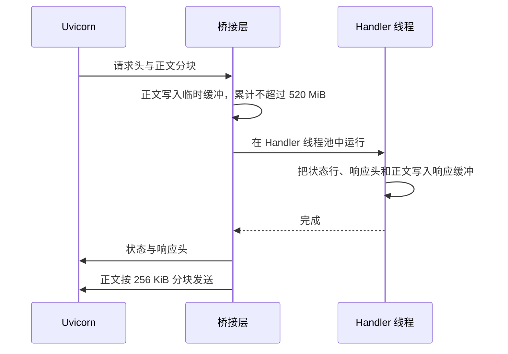

# Portal ASGI、同步 HTTP Handler 与长连接边界

Portal Web 是 Portal 的浏览器应用层。它的大部分页面和 JSON 接口由同步处理函数实现：读取完整请求，一次生成完整响应。它还要支持持续推送的事件流、分块下载和进程重启前的连接清空。Portal Web 用 ASGI 应用承载这两类请求：同步处理函数放到线程中执行，需要长时间保持的连接由异步路由直接处理。

本篇说明 Portal Web 进程内的运行方式：请求怎样到达同步处理函数、哪些路由走异步处理、线程池和队列的容量、进程启动和关闭的顺序，以及重启前怎样清空实时连接。页面路由表、登录检查和错误格式见 decision_0820081083f5；事件流中通知的内容和可见性见 decision_abaedeefca6f。

## 必要概念

- **ASGI**：Python 异步 Web 服务器与应用之间的接口规范。Portal Web 用 Starlette 框架实现 ASGI 应用，由 Uvicorn 服务器运行。
- **事件循环**：在一个线程里轮流调度异步任务的运行器。任务等待网络或计时器时让出执行权，所以一条长连接不会占住一个线程；反过来，任何阻塞操作放在事件循环里都会让所有连接停顿。
- **同步处理函数（Handler）**：沿用 Python 标准库 `BaseHTTPRequestHandler` 写法的请求处理类 `portal.Handler`，从类文件对象读请求、向类文件对象写响应。
- **桥接层**：把 ASGI 请求转换成 Handler 能读取的对象，在线程中运行 Handler，再把它写出的响应转换回 ASGI 响应的代码（`asgi.py` 中的 `portal_http`）。
- **临时缓冲（spool）**：先放在内存、超过阈值后自动转存到临时文件的缓冲区。
- **SSE（Server-Sent Events）**：服务器沿一条 HTTP 连接持续推送文本事件的机制。
- **lifespan**：ASGI 规定的进程启动和关闭钩子，Portal Web 在这里创建和释放全进程共用的组件。
- **本机直接请求**：来源地址为 `127.0.0.1` 或 `::1`、且没有 `X-Forwarded-For` 请求头的请求，即没有经过反向代理转发的本机请求。

## 部署方式

Dev 和 Release 两个实例各运行一个 Uvicorn 进程：`uvicorn management_portal.asgi:app --host 127.0.0.1 --workers 1 --timeout-graceful-shutdown 15`，Dev 监听端口 18086，Release 监听端口 18085。每个实例只有一个 worker 进程，所以下文的线程池、通知队列和实时连接登记在每个实例中各有一份。外部访问经过反向代理（decision_85222f2d316b）。

## 路由

| 路由 | 方法 | 处理方式 | 作用 |
| --- | --- | --- | --- |
| `/api/events` | GET | 异步 | 浏览器变化事件流（SSE） |
| `/api/instructions/execute` | POST | 异步 | HATG ISA 指令的 HTTP 入口；普通指令返回一次 JSON，流式指令返回 SSE（decision_898b8911a2ff） |
| `/api/uploads/{upload_id}` | PUT、POST | 异步 | 向已经创建的上传写入内容 |
| `/api/uploads/{upload_id}` | GET | 异步 | 读取已完成的上传内容，用于附件预览 |
| `/api/resources/download/{token}` | GET | 异步 | 分块下载一次资源读取中过大的结果，支持单段 `Range` |
| `/api/internal/restart-notice` | POST | 异步，仅本机直接请求 | 发布重启倒计时提示 |
| `/api/internal/drain-realtime` | POST | 异步，仅本机直接请求 | 停止接纳新实时连接并等待现有连接结束 |
| 其他所有路径 | GET、HEAD、POST、OPTIONS | 同步 Handler | 页面、静态文件和其余 JSON 接口 |

除了最后一行，每个异步路由都包在同一个错误边界里：未处理的异常按 Portal 的 JSON 错误格式返回，5xx 错误对外只显示“Portal request failed”，不暴露内部细节。

## 设计点

- **同步 Handler 在线程池中运行。** 事件循环线程只负责收发数据；文件读取、模板渲染和内部 RPC 这类阻塞操作都在线程中执行。
- **请求正文收齐并检查大小后才调用 Handler。** 正文上限 520 MiB，超过时立即返回 413，Handler 不会执行。
- **请求和响应都先写进 2 MiB 的临时缓冲。** 超过 2 MiB 的部分转存到临时文件，内存占用有上限。各业务接口仍按自己的规则限制内容大小。
- **需要长时间保持或分块发送的连接由异步路由处理。** 这些连接不占用 Handler 线程；可能阻塞的计算（可见性查询、指令执行、读取下一块内容）交给线程执行。
- **已经生成的响应不排在业务请求后面发送。** 响应正文由 Starlette 自带的线程池分块读取，与 Handler 线程池分开，Handler 线程全部被慢速内部调用占住时，已完成的响应仍能发出。
- **实时连接全部结束后，清空才算成功。** 清空接口先停止接纳新连接，再唤醒现有连接，最后等待每条连接都登记退出。
- **内部控制入口只接受本机直接请求。** 经过反向代理转发的请求不能触发重启提示或连接清空。

## 同步请求怎样处理

**Handler 看到的请求与原来一致。** 桥接层为 Handler 填好方法、路径和查询字符串、HTTP 版本（固定为 HTTP/1.1）、请求头、客户端地址、服务器地址、请求协议（http 或 https，用于同源检查）和正文。Handler 没有对应的 `do_<方法>` 时返回 405。

**响应由缓冲收集后再发送。** Handler 写出的第一部分被解析为状态行和响应头，头部超过 64 KiB、状态行无效或 Handler 没有写出任何响应时报错。`Connection` 和 `Transfer-Encoding` 由 Uvicorn 自己管理，桥接层丢弃 Handler 写出的这两个头。Handler 完成后才开始发送响应，所以同步路由不适合持续推送。

**Handler 抛出异常时。** JSON 接口路径按 Portal 的 JSON 错误格式返回对应状态码；页面路径交给 Starlette 返回 500。无论成功还是失败，临时缓冲都会关闭。

**客户端中途断开时。** 当前请求的发送结束，但线程中已经提交的领域操作仍然有效；调用方重试写操作前，应先用稳定 ID 或版本号查询当前状态。

## 线程池和容量

| 资源 | 容量 | 超出或用尽时 |
| --- | --- | --- |
| 同步 Handler 请求正文 | 520 MiB | 返回 413，不调用 Handler |
| 请求与响应的内存缓冲 | 各 2 MiB | 超出部分转存临时文件 |
| 响应头 | 64 KiB | 报错，返回失败 |
| 响应发送块 | 256 KiB | 按块读取和发送 |
| Handler 线程池 `portal-http` | `PORTAL_HTTP_HANDLER_WORKERS`，默认 32，最少 16 | 同步路由排队等待线程 |
| 非流式指令线程池 `portal-instruction` | 16 个线程 | 普通 ISA 调用排队，不占用 Handler 线程池 |
| 事件线程池 `portal-sse-payload` | 4 个线程 | 事件内容生成与流式指令共用；单批事件内容等待超过 8 秒时改为要求页面重新读取，清空信号可提前结束等待 |
| 事件流单连接队列 | 64 条通知 | 这个连接改为要求页面重新读取 |
| 流式指令的批次队列 | 16 批 | 生成批次的线程等待浏览器取走 |

变化事件流的 ready、心跳、重连及快照内容由 decision_abaedeefca6f 定义；本表集中定义执行容量和等待时限。

## 长连接路由

**变化事件流 `/api/events`。** 需要登录，未登录时重定向到 `/login`。打开前确保 NATS 监听器和知识归档的文件观察器（decision_f55bac7fc199）已经启动。实时连接登记已停止接纳、分发器或事件线程池不可用时返回 503。每批通知在线程池中生成内容；清空信号可打断等待，连接退出时取消订阅并注销实时连接。响应类型为 `text/event-stream`，带 `Cache-Control: no-cache, no-store` 和 `X-Accel-Buffering: no`，后者让反向代理不缓冲事件。事件内容、筛选、ready、心跳及重连契约见 decision_abaedeefca6f。

**流式指令 `/api/instructions/execute`。** 调用者用登录会话或 Bearer 凭证认证，页面请求还要通过同源检查。流式指令在事件线程池中运行，每产生一批结果放进最多 16 批的队列，浏览器依次收到 `batch` 事件（事件 ID 为最后一项的游标），结束时收到 `end`，出错时收到 `error`；连接先发送 `retry: 3000`，空闲 10 秒发送心跳。浏览器断开后设置停止标志并取消流式调用；远端流通过关闭绑定 socket 打断阻塞读取，生产线程不再继续向队列发布。线程取消不回滚已经提交的领域操作。认证、授权上下文和结果格式见 decision_898b8911a2ff。

**上传与下载。** 上传写入在读取正文前先检查 `Content-Length`，读取过程中累计超过上传上限立即返回 413。下载每一块都重新检查调用者对资源的读权限；`Range` 越界时返回 416。这两类请求的业务规则属于资源指令。

## 重启提示与连接清空

这两个接口只接受本机直接请求，其他来源返回 403。控制面在受控停止 Web 前调用它们；Dev 的 `ExecStop` 与 Release 的重启、发布脚本如何组织调用，见 decision_37f98f8fcb4b。本文只定义 Web 接口和连接清空结果。

**重启提示 `/api/internal/restart-notice`。** 正文必须是 JSON 对象，否则返回 400。实时连接登记已停止接纳或分发器不可用时返回 503。成功时发布重启倒计时提示，返回提示内容和当前事件流订阅数。它只发布提示，不执行重启。

**连接清空 `/api/internal/drain-realtime`。** 步骤如下：

1. 实时连接登记停止接纳新连接，并记录此刻的活动连接数；
2. 发出清空信号，正在等待通知或等待内容生成的连接停止等待并结束；
3. 关闭分发器，唤醒所有连接；
4. 最多等待 2 秒，直到每条连接都登记退出。

活动连接归零时返回 200 和 `drained: true`；2 秒后仍有连接时返回 503 和 `drained: false`。两种结果都报告开始时的连接数、已关闭数、剩余数和耗时。清空后新的 `/api/events` 返回 503；同步路由不受影响。

**清空失败不阻止重启。** 停止脚本在重启提示或连接清空失败时只打印错误，然后继续停止进程；剩余连接随进程退出断开，浏览器随后自动重连。

## 启动和关闭顺序

lifespan 启动时依次：

1. 调用已安装功能的 `web.lifespan` 接入点，保存各功能返回的停止回调；后台任务清单属于功能声明，不由 ASGI 重复维护。
2. 创建并启动分发器，启动 NATS 监听器。
3. 让侧栏缓存订阅通知中心：会话通知使会话索引缓存失效，执行通知以外的其他通知使 Resident 侧栏缓存失效。
4. 创建 Handler、非流式指令和事件内容三个线程池，保存到应用状态；创建初始接纳新连接的实时连接登记。
5. 登记本进程的 Web kernel；`PORTAL_ISA_ROUTING=socket` 时再打开指令 socket（decision_96a887d83e8a）。

关闭时依次：

1. 实时连接登记停止接纳新连接并发出清空信号。
2. 若已打开指令 socket，停止它。
3. 取消侧栏缓存订阅并清空缓存。
4. 按启动的反序执行功能停止回调。
5. 关闭分发器。
6. 关闭三个线程池，不等待运行中的任务，并取消尚未开始的任务。
7. 关闭 NATS 监听器和发布器。

lifespan 关闭本身不等待连接归零；需要确认实时连接是否清空时，控制面调用上文的排空接口。领域服务和 NATS 能独立重连，Portal Web 启动不需要等它们就绪。具体功能后台任务由功能自身负责启动和停止，接入约定见 decision_15aab18c0ab3。

## 故障与恢复

| 情况 | 结果 | 恢复方式 |
| --- | --- | --- |
| 同步 Handler 请求正文超过 520 MiB | 413 | 缩小请求，或改用上传接口 |
| Handler 抛出异常 | JSON 接口返回对应错误码，页面返回 500 | 先查询领域状态确认是否已经提交，再按幂等键或版本规则重试 |
| Handler 线程全部占用 | 新的同步请求排队 | 已经生成的响应照常发送；慢调用结束后恢复 |
| 实时连接不可接纳 | `/api/events` 返回 503 | 新进程就绪后浏览器重连 |
| 事件内容生成过慢 | 该批改为要求重新读取 | 页面重新读取当前视图 |
| 连接清空超时 | 清空接口返回 503 和剩余连接数 | 停止脚本继续关闭进程，剩余连接随之断开 |
| 客户端中途断开 | 当前请求结束 | 领域状态以实际提交结果为准 |
