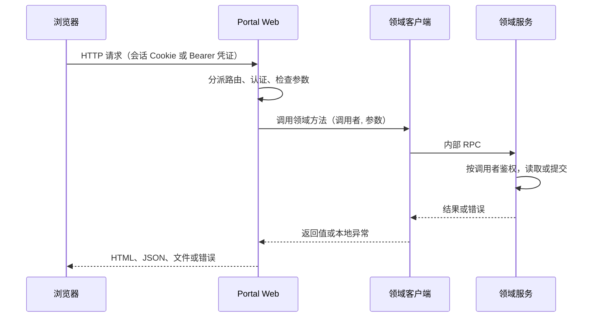

# Portal Web 应用与请求处理架构

Portal Web 是 Portal 的浏览器应用层，位于浏览器与后台领域服务之间。人类用户通过它浏览资源、与 Resident（长期驻留的人工智能协作者）协作、管理 Lineage（一组 Resident 的协作关系）和观察模型执行；Resident 和命令行客户端也可以用 Portal 发放的凭证调用其中一部分接口。

本篇说明 Portal Web 怎样确认调用者、把请求分派给处理函数、调用后台领域服务，以及怎样把结果和错误变成 HTTP 响应。进程内的运行方式（ASGI、线程池、长连接、启动和关闭）见 decision_ecf0f2b2de28；浏览器实时事件见 decision_abaedeefca6f；与后台服务之间的内部 RPC 见 decision_96a887d83e8a；各类数据归哪个服务所有见 decision_86aed2f0e8c7。

## 必要概念

- **调用者（actor）**：发起请求的用户或 Resident 的稳定身份，传给领域服务做权限判断。
- **登录会话**：用户登录后浏览器保存的会话 Cookie（`HttpOnly`、`SameSite=Lax`，默认有效期 30 天，可用 `MANAGEMENT_PORTAL_SESSION_MAX_AGE` 调整）。登录、密码和重置规则见 decision_3bce8b455a3c。
- **Bearer 凭证**：放在 `Authorization: Bearer <凭证>` 请求头中的访问令牌。Portal 发放两类：发给 Resident 的 Agent 凭证，以及用户为命令行创建的个人访问令牌（以 `dbu_` 开头）。
- **路由**：HTTP 方法加路径到处理函数的对应关系。
- **领域服务**：ResourceService（资源）、SocietyService（Resident 与 Lineage）和 ExecutionService（模型执行）。Portal Web 通过各自的客户端调用它们，部署时这些客户端都以 `client` 模式连接服务的 Unix socket。

## 参与组件

| 组件 | 负责什么 | 位置 |
| --- | --- | --- |
| ASGI 应用 | 接收请求；事件流、指令、上传和下载等少数路由直接处理，其余交给同步 Handler | `asgi.py` |
| 同步 Handler | 认证、路由分派、返回页面、文件和 JSON | `serve_management_portal.py` 中的 `Handler` |
| 路由目录 | 登记全部同步 GET 和 POST 路由，检查重复；可选功能的路由由功能声明的 `web.routes` 接入点提供（decision_15aab18c0ab3） | `http_routes.py`、`serve_management_portal.py` 中的 `_portal_route_definitions` |
| 各模块的 HTTP 处理类 | 解析某个页面模块的请求参数并调用后端 | `http_*.py`（例如 `http_resources.py`、`http_paper.py`、`http_lineage.py`） |
| 错误格式 | 把异常转换成统一的 JSON 错误 | `http_errors.py`、`management_common/operation_errors.py` |
| 领域客户端 | 调用三个领域服务 | `resources/transport.py`、`society_service/transport.py`、`execution/transport.py` |

## 设计点

- **调用者只来自可信的认证结果。** 页面请求从登录会话取得用户；Bearer 请求从 Portal 验证过的凭证取得用户或 Resident。查询参数、表单字段和 JSON 正文中的身份字段不能覆盖它。
- **所有同步路由登记在一个目录里，重复登记在启动时报错。** 匹配结果不依赖登记顺序。
- **先按公开程度分派，再认证。** 公开路由在认证前处理；其余路由要求有效的认证。
- **带登录会话的 POST 必须来自同源页面。** 这是对浏览器 Cookie 自动携带的防护；只用 Bearer 凭证的调用不受影响。
- **业务判断留在领域服务。** Portal Web 检查参数是否存在、类型是否正确和正文是否过大；资源版本冲突、Lineage 状态是否允许、执行是否仍属于某个 worker，由领域服务判断。
- **每个路由只读取自己声明的参数名。** 不接受历史别名，也不用通用字段猜测目标。
- **错误以统一的 JSON 格式返回。** 格式中说明错误码、HTTP 状态、能否重试和修改是否已经提交。
- **长任务的提交和观察分开。** 提交请求只负责创建或接受工作；进展通过状态查询和实时事件观察，一次 HTTP 请求不会一直等到任务完成。
- **页面显示的数据以领域服务的当前查询为准。** Portal Web 的侧栏等缓存在收到对应变化通知时失效；实时事件只提示“可能变了”，页面随后重新查询。

## 调用者与认证方式

| 入口 | 接受的认证 | 调用者 |
| --- | --- | --- |
| 页面和大多数 JSON 接口 | 登录会话 | 当前用户 |
| 论文模块的接口（`/paper/api/...`） | 登录会话、个人访问令牌或 Agent 凭证 | 用户或 Resident，再按读写类别检查权限 |
| 测试实验室接口（`/test/api/...`） | 登录会话、个人访问令牌或 Agent 凭证 | 同上 |
| HATG 指令入口 `/api/instructions/execute` | 登录会话、个人访问令牌或 Agent 凭证 | 用户或 Resident（decision_898b8911a2ff） |
| 浏览器事件流 `/api/events` | 仅登录会话 | 当前用户 |
| 本机控制入口 `/api/internal/...` | 仅本机直接请求 | 无（decision_ecf0f2b2de28） |

登录会话和个人访问令牌对应的用户还必须处于启用状态；配置了允许用户名单时，必须在名单内。

同源检查比较请求的 `Origin`（没有时用 `Referer` 的来源部分）与本次请求的协议加 `Host`；两个头都没有时视为同源。协议取反向代理验证过的原始协议。

## 路由分派

同步路由用 `RouteDefinition` 描述：方法、路径、匹配方式、公开程度（phase）、所属模块分组和处理函数。匹配方式有精确匹配（`exact`）、前缀匹配（`prefix`）、路径模板（`template`，如 `/api/x/{item_id}`）、前缀兜底（`prefix_fallback`）和全局兜底（`fallback`）。

公开程度有三级：

| phase | 含义 |
| --- | --- |
| `public` | 认证前处理，例如登录页、公开页面和重启提示查询 |
| `dual-auth` | 处理函数自己接受登录会话或 Bearer 凭证；目前是论文模块的接口 |
| `protected` | 通过认证检查后处理，处理函数收到当前用户 |

**目录在启动时检查冲突。** 同一方法、同一 phase 下，两条路由可能匹配同一路径时（精确与精确相同、精确落在前缀内、前缀互相包含、模板与前缀或模板重叠），目录构建失败并报出两个所属分组。兜底路由之后不能再登记同一方法和 phase 的路由。

**目录先放核心路由，再放已安装功能的路由，最后是外壳兜底路由。** Paper、Article、WALL、Test 等可选功能在 `portal_features.py` 的声明中提供 `web.routes`：一个接收外壳模块、返回该功能 `RouteDefinition` 列表的函数，写在功能自己的 `http_*.py` 中。没有打包的功能不提供路由，它的路径落到兜底处理，Web 照常启动。功能后台任务通过 `web.lifespan` 接入；进程启动、反序停止和执行容量由 decision_ecf0f2b2de28 说明。

**GET 请求的处理顺序：**

1. 依次尝试 `public` 和 `dual-auth` 路由；
2. `/test/api/` 路径按测试实验室规则认证；
3. 其他请求要求有效登录会话：JSON 接口返回 401，页面重定向到 `/login`；
4. 尝试 `protected` 路由；都不匹配时由兜底处理：JSON 接口返回 404，路径是资源 ID 时重定向到资源页面，其余交给静态文件处理。

业务操作的授权由对应入口按当前指令、目标参数及领域约束执行（decision_b820faf42218）。终端等系统级功能也遵循当前权限声明，不再附加已退役的 Project 角色或 system_capabilities 门槛（decision_34158fdd4078）。

**POST 请求** 顺序相同，只是在 `dual-auth` 之前先做同源检查：带登录会话但来源不同的请求返回 403；认证失败一律返回 401。HEAD 与 GET 走同一逻辑；OPTIONS 返回 204 和允许的方法（GET、POST、HEAD、OPTIONS）。

## 请求参数的约定

每个路由只读取自己声明的参数名，缺少时返回 400。当前的例子：

- 资源语义搜索的范围只用 `resource_scope`；
- Skill 和 Experiment 详情只用 `item`；
- 测试目录的多值筛选使用重复的 `module` 和 `aspect` 参数；
- Resident Watchboard 的文件和命令只用 `path` 和 `command_id`；
- `/lineage/api/node-metadata` 需要 `lineage_id` 和 `resident_id`；

## 一次普通请求



写请求在领域服务确认提交后才返回成功。提交后产生的变化通知送给其他页面，与本次响应分开。

## Portal Web 自己执行的指令

Portal Web 通过 `/api/instructions/execute` 接收 HATG ISA 调用，按指令声明的 owner 路由；owner 为 `web` 的指令由本进程的 Web kernel 执行。用户与导航、讨论、User Mailbox 和 Portal 运行环境等功能在各自领域中声明指令。可用指令及其归属以当前 `ListInstructions` 和 `GetInstructionSchema` 为准；目录、认证上下文和执行规则见 decision_898b8911a2ff，本文不重复维护指令数量与清单。

在 socket 路由模式下，Portal Web 还提供 `instruction.execute` 供其他服务调用 Web 所有的指令；服务身份、传输和错误语义见 decision_96a887d83e8a。

## 资源内容接口

`GET /api/resources/content?address=<资源地址>` 读取一个资源的内容，需要登录会话；缺少 `address` 时返回 400。`download` 为 `1`、`true`、`yes` 或 `on` 时请求附件下载。

Portal Web 把资源地址和已认证的当前用户交给 ResourceService 的 `open_content`。ResourceService 在服务内部解析地址并检查读权限，再返回内容字节或文件读取计划；客户端传入的解析结果不能替代这次检查。Web 按结果发送：

1. 返回字节、媒体类型和元数据时直接响应；请求下载时使用结果中的文件名或资源地址生成附件头。
2. 返回可在本机读取的文件计划时，交给本地媒体或下载发送函数。
3. 返回带大小和修改时间、可按范围读取的文件计划时，以 1 MiB 分块调用 `read_content_range`，支持 `Range`、`If-Range` 和 `If-None-Match`（206、304 或 416）；大小、修改时间改变或分块长度不足时中止。
4. 其他计划视为不支持的内容计划，按资源错误规则返回。

媒体发送路径只让安全媒体内联展示，其他文件按下载处理；附件名清除路径分隔符和控制字符，并提供 ASCII 文件名与 UTF-8 的 `filename*`。直接读取本地文件也必须以 ResourceService 已鉴权的计划为依据。内部调用和资源错误语义见 decision_96a887d83e8a。

## 错误响应

**所有 JSON 错误使用同一格式：**

```json
{
  "error": "说明",
  "message": "说明",
  "code": "operation.invalid",
  "http_status": 400,
  "retryable": false,
  "commit_state": "not_committed",
  "details": {}
}
```

`commit_state` 说明修改是否已经提交：`not_committed`（没有提交）、`committed`（已经提交）或 `unknown`（无法确定，重试写操作前应先查询当前状态）。处理函数只给出 `error` 时，其余字段按 HTTP 状态补齐：`code` 取该状态的默认错误码（如 400 为 `operation.invalid`、503 为 `operation.unavailable`）；400、401、403、404、405、413 和 422 的 `commit_state` 为 `not_committed`，其他状态为 `unknown`；`retryable` 默认为 `false`。

**未捕获的异常按类型映射：**

| 异常 | HTTP 状态 | 错误码 |
| --- | --- | --- |
| `ValueError` | 400 | `operation.invalid` |
| `PermissionError` | 403 | `operation.forbidden` |
| `KeyError` | 404 | `operation.not_found`（去掉 Python 给键名加的引号） |
| `FileNotFoundError` | 404 | `operation.file_not_found` |
| `FileExistsError` | 409 | `operation.conflict` |
| `TimeoutError` | 504 | `operation.timeout` |
| 带错误码的领域异常（`OperationError`） | 异常自带 | 异常自带；例如 SocietyService 或 ResourceService 不可用为 503，Lineage 对象冲突（`instruction.conflict`）为 409 |
| 其他异常 | 500 | `operation.failed`，消息替换为 “Portal request failed”，不暴露内部细节 |

资源类接口按 ResourceService 的错误对照表返回（decision_96a887d83e8a），例如资源版本冲突返回 409 并附带期望版本和当前版本。GET 请求的页面路径（非 JSON 接口）出错时返回 500 纯文本；POST 请求出错一律返回 JSON 错误，其中正文过大为 413、正文格式无效为 400。错误响应不包含认证材料。

ExecutionService 客户端的“不可用”异常目前不带错误码，按“其他异常”返回 500；这与“依赖服务不可用返回 503”的规则不一致，已登记为 WALL 不一致点 `execution-service-unavailable-http-status`。

Chat 的 Skill 与 Agent 上下文选项由 `GET /api/agent-context-options` 提供；`GET /api/users` 从用户身份模块读取登录账号与目录用户。它们是 Portal 公共入口。
