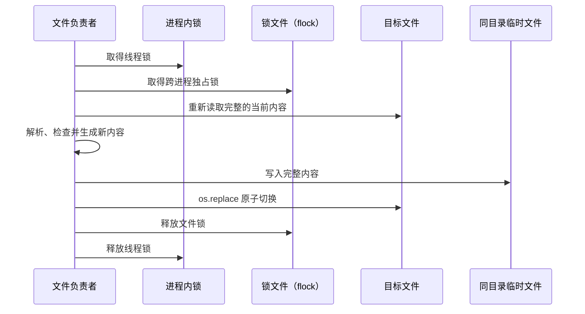

# Portal 共享文件状态的锁、原子替换与不变量作用域

Portal 的业务状态主要保存在 PostgreSQL 中（decision_86aed2f0e8c7），但仍有一部分保存在共享文件里：外部系统拥有的 JSON 与 YAML 文档、Markdown 正文、文件清单、登记表、状态缓存和运维公告。多个线程、Dev 与 Release 两个 Portal 实例，以及 Portal 之外的工具，可能同时读写这些文件。一次修改通常要先读出旧内容、检查业务条件、算出新内容，再写回；如果两次修改的这些步骤交错，就会丢失更新，或者让读者看到只写了一半的文件。

本篇说明两件事：文件的负责者怎样用同一个锁让“读取、修改、写回”依次执行，并用同目录的原子替换保证不加锁的读者也只看到完整文件；以及 SocietyService 怎样按业务对象划分锁（不变量作用域），决定哪些数据必须一起保持一致、由哪个锁保护。每种文件的格式、校验和恢复仍由它的负责者说明。

## 用户能观察到什么

用户修改偏好、WALL 文档、Paper 笔记或其他保存在文件中的状态时，只会得到完整的成功或明确的失败。并发修改不会拼接出损坏的 JSON，读取者也不会看到半份 Markdown。修改完成后，页面通过重新查询或变化通知看到新内容。

原子替换只保证一个文件在切换的瞬间要么是完整的旧内容、要么是完整的新内容。两个写者基于同一份旧内容各自算出新内容的冲突，以及多个文件需要一起更新的一致性，由锁、版本号和负责者的规则处理。

## 必要概念

- **不变量**：一次操作前后都必须成立的业务条件，例如“Resident 的成员关系与 Lineage 中的节点一致”。
- **临界区**：持锁期间只有一个参与者能执行的代码范围。读取、检查和写回必须在同一个临界区里，才能避免丢失更新。
- **进程内锁**：Python 线程之间共享的可重入锁（`RLock`），同一线程可以重复进入。
- **文件锁**：操作系统对一个锁文件施加的跨进程独占锁（`flock`）。锁文件与要保护的业务对象有固定对应关系，但独立于业务文件本身。
- **原子替换**：先在目标所在目录写好一个完整的临时文件，再用 `os.replace` 一步把目标路径切换到新文件。在同一个文件系统内，读取者看到的是旧文件或新文件，不会看到中间状态。
- **作用域锁**：按业务对象划分的锁，例如“某个 Resident”。不同对象的锁可以同时持有，同一对象上的修改依次进行。
- **延后回调**：等外层的锁全部释放后才执行的动作，用于发送通知或启动可能再次取锁的后续工作。

## 参与组件与责任

| 组件 | 负责什么 | 不负责什么 |
| --- | --- | --- |
| 文件的负责者 | 选择锁、解析旧内容、检查条件并生成新内容 | — |
| `exclusive_file_lock(path)`（`management_portal/shared_state.py`） | 对调用方给出的锁文件取得跨进程独占锁 | 不附带进程内锁，也不推断要保护哪个文件 |
| `atomic_replace_text(path, content)` | 在目标目录写完整的 UTF-8 文本，flush 并 fsync 临时文件后原子替换 | 不取锁，不做业务校验，不 fsync 父目录；不提供跨写者 CAS |
| `atomic_replace_json(path, payload)` | 统一序列化 JSON，写临时文件并 `fsync`，原子替换后再 `fsync` 所在目录 | 不取锁，不检测版本冲突 |
| `atomic_create_json(path, payload)` | 以“目标已存在就失败”的方式创建只写一次的 JSON，写完后 `fsync` 文件和目录 | 只用于创建后不可覆盖的文件，例如发布身份 |
| 负责者自己的进程内锁 | 让同一进程中的线程依次执行 | 不能保护其他进程 |
| SocietyService 的 `invariant_locks` | 按 Resident、Resident 对话或登记目录划分锁作用域，组合进程内锁与文件锁，并统计锁的等待与持有；为 Lineage 操作提供不取锁的延后回调作用域 | 不保护跨数据库或跨文件系统的原子性 |
| 不加锁的读取者 | 直接读取完整的旧文件或新文件 | 可能读到旧内容；需要最新内容时按负责者的协议重试或查询 |

## 设计点

### 锁怎样使用

- **会修改同一份数据的写者使用同一个锁。** 锁文件的路径或业务作用域由负责者固定下来；按临时文件名、线程或调用路径生成的锁无法互斥。
- **取得锁之后重新读取当前内容，再计算修改。** 先不加锁地读取、稍后才加锁写回，会覆盖别的写者已经提交的修改。
- **进程内锁和文件锁各管一层。** `RLock` 管同一进程的线程，`flock` 管遵守同一锁文件的不同进程；两者都需要时，负责者按固定顺序组合。
- **临时文件和目标放在同一目录。** `os.replace` 只在同一文件系统内是原子的。
- **原子替换不检测版本冲突。** 需要阻止旧页面覆盖新内容时，负责者比较版本号、修改时间或内容摘要，并返回冲突。
- **多个文件需要一起保持一致时，按它们共同的业务对象加锁。** 每个文件各自原子替换，两次替换之间仍可能出现组合不一致；跨数据库或文件系统的操作使用持久的操作意图、身份校验和可恢复的步骤，不靠扩大锁的范围假装获得跨存储事务。
- **锁释放之后再发通知、执行可能再次取锁的动作。** 持锁期间只完成持久状态的修改，缩短临界区，也避免回调再取同一把锁造成死锁。

### SocietyService 的作用域

| 作用域 | 保护什么 | 不包含什么 |
| --- | --- | --- |
| `lineage:<lineage_id>`（不取锁） | 只收集一次 Lineage 操作的延后回调，操作的事务全部提交后执行；Lineage 定义的一致性由提交时的行锁与三方合并保证（decision_d918ebebc062） | 不让同一 Lineage 上的指令依次执行 |
| `resident:<resident_id>` | 一个 Resident 的输入与队列、配置、执行绑定、停止意图、结果归并，以及对话写入授权意图的短提交 | 读取 AgentData、写对话、组装快照、发送通知 |
| `resident-conversation:<resident_id>` | 一个 Resident 的对话写入与递增的事件游标 | 与 `resident:<id>` 相互独立：慢的对话写入不会阻塞停止、排队或执行绑定，慢的执行调用也不会占住对话读取 |
| `catalog:<name>` | 跨多个 Lineage 的登记目录的短读改写，例如唯一性检查 | 单个 Lineage 内的数据 |
| `resident-continuation:<resident_id>` | 一个 Resident 的完成等待者归属；以“尝试获取”方式使用，取不到说明其他进程已经在等待 | 普通状态命令不争用它 |
| `resident-lifecycle:<operation_id>` | 一个生命周期操作的执行者归属；以“尝试获取”方式使用 | 它不是状态锁；不同操作可以并行，清理与 Resident 接收输入使用各自独立的工作额度 |

- **同一 Lineage 上的指令并发执行。** 定义写入不取作用域锁，在数据库事务内锁定 Lineage 行并把自己的修改合并到已提交的定义上；Lineage 作用域只负责把通知等后续动作推迟到提交之后。
- **多个 Resident 的短提交按固定顺序取锁：** Resident 锁按 ID 排序获取，最后进入数据库事务。普通 Resident 提交先释放自己的锁，再发出需要 Lineage 协调的通知，避免反向嵌套。
- **慢操作都在 Resident 状态锁之外。** Provider 调用、跨服务调用、长轮询、跨存储的对话写入、快照组装、文件树搬移、资源索引和通知都不在 `resident:<id>` 内执行。执行结果写入对话时，先在 Resident 记录中保存带工作 ID、execution ID 和稳定消息 ID 的有界授权意图，释放锁后写入对话，再用一次短提交确认或隔离错误。
- **对话状态投影带着提交时的版本号。** Resident 状态提交之后，对话状态在锁外更新；更新期间出现更新的修改时，重新读取最新版本并有限次修复，旧投影不会覆盖新状态。局部投影失败不阻止取消通知或执行唤醒。
- **读取对话不取独占锁。** 快照、分页、单条消息和状态查询只读；同时读取 AgentData 与 LineageData 时，先后核对游标，组装期间游标变化就重读一次，之后由游标补读收敛。

## 单个文件怎样写入

解析或检查失败时不替换目标；写临时文件失败时旧文件保持不变；`os.replace` 成功后，新打开目标的读取者看到新内容。

`exclusive_file_lock(path)` 创建锁文件的父目录，以追加方式打开锁文件，调用 `flock(LOCK_EX)` 等待独占锁，退出 `with` 块时解锁并关闭文件。它只约束同样使用 `flock` 的写者；绕过锁直接写目标的外部工具仍可能造成冲突，所以共享文件的约定必须把锁文件路径告诉所有写者，或让外部写入经过负责者的接口。它不内置进程内锁，需要线程级串行的负责者在外层持有自己的 `RLock`。

`atomic_replace_text(path, content)` 通过 `tempfile.mkstemp` 在目标目录创建前缀为 `.<目标名>.`、后缀为 `.tmp` 的临时文件，写入完整 UTF-8 文本并 flush、fsync 该文件；目标已存在时沿用其权限，否则使用 `0664`，随后 `os.replace`。出错时尽量删除临时文件。它不 fsync 所在目录，因此文件内容同步与目录项持久性保证必须分开：替换前文件同步失败保留旧目标，成功 replace 后新打开目标的读取者看到完整新内容；不能据此保证断电后目录替换一定持久。需要同步目录项的 JSON 写入使用 `atomic_replace_json`。

### JSON 文件统一由 `shared_state` 写入

可以覆盖的 JSON 文件调用 `atomic_replace_json`：它在目标目录创建临时文件，以 UTF-8 序列化并在末尾加换行，设置权限，写完后 `fsync` 文件，`os.replace` 之后再 `fsync` 所在目录。调用方只提供内容、是否排序和缩进；敏感文件显式传入权限，否则沿用目标原有权限，新文件使用 `0664`。

创建后不允许覆盖的文件调用 `atomic_create_json`：它以 `O_CREAT | O_EXCL`（目标存在即失败）打开目标，写入并 `fsync` 完整的 JSON，再 `fsync` 所在目录；写入过程出错时删除这个未写完的文件。

领域模块不自己组合“临时文件 + `json.dump` + `chmod` + `os.replace`”或“`O_EXCL` + `json.dump` + `fsync`”，也不用 `Path.write_text(json.dumps(...))` 覆盖持久文件。只在一次调用或临时目录中存在、随后就删除的进程临时 JSON（例如 Git 凭据、临时的 Provider 能力缓存）不在此列。Portal 自有的可变业务状态保存在领域数据库中，不借用这些文件工具另建一份权威数据。

当前使用这些工具的包括 Paper、WALL 文档、Pulse、界面状态中的密钥锁、状态缓存、组件生命周期公告、重启通知和多个运维脚本。某些专用文件格式有自己的原子写入和回滚流程；判断一个具体文件是否安全，要看它的负责者的写入入口、锁和错误恢复。

### Workspace 文件的受控写入

`UpdateWorkspaceFile` 只接受 `<workspace-id>/file/<相对路径>`，不接受绝对路径。ResourceService 在已鉴权的 Workspace 内打开目标父目录，并在该目录的 `flock` 内比较内容摘要、写临时文件及 `os.replace`；同一目录锁下的受控写者共同遵守版本检查。该入口不显式同步文件或目录，不能把原子替换的可见性解释为断电持久化保证；绕过目录锁的外部写者也不受此版本检查约束。地址、权限与调用契约由 decision_ad3e21094f14 定义。

## Lineage 不变量锁怎样工作

`invariant_locks` 把每个作用域映射为 `PORTAL_LINEAGE_ROOT/.locks/` 下的一个锁文件，文件名由作用域字符串过滤非法字符并截取前 120 个字符得到。

- **Lineage 作用域**：`lineage_scope` 与跨多个 Lineage 的 `lineage_scopes` 不创建锁文件，只登记诊断名称并收集延后回调；内层作用域把回调交给外层，最外层成功结束时执行，失败时丢弃。
- **单个锁作用域**：`resident_lock`、`resident_conversation_lock`、`catalog_lock` 在同一进程内共享一个 `RLock`，在进程之间共享一个锁文件。同一线程嵌套进入同一作用域时复用外层的持有，不重复加文件锁；最外层退出时才释放文件锁和 `RLock`，并执行积累的延后回调。
- **多个 Resident**：`resident_locks` 对 ID 去重、排序后依次获取，避免两个线程分别按 A→B 和 B→A 的顺序互相等待。
- **登记目录**：`catalog_lock(name)` 的名称转为小写的安全字符串，最长 80 个字符。调用方按实际要保护的一致性选择作用域，不用宽泛的全局锁代替明确的边界。
- **Resident 状态与对话写入不嵌套成长临界区。** 跨存储的一致性依靠稳定的消息 ID、持久的授权意图、版本检查和游标恢复。

### 延后回调

`defer_until_state_unlock(callback)` 把回调登记到当前最内层的状态作用域（锁作用域或 Lineage 作用域）；不在任何作用域中时立即执行。内层作用域成功退出时，回调转交给仍持有的外层作用域；所有作用域成功退出、释放文件锁和 `RLock` 之后才执行。某个作用域失败时，丢弃这个作用域中登记的回调，不发布已经回滚的变化。一组已提交的回调彼此隔离：其中一个出错，其余照常执行，最后再报告第一个错误。

延后回调适合发送变化通知和唤醒后台协调器，不承担必须完成的业务清理。删除、清空上下文这类操作把清理意图与本地状态写在同一个 LineageData 事务中，由 `resident_lifecycle_operations` 保存稳定的操作 ID、步骤游标、重试时间和错误（decision_71aa039e3211）。恢复者在状态锁之外执行可重复的步骤，每完成一步就保存游标；失败时保留意图和错误，不把已删除的身份恢复成仍然存在。释放 Provider 会话前核对操作当时记下的会话身份，不释放后来替换的新会话；清空上下文的清理未完成时可以接收新的输入，但新会话不开始执行。外部调用已经成功、游标尚未保存时的重放，仍使用同一个操作 ID。

### 锁的健康统计

`invariant_locks` 记录获取次数、发生等待的次数、等待与持有达到阈值的次数、最长等待和最长持有时间，以及最近 20 条慢事件；健康结果还列出当前持有者、作用域数量和阈值。阈值由 `PORTAL_LINEAGE_SLOW_LOCK_SECONDS` 设置，默认 1 秒；持有超过阈值的当前持有者附带线程堆栈。调用方可以用 `diagnostic_scope` 给一次操作附加可读的名称，帮助定位长时间持锁者。慢事件的堆栈格式化和记录在锁释放之后完成，统计本身不会延长临界区，也不改变加锁结果。SocietyService 的健康接口汇总这些统计（decision_1b2bdf5c33d6）。

## 数据库事务与文件锁的关系

数据库事务与文件锁不能互相替代。PostgreSQL 保护一个数据库内多张表的提交，Lineage 定义的并发写入也由它的行锁串行合并；Resident 与登记目录的作用域锁保护跨存储业务操作的先后顺序。跨数据库，或数据库与文件之间，没有单一的原子提交，需要设计可以重试的步骤和协调记录。

## 故障与恢复

| 情况 | 结果 | 恢复方式 |
| --- | --- | --- |
| 进程在替换前退出 | 旧文件仍在，可能留下临时文件 | 之后的写入忽略或清理不匹配的临时文件 |
| 进程在 `os.replace` 之后退出 | 目标已经是完整的新文件 | 负责者重新读取当前内容，不凭内存判断 |
| 进程持有 `flock` 时退出 | 操作系统关闭文件描述符并释放锁 | 下一个写者重新读取当前内容后继续 |
| 两个写者使用了不同的锁文件 | 可能丢失更新 | 统一负责者的约定和锁；用版本号检测旧写入 |
| 延后回调失败 | 持久状态已经提交，副作用没完成 | 记录错误，由重新通知、待发件箱或对账恢复 |
| 多文件操作中途失败 | 已经替换的文件可能形成部分提交 | 负责者使用备份与回滚，或可识别的协调状态 |
| 文件观察器漏掉替换事件 | 页面投影暂时过期 | 定期比较文件指纹和启动扫描恢复（decision_f55bac7fc199） |
