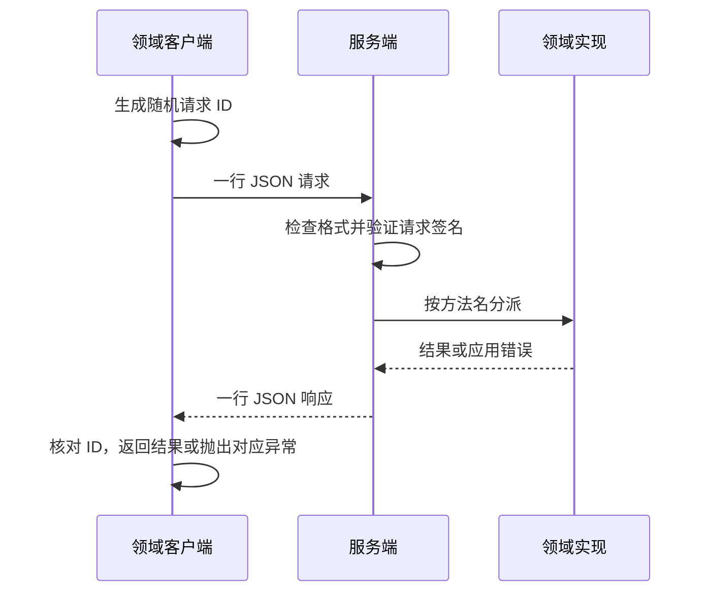

# Portal 内部本地 RPC、服务身份与错误语义

Portal 由几个运行在同一台主机上的进程组成：浏览器应用层 Portal Web，以及三个后台领域服务——管理资源的 ResourceService、管理 Resident 与 Lineage 的 SocietyService、管理模型执行的 ExecutionService。页面请求要查询领域数据，执行进程（ExecutionWorker）要领取任务，服务之间也要互相调用。它们通过内部 RPC 交换请求和结果。RPC（远程过程调用）是把一次跨进程调用包装成“发送方法名和参数、等待结果”的通信方式。

本篇说明这套内部 RPC 的共同规则：请求怎样到达、怎样返回、调用者的身份怎样确认，以及失败时调用方看到什么。各服务提供哪些方法、每个方法的业务规则，由各领域的 Design 说明；SocietyService 的领域方法见 decision_d918ebebc062，HATG ISA 指令见 decision_898b8911a2ff。

## 必要概念

- **Unix socket**：同一台主机上进程之间通信的端点，用一个文件路径定位。它不经过网络端口，谁能连接由这个文件的操作系统权限决定。
- **一行一条消息（JSON line）**：请求和响应都是一行 JSON，换行符表示一条消息结束。
- **调用者（actor）**：发起业务操作的人或 Resident 的身份，决定能否访问具体对象。连接 socket 的内部进程只证明“我是 Portal 的受控进程”，不代表调用者有权访问一切。
- **签名**：四个内部服务的请求用共享密钥计算 HMAC-SHA256 消息认证码，证明请求中的调用者身份和参数由持有密钥的 Portal 进程发出，途中没有被改动。
- **nonce**：每次请求附带的一次性随机值。服务端记住短时间内见过的 nonce，同一个签名不能被重复使用。
- **传输失败与应用错误**：传输失败指连接不上、超时、连接中途断开或返回内容无法解析；应用错误指请求已经到达服务，被参数、权限、对象状态或业务规则拒绝。

## 参与组件

| 组件 | 负责什么 | 位置 |
| --- | --- | --- |
| 领域客户端 | 生成请求 ID、编码参数、连接 socket、解析结果，把远端错误还原成本地异常 | `resources/transport.py`、`society_service/transport.py`、`execution/transport.py` |
| 服务连接 | 连接服务 socket；服务正在重启时等它重新监听 | `management_common/service_socket.py` |
| 服务端 | 监听 socket，每个连接处理一个请求，把允许的方法交给领域实现 | `resources/server.py`、`society_service/server.py`、`execution/service.py`、`web_instruction_server.py` |
| 指令接口 | 四个服务共用的 `instruction.execute` 方法的客户端和服务端 | `hatg/socket_rpc.py` |
| 请求认证 | 为各服务请求签名，统一验证签名和 nonce；资源方法集合由资源服务声明 | `management_common/rpc_auth.py`、`resources/rpc_auth.py` |

各服务的逻辑路径位于实例目录下：`<实例根目录>/<实例名>/resource-service.sock`、`society-service.sock`、`execution-service.sock` 和 `web-service.sock`，可以分别用环境变量 `PORTAL_RESOURCE_SERVICE_SOCKET`、`PORTAL_SOCIETY_SERVICE_SOCKET`、`PORTAL_EXECUTION_SERVICE_SOCKET`、`PORTAL_WEB_SERVICE_SOCKET` 改到别处。Linux 和 macOS 把逻辑路径作为 Unix socket 地址；Windows 由系统分配 `127.0.0.1` 临时 TCP 端口，通过当前用户私有目录的端点描述文件发现。完整安装路径和服务名构成端点身份，不使用固定 Dev/Release 端口，也不要求安装目录只能叫 dev 或 release。`management_common/service_endpoint.py` 负责逻辑端点，`management_common/local_ipc.py` 负责监听、私有描述文件和应用字节之前的双向随机挑战 HMAC 认证；业务层 RPC 签名和权限检查继续保留。未知 Windows 服务名直接报错，防止误用其他本地端点。

## 设计点

- **每个请求有独立的 ID。** 客户端为每次调用生成随机 `id`，响应带回同一个 ID；ID 不一致时客户端把响应当作传输失败。
- **一个连接只处理一个请求。** 客户端连接、发送一行请求、读取响应后关闭连接。流式指令的响应分多行返回，但一个连接仍只对应一个请求。
- **服务端只执行明确列出的方法。** 每个服务按方法名逐一分派，未知方法作为应用错误返回，不按字符串动态加载代码。
- **请求和参数都必须是 JSON 对象。** 顶层请求与 `params` 不是对象时，服务端直接拒绝。
- **能连接 socket 不等于有权访问对象。** socket 文件的权限是 `0660`，只有 Portal 的服务账号和同组进程能连接；签名确认调用者身份后，指令权限由 ISA 内核经权限系统检查。
- **应用错误原样返回给调用方，不触发重试或换服务。** 只有 ExecutionService 客户端在当前实例不可达时，会改连另一个实例（见下文）。
- **服务重启期间，请求等它回来。** socket 不存在或拒绝连接说明服务正在重启，请求还没有送出；客户端最多等 30 秒，服务重新监听后把请求送达一次（见“服务重启期间的连接等待”）。
- **远端错误还原成明确的本地异常。** 已知的错误码对应固定的本地异常类型，并保留结构化详情；不认识的错误变成带远端说明的 `RuntimeError`，不假装成其他本地异常。

## 一次普通调用怎样进行

请求格式为 `{"id": "<随机 ID>", "method": "<方法名>", "params": {...}}`。成功响应为 `{"id": ..., "ok": true, "result": ...}`；失败响应为 `{"id": ..., "ok": false, "error": {...}}`，`error` 的字段由各服务的错误格式决定（见下文）。

四个服务端都按端点地址族监听：每个连接在单独的后台线程中处理，连接等待队列的长度为系统允许的最大值（`socket.SOMAXCONN`）。Unix socket 启动时清理旧 socket 文件、绑定后设 `0660`，关闭时删除；Windows TCP 只绑定本机回环地址，端点描述文件须原子写入且仅当前用户可读写；退出时仅清理本代描述，不能删除新一代端点。认证失败不能把任何字节送入业务处理器。当前 Linux 部署由各自的 systemd 用户服务管理进程。

## 服务停止与工作恢复

SocietyService 与 ResourceService 收到 SIGTERM 后停止接受新连接，关闭现有 RPC 连接，并同时通知各后台 worker 停止领新工作。Lineage 的 Watch 订阅立即结束等待；只读子进程取消当前读取后退出，停止期间不再补建进程池。

两个服务的退出总时限为 10 秒，包含后台清理与 Python 解释器等待线程池的时间。各 worker 共享清理时间，避免逐个等待叠加；到截止时间仍未退出时，服务记录线程栈并结束进程。正在执行的 worker 在实际退出前继续持有租约，下一进程按原有租约与持久恢复记录接续工作。未提交的数据库事务随连接关闭回滚；已提交的工作、指令回执与独立 ScriptRun 执行单元继续由各自恢复协议管理。

停止期间尚未得到响应的调用按传输中断处理，提交状态可能未知。读取可以重试，写入继续使用原幂等键或查询执行记录；调用方不能把断连解释为未提交。

## 服务重启期间的连接等待

一次发布会依次重启 SocietyService、ResourceService 和 ExecutionService。旧进程停止时删除自己的 socket 文件，新进程完成初始化后重新绑定；这段时间里连接 socket 会得到“文件不存在”（ENOENT）或“连接被拒绝”（ECONNREFUSED），监听队列满时得到 EAGAIN。三种情况下请求都还没有送达服务。

各领域客户端和指令接口通过 `management_common/service_socket.py` 的 `connect_service` 建立连接。遇到上述三种错误时，它按退避间隔重连：第一次隔 0.25 秒，之后每次翻倍，最长 2 秒一次（`retry_delays`，即 0.25、0.5、1、2、2…秒），最多等 30 秒（`SERVICE_RESTART_WAIT_SECONDS`）。一次重连只是本机内核里一次失败的 `connect`，实测约 8 微秒；退避把一次 10 秒重启期间的重连从约 40 次减到约 8 次，服务回来后请求最多晚 2 秒接上。服务重新监听后，请求照常发送一次，不会重复。30 秒后仍连不上，客户端才抛出原来的服务不可用错误，提交状态为“未提交”。其他连接错误（例如权限错误）不等待。给了多个 socket 时（ExecutionService 的本实例与另一个实例），一轮里任一 socket 接受连接就立即使用它，只有全部都不接受时才等待。

Portal Web 因此在后台服务重启期间让页面请求等待，不再立即返回 503；用户路由器对 Portal Web 的重启采用同样的 30 秒等待（decision_850e6248d680）。以下调用需要立刻知道服务是否在线，不等待：

- SocietyService 的 `health` 与 `runtime.resident.wake`；
- ResourceService 的 `resource.status`；
- ExecutionService 的 `health`；
- ExecutionWorker 的调度客户端 `SchedulerClient`。Worker 按租约截止时间判断是否放弃手上的任务，等待会让它在租约过期后继续运行。

## 内部请求认证

ResourceService、SocietyService、ExecutionService 与 Portal Web 的 socket 请求都必须带签名，包括健康检查、Worker 控制、领域调用、指令流与恢复确认。客户端对实际连接的目标 socket 选择密钥；跨实例重试也使用目标实例的密钥。

- 客户端把入口确认的调用者放进签名块 `auth`。签名内容包括格式名（新请求使用 `tfi.resource-rpc-auth.v1`，仅接受该精确格式；验证签名使用请求携带的原标签，不改写签名原像）、方法名、调用者、签发时间、nonce 和完整参数的 SHA-256 摘要；没有人或 Resident 调用者的内部控制请求使用空调用者。
- 服务启动时从 socket 旁的 `resource-rpc-signing.key` 读取密钥，缺失时生成权限为 `0600` 的随机密钥。`PORTAL_RESOURCE_RPC_SIGNING_KEY_FILE` 可指定密钥路径。密钥至少 32 字节。Unix 上要求密钥文件权限不允许同组或其他用户读写；Windows 默认把密钥放在当前用户的 `LocalAppData/TFI/Portal/rpc-keys` 中，按实例逻辑路径隔离。安装器将 `LOCALAPPDATA` 设置到实例 `home/AppData/Local`，不会使用宿主交互用户的旧产品目录；独立启动者须显式提供对应实例环境。通过 `management_common/file_permissions.py` 在文件创建时设置并在读取时验证当前用户 NTFS ACL、文件所有者与非重解析点路径。Windows 的 `stat` 权限位不能表示 ACL，不能用 Unix 的 `0600` 检查代替 ACL 验证；自定义密钥路径也执行相同检查，不能仅信任部署约定。
- 服务端先验证签名，随后才分派请求。签发时间与当前时间相差不超过 30 秒；nonce 非空、不超过 128 字符，且服务端近期未见过；参数摘要与签名必须匹配。过期、篡改和重放请求均在领域执行前拒绝。
- `instruction.execute` 的签名调用者必须与 `context.caller` 一致；`_authorization` 中的主体也必须属于同一调用者。Lineage 领域请求遵守同样的主体绑定规则。ResourceService 带调用者的方法从签名取得 actor，拒绝参数再声明 actor；ExecutionService 保留的 actor 参数必须与签名一致。
- 签名只确认受信内部进程传递的身份和参数。业务权限由权限系统判断，Worker 领取令牌和租约继续用于调度一致性。签名不会让调用者自动取得管理权限。

RunScript 通过每次运行独立的 `isa.sock` 调用桥接端点，只提交指令与参数。桥接进程携带该运行的认证信息进入 Portal，Portal 再签名转交拥有服务。代理不接受脚本自报调用身份；RunScript 作为服务所属操作系统账号的主机进程运行，可直接访问该用户拥有的内部服务 socket 与签名密钥。主机上能读取同一密钥的进程属于同一信任边界；HMAC 不提供同一操作系统账号内的进程隔离。

ResourceService 测试可直接注入领域实现并在没有密钥时调用无身份语义的测试方法；`authorization.*`、执行关联和 `instruction.execute` 始终要求签名身份。部署的服务不开放未签名通道。

## ResourceService

### 方法

ResourceService 的查询、读取、协作投影、登记、变更、动作与索引控制由 decision_b6e74d78f7b6 维护方法契约；权限判定与权限管理协议见 decision_b820faf42218。客户端 `ResourceServiceClient` 按这些契约调用拥有领域，不在本篇另维护资源与权限方法目录。默认请求超时 10 秒，服务重启期间先等待监听恢复，`resource.status` 健康检查除外。

### 二进制内容

`resource.read_content` 可能返回任意字节，不能直接放进一行 JSON。成功时服务端先返回一行 JSON，其中 `content` 给出内容长度、内容类型和解析后的目标信息，然后紧接着发送恰好这么多字节的原始内容。客户端核对 ID 与长度后读取这些字节；读到的字节数不够时按传输失败处理。单次读取的上限由调用方的 `max_bytes` 决定，默认 4 MiB，最大 200 MiB。

### 错误格式

失败响应为 `error: {code, message, details}`：`code` 是稳定的机器可读错误码，`message` 是说明，`details` 总是一个对象。服务端和客户端共用 `resources/errors.py` 中同一张对照表，线上传的是错误码，不是 Python 类名：

| 错误码 | 客户端还原为 | HTTP 状态 | `details` 中保留的信息 |
| --- | --- | --- | --- |
| `resource_operation_error` | `ResourceOperationError` | 由领域指定 | 领域错误码、HTTP 状态和领域详情 |
| `git_checkout_required` | `GitCheckoutRequired` | 409 | 目录的绝对路径和“可以初始化 Git”的提示 |
| `resource_version_conflict` | `ResourceVersionConflict` | 409 | 期望版本与当前版本 |
| `resource_service_unavailable` | `ResourceServiceUnavailable` | 503 | — |
| `file_not_found`、`file_exists`、`permission_denied` | `FileNotFoundError`、`FileExistsError`、`PermissionError` | 404、409、403 | 文件系统错误附带的 errno、说明和文件名 |
| `resource_not_found` | `KeyError` | 404 | — |
| `invalid_argument` | `ValueError` | 400 | — |
| `internal_error` 及未知错误码 | `RuntimeError` | 500 | — |

客户端先完成收发、关闭连接，再还原远端错误，所以远端的文件冲突等错误不会被误当成连接失败。连接不上、超时、提前断开和无法解析的响应都抛出 `ResourceServiceUnavailable`。资源层怎样使用这些错误见 decision_b6e74d78f7b6。

## SocietyService

SocietyService 的顶层入口包括 `health`、`domain.call`、`instruction.execute` 与 `runtime.resident.wake`。`domain.call` 只接受 `society_service/contracts.py` 的 `DOMAIN_OPERATIONS` 登记的方法，服务启动时核对实现。各方法的用途、读写性质、调用方式和并发规则见 decision_d918ebebc062，模块划分见 decision_1b2bdf5c33d6。

客户端 `SocietyServiceClient` 的默认超时为 120 秒，`health` 为 5 秒，`runtime.resident.wake` 为 1 秒。服务重启期间先等它重新监听（`health` 与 `runtime.resident.wake` 除外）。等待超时抛出 `SocietyServiceBusy`；连接不上、连接关闭或响应格式无效抛出 `SocietyServiceUnavailable`。远端错误码按下表还原：

| 远端错误码 | 本地异常 |
| --- | --- |
| `operation.invalid` | `ValueError` |
| `operation.forbidden` | `PermissionError` |
| `operation.not_found` | `KeyError` |
| `operation.file_not_found` | `FileNotFoundError` |
| `operation.conflict` | `FileExistsError` |
| `instruction.conflict`（`details.conflict=true`） | `LineageConflictError`（对象已被另一条指令删除，或 Lineage 正在删除） |
| 其他 `instruction.*` | `InstructionError`（保留错误码、详情和 HTTP 状态） |
| `projection.pending` | `CommittedProjectionError` |
| `lineage.busy` | `SocietyServiceBusy` |
| `lineage.unavailable`、`resource.unavailable` | `SocietyServiceUnavailable` |
| `service_invocation.conflict` | `ServiceInvocationConflict` |
| 其他 | `RuntimeError` |

SocietyService 验证请求签名后才进入领域分派；读取进程池继承经过验证的调用者上下文。

## ExecutionService

ExecutionService 同时服务业务调用方和执行进程（ExecutionWorker）。方法分为以下几组：

| 分组 | 方法 |
| --- | --- |
| 健康与目录 | `health`、`runtime.catalog`、`accounts.list`、`accounts.resolve`、`accounts.usage` |
| 执行请求 | `execution.submit`、`execution.status`、`execution.diagnostics`、`execution.recent`、`execution.token_usage`、`execution.wait`、`execution.input.append`、`execution.input.get`、`execution.turn_settings.update`、`execution.cancel`、`execution.priority`、`execution.route.reassign`、`execution.acknowledge` |
| 执行进程与调度 | `scheduler.worker.register`、`scheduler.worker.activate`、`scheduler.worker.state`、`scheduler.worker.handover`、`scheduler.worker.unregister`、`scheduler.claim`、`scheduler.claim.wait`、`scheduler.start`、`scheduler.heartbeat`、`scheduler.handover.prepare`、`scheduler.requeue`、`scheduler.control.wait`、`scheduler.input.complete`、`scheduler.event`、`scheduler.checkpoint`、`scheduler.capacity.reassign`、`scheduler.capacity.configure`、`scheduler.quota_overrides.configure`、`scheduler.finish` |
| 指令 | `instruction.execute` |

各方法的业务规则见 ExecutionService 的 Design（decision_6ad0384e020d）。

客户端默认超时 30 秒，`health` 为 5 秒。Dev 与 Release 两个实例的客户端在没有指定 socket 路径时，先连接本实例的 ExecutionService，连不上时立即改连另一个实例的 ExecutionService；两个都不接受连接时，等其中一个重新监听，最多 30 秒。应用错误直接返回，不换实例。`retry_on_unavailable=False` 的请求只连本实例。连接建立前失败抛出 `ExecutionServiceUnavailable`；连接建立后发送或读取失败、提前断开、无法解析和 ID 不一致抛出 `ExecutionResponseUnknown`。后者表示响应未确认，不能推断业务未提交，也不自动换实例重发。ExecutionWorker 的 `SchedulerClient` 用 `restart_wait=0` 创建客户端，连不上时立即得到这个错误。

ExecutionService 的失败响应为 `error: {class, message}`，客户端按 `class` 还原：`KeyError`、`ValueError` 和 `PermissionError` 还原为同名异常；消息恰好是 `execution claim ownership changed` 的 `PermissionError` 还原为 `ExecutionClaimOwnershipLost`，告诉执行进程它已经失去这项任务的租约；其他都还原为 `RuntimeError`。

ExecutionService 在指令与 Worker 控制分派前统一验签。登记的 Worker、领取令牌和租约继续约束任务所有权与状态推进。

## 指令接口 `instruction.execute`

ResourceService、SocietyService、ExecutionService 和 Portal Web 都在各自的 socket 上提供 `instruction.execute`，执行自己拥有的 HATG ISA 指令（decision_898b8911a2ff）。Portal Web 的 socket 只提供这一个方法，其他服务通过它调用由 Portal Web 执行的指令，包括用户、讨论、User Mailbox 和 Portal 服务相关的指令；浏览器发来的指令仍由 Portal Web 在本进程内执行。

- **什么时候走 socket。** 部署的 Portal 进程设置 `PORTAL_ISA_ROUTING=socket`。入口收到一条指令后，查指令声明中的拥有服务：本进程运行着这个拥有服务的指令内核时，直接在进程内执行；否则通过拥有服务的 `instruction.execute` 转交。未设置时为 `local`，本进程为所有拥有服务建立指令内核，供测试和一次性脚本使用。Portal Web 只在 `socket` 模式下打开自己的 `web-service.sock`。
- **请求内容。** `params` 包含完整的指令调用 `call` 和入口已经确认的上下文 `context`（调用者与入口种类）；请求不携带授权主体，权限按调用者自身判定（decision_b820faf42218）。发给各拥有服务的请求均按上面的规则签名；缺少已验证的身份，或签名调用者与 `context` 中的调用者不一致时，指令分派以 `instruction.forbidden` 拒绝。请求 ID 形如 `isa-<20 位十六进制>`。
- **普通指令的响应。** 服务端返回一行 `{"id", "ok": true, "result"}`，`result` 是完整的指令结果；失败时返回 `{"id", "ok": false, "error"}`，`error` 包含错误码、说明、详情、能否重试和提交状态。客户端等待结果的上限是 900 秒。
- **流式指令的响应。** 服务端每产生一批结果写一行 `{"id", "ok": true, "batch": [...]}`，结束时写一行 `{"id", "ok": true, "end": true}`；中途出错时写一行失败响应后结束。两批之间超过 120 秒没有数据，客户端视为连接中断。调用方关闭连接即停止订阅，服务端在下一次写入时发现连接已断开并停止。
- **服务不可用时。** 拥有服务正在重启时，客户端先等它重新监听，最多 30 秒。仍连接不上或发送失败时，客户端返回 `instruction.owner_unavailable`，可以重试，提交状态为“未提交”；已经发出请求后连接中断、超时或收到无法解析的响应时，同样返回 `instruction.owner_unavailable`，但提交状态为“未知”，调用者应带原幂等键重试或按执行记录确认。
- **指令不归本服务执行时。** 服务端收到不由自己执行的指令，返回 `instruction.failed`。

## 失败与恢复

| 情况 | 调用方看到什么 | 恢复方式 |
| --- | --- | --- |
| socket 不存在或连接被拒绝 | 客户端最多等 30 秒；服务回来后请求照常完成，仍不在时为服务不可用（未提交） | 服务管理器重启进程；调用方按操作性质重试 |
| 等待超时 | SocietyService 连接超时为 `SocietyServiceUnavailable`（not_committed），发送或读取超时为 `SocietyServiceBusy`（unknown）；ExecutionService 已连接后的超时为 `ExecutionResponseUnknown`，不能据此认定未提交；ResourceService 按其传输错误返回 | 读取操作可以直接重试；写操作带原幂等键重试，或先读取目标对象确认是否已经生效 |
| 请求或参数格式错误 | 应用错误（参数无效） | 修正调用方，不自动重复 |
| 签名缺失、过期、nonce 重复或签名不匹配 | 拥有服务在执行前拒绝（认证错误） | 用当前时间和新的 nonce 重新签名，不复用旧请求 |
| 调用者提供的版本已经变化 | 版本冲突，附带期望版本与当前版本 | 重新读取当前内容后再决定 |
| ExecutionService 本实例不可达 | 客户端立即改连另一个实例 | 两个实例都不接受连接时等待最多 30 秒，之后返回服务不可用 |
| 其他应用错误 | 对应的本地异常 | 调用方按错误修正输入、权限或状态 |

Portal Web 把这些本地异常转换成 HTTP 响应的规则见 decision_0820081083f5。服务提交修改后发出的变化通知见 decision_abaedeefca6f：命令和查询走本篇的 RPC，通知只用来提示“可能变了”。
