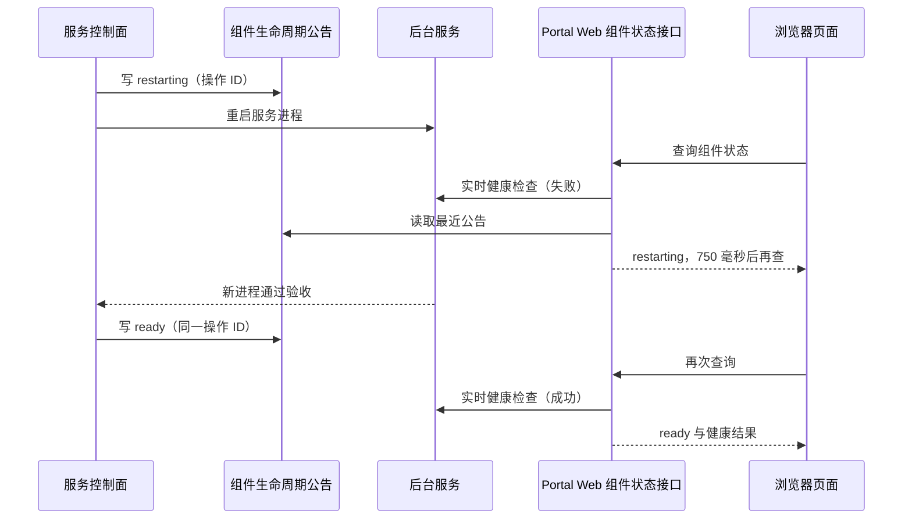

# Portal 运行状态与 Component Lifecycle 投影

Portal 启动、某个后台服务正在重启或数据库暂时无法读取时，页面需要告诉用户应该等待、稍后重试，还是停止自动重连并联系运维。Portal 为此提供三种状态信号，并在页面的服务状态接口中把它们合并成一个结论：

- **运行状态**（runtime status）：用户路由器报告数据库能否读取、数据库结构标记是否与当前代码一致。
- **组件生命周期公告**（component lifecycle）：服务控制面在重启 ResourceService 或 SocietyService 时写下的最近状态。
- **实时健康**（live health）：页面请求到达时直接询问服务“现在能否响应”的结果。

本 Design 定义这三种信号各自的含义、保存方式和合并规则。浏览器怎样显示恢复遮罩和重试见 `decision_f25266e5a0e7`；控制面在重启过程中何时写公告见 `decision_37f98f8fcb4b`；用户路由器本身见 `decision_850e6248d680`。

## 用户看到什么

资源目录、代码仓库工作区和 Society 工作台依赖后台服务。服务不可用时，这些页面通过共享的恢复组件 `PortalComponentRecovery` 在对应区域上显示一层恢复遮罩，并禁用区域内的操作控件：

- 服务正在计划内重启时，标题为“<服务名> 正在重启”，说明页面会在服务上线后自动恢复，并显示第几次重试。
- SocietyService 仍在线但暂时无法回答时，标题为“<服务名> 正忙，正在等待”。
- 其他暂时不可用的情况，标题为“正在重新连接 <服务名>”，说明正在后台自动重试，Portal 其他页面不受影响。
- 服务报告不可恢复，或有限次数的自动重试（默认 24 次）用完后，遮罩显示错误标题和“重新检查”按钮，自动重连停止。

服务恢复后，遮罩消失，控件恢复可用，页面重新加载所需数据。

## 基本概念

- **数据库结构标记**（schema marker）：AgentData（保存 Agent 对话和执行数据的数据库 schema）中表 `agent_store_meta` 里 `key = 'schema'` 的一行，值是数据库结构的版本名。当前结构版本由 `management_common/agent_data_schema.py` 的 `AGENT_DATA_SCHEMA` 定义。服务初始化时写入或校正它。
- **运行状态**：用户路由器接口 `/__portal_router/status` 的返回内容，schema 为 `tfi.portal-runtime-status.v1`。它只检查数据库结构标记，因此在 Portal Web 不可用时也能回答。
- **组件生命周期公告**：每个实例一个 JSON 文件，按组件记录控制面最近宣布的状态：`restarting`（正在重启）、`ready`（已就绪）或 `unavailable`（不可用）。目前控制面只为 `resource`（ResourceService）和 `lineage`（SocietyService）写公告。
- **操作 ID**：控制面为一次组件重启生成的标识，形如 `lineage-restart-<uuid>`。同一次重启的 `restarting` 和随后的 `ready` 或 `unavailable` 使用同一个 ID。
- **实时健康**：Portal Web 在处理状态请求时调用服务的健康检查（等待上限 0.75 秒）得到的结果。
- **组件状态接口**：`GET /lineage/api/service-status` 和 `GET /resource/api/service-status`，schema 为 `tfi.portal-component-status.v1`。它们把实时健康与组件生命周期公告合并，交给页面的恢复组件使用。
- **`terminal` 与 `retryable`**：状态中的两个布尔字段。`terminal` 为真表示页面应停止自动恢复；`retryable` 为真表示稍后再读取可能得到不同结果。页面按这两个字段决定恢复策略。

## 设计点

- **运行状态只读取数据库结构标记。** 它执行一条查询，不检查其他表，不执行迁移，也不探测 ResourceService、SocietyService 或 ExecutionService。
- **结构标记与期望值不同时，运行状态仍报告就绪。** 数据库可以读取，服务初始化会校正标记，因此返回 `ready: true`，同时以 `retryable: true` 提示稍后再读。
- **结构标记无法读取时，运行状态报告暂时不可用。** 数据库暂时无法连接或表不可读时返回 `unavailable`，`retryable: true`，页面继续重试。
- **路由器无法取得运行状态时，报告不可恢复。** 读取运行状态的过程本身出错时，路由器返回 `blocked` 和 `terminal: true`，页面停止自动重连，等待运维处理。
- **组件生命周期公告只表示控制面的宣布。** 服务此刻能否响应由实时健康决定：健康检查成功时，页面显示就绪，与公告内容无关。
- **实时健康失败时，有“正在重启”公告就显示正在重启。** 公告为 `restarting` 时，组件状态接口返回 `restarting`；没有这个公告时，SocietyService 的忙碌异常返回 `busy`，其他失败返回 `unavailable`。用户因此能区分计划内重启和意外断线。
- **页面在组件状态不就绪时再查询一次运行状态。** 运行状态为不可恢复时，页面以它为准停止自动重连；否则按组件状态继续重试。
- **读取任何状态都不做修复。** 状态接口不运行迁移、不回收租约、不修改组件生命周期公告；修复由服务初始化、维护任务或控制面完成。

## 运行状态

### 接口

用户路由器提供 `GET` 和 `HEAD /__portal_router/status`，无需登录，其他方法返回 `405` 并带 `Allow: GET, HEAD`。响应始终是 HTTP `200`（使恢复页面总能解析同一种格式），带 `Cache-Control: no-store`；`HEAD` 只返回响应头。

路由器只公开以下字段：`schema`、`ok`、`ready`、`state`、`code`、`terminal`、`retryable`、`title`、`message`。读取过程内部还产生 `agent_data`（期望与实际的结构版本及是否一致）和 `detail`（异常文本），这些内容不出现在公开响应中。

### 四种结果

| 情况 | `ok` | `ready` | `state` | `code` | `terminal` | `retryable` | 标题 |
| --- | --- | --- | --- | --- | --- | --- | --- |
| 标记与期望一致 | true | true | `ready` | 空 | false | false | Portal 数据库已就绪 |
| 标记与期望不同 | true | true | `ready` | `agent_data_schema_marker_mismatch` | false | true | Portal 数据库可用 |
| 标记无法读取 | false | false | `unavailable` | `agent_data_schema_unreadable` | false | true | 数据库状态暂时不可用 |
| 路由器读取运行状态出错 | false | false | `blocked` | `runtime_status_unavailable` | true | false | 服务状态无法确认 |

`message` 用中文说明具体情况，例如标记不同时写明“数据库标记为 vX，当前运行版本为 vY。服务初始化时会校正该标记。”

### 读取方式

期望的结构版本默认取共享常量 `AGENT_DATA_SCHEMA`，与 AgentData 存储使用同一来源。调用 `portal_runtime_status(expected_agent_data_schema=...)` 可显式指定期望值；路由器按默认值调用，`PORTAL_EXPECTED_AGENT_DATA_SCHEMA` 不再作为配置入口。比较 AgentData 标签时，实际完整的 `tfi.agent-data.vN` 标签（`N` 表示版本号）必须与期望值精确相同；其他标记继续按状态矩阵报告。读取通过 Portal 的共享数据库层连接 `PORTAL_DATABASE_URL` 指向的 PostgreSQL，在 AgentData 所在的 schema 中执行：

```sql
SELECT value FROM agent_store_meta WHERE key = 'schema'
```

共享数据库层在进程第一次使用时建立连接池（最多等待 15 秒），并确保对应 schema 存在。连接失败、等待超时、表不存在都归为“标记无法读取”。

## 组件生命周期公告

### 文件与格式

每个实例的公告文件是 `<实例根目录>/<实例名>/component-lifecycle.json`（实例根目录见 `decision_850e6248d680`，当前为 `${instances_root}`），schema 为 `tfi.portal-component-lifecycle.v1`：

```json
{
  "schema": "tfi.portal-component-lifecycle.v1",
  "instance": "dev",
  "updated_at": 1790000000.0,
  "components": {
    "lineage": {
      "component": "lineage",
      "state": "ready",
      "message": "SocietyService 已就绪",
      "operation_id": "lineage-restart-…",
      "updated_at": 1790000000.0,
      "started_at": 1789999990.0
    }
  }
}
```

实例名和组件名先转为小写，必须由小写字母、数字和 `-` 组成、以字母或数字开头、最长 64 个字符。每个组件的记录包含：

| 字段 | 含义 |
| --- | --- |
| `component` | 组件名 |
| `state` | `restarting`、`ready` 或 `unavailable` |
| `message` | 控制面提供的提示，例如“SocietyService 正在重启” |
| `operation_id` | 本次重启的操作 ID；存储层不检查它是否为空或唯一 |
| `updated_at` | 本条公告的时间（Unix 秒） |
| `started_at` | 本轮重启开始的时间 |

写 `restarting` 时，`started_at` 设为当前时间；写 `ready` 或 `unavailable` 时沿用该组件已有记录的 `started_at`（已有记录缺这个字段时用当前时间）。组件此前没有任何记录时，`ready` 或 `unavailable` 记录不带 `started_at`。

### 读取与写入

读取只接受精确的 `tfi.portal-component-lifecycle.v1`。文件不存在、不是合法 JSON 或 schema 不等于该值时，都视为没有任何公告；`components` 不是对象时视为空。查询没有记录的组件得到空对象。

写入函数 `publish_component_state` 先取得同目录下 `component-lifecycle.json.lock` 的独占文件锁，在锁内重新读取文件，只替换目标组件的记录，保留其他组件。新内容写入同目录的临时文件（键排序、末尾换行），刷新并同步到磁盘后原子替换原文件，再同步所在目录。因此多个写入者不会互相覆盖，进程在写入中途退出时，文件保持为旧的或新的完整内容。

目前只有服务控制面 `scripts/portal_services.py` 调用这个函数，写入时机见 `decision_37f98f8fcb4b`。

## 组件状态接口

两个接口都需要登录，由 Portal Web 提供。响应字段为 `schema`、`component`、`service`、`state`、`ready`、`message`、`retry_after_ms`（建议多久后再查询，毫秒）、`operation_id` 和 `updated_at`（均取自该组件的最近公告，没有公告时为空字符串和 0），成功时另附 `health`（服务健康检查的原始结果），失败时另附 `detail`（异常文本）。

| 实时健康结果 | 最近公告 | `state` | `ready` | `retry_after_ms` | 提示 |
| --- | --- | --- | --- | --- | --- |
| 成功 | 任意 | `ready` | true | 0 | “<服务> 已就绪” |
| 失败 | `restarting` | `restarting` | false | 750 | “<服务> 正在重启” |
| SocietyService 抛出忙碌异常 | 不是 `restarting` | `busy` | false | 750 | “SocietyService 正忙，正在等待当前操作完成” |
| 其他失败 | 不是 `restarting` | `unavailable` | false | 750 | “<服务> 暂时不可用，正在重新连接” |

ResourceService 没有忙碌状态。

## 一次计划内重启时各信号的变化



控制面漏写 `ready` 而服务已经恢复时，实时健康成功，页面照样显示就绪；公告写着 `ready` 而服务无法响应时，页面显示暂时不可用。公告只为实时健康失败的情况提供解释。

## 故障与恢复

| 情况 | 状态表现 | 恢复方式 |
| --- | --- | --- |
| 数据库结构标记与期望不同 | 运行状态就绪，`retryable: true` | 服务初始化校正标记 |
| 数据库暂时无法读取 | 运行状态 `unavailable` | 页面继续重试；运行状态不执行迁移 |
| 路由器读取运行状态出错 | `blocked`，`terminal: true` | 页面停止自动重连，由运维修复 |
| 公告文件缺失或损坏 | 视为没有公告 | 实时健康仍能判断服务；下一次写公告会重建文件 |
| 公告为 `restarting`，健康检查失败 | 组件状态 `restarting` | 页面按建议间隔重试 |
| 没有重启公告，SocietyService 忙碌 | 组件状态 `busy` | 页面继续重试 |
| 公告为 `ready`，健康检查失败 | 组件状态 `unavailable` | 公告已过时或服务意外退出，由运维恢复 |
| 写公告时进程退出 | 文件保持旧的或新的完整内容，锁随进程释放 | 下一次写入在锁内重新读取并替换目标组件 |

这些信号各自只回答一个问题：运行状态说明数据库标记能否读取以及是否一致，组件生命周期公告说明控制面最近宣布了什么，实时健康说明服务此刻能否响应，路由器的 `/__portal_router/health` 只说明路由器进程在运行。ExecutionService 的租约恢复、资源索引的来源协调和浏览器事件流重连由各自的 Design 负责；各领域数据的数据库归属见 `decision_86aed2f0e8c7`。
