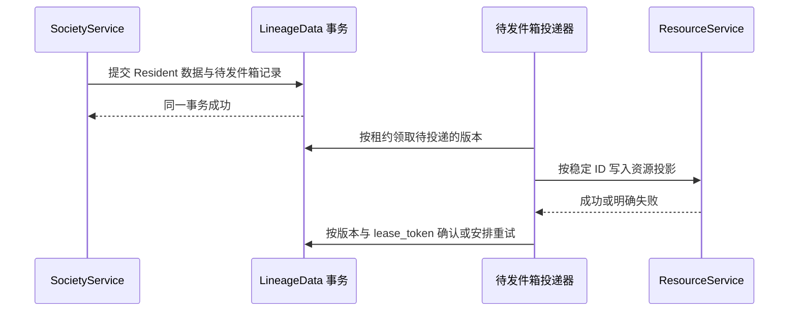

# Portal 领域数据所有权与数据库分区

Portal 自己产生和修改的业务数据与运行数据，都以 PostgreSQL 为唯一的权威来源。所有 Portal 进程通过环境变量 `PORTAL_DATABASE_URL` 连接同一个 PostgreSQL 服务，每个领域使用自己的 schema（数据库中的命名分区，包含一组表、索引和约束）。共享文件只保存外部系统自己拥有的数据、正文与附件、部署时的引导配置、独立的密钥文件、可以重建的投影和非权威的诊断信息。

本篇给出 Portal 的数据所有权地图：哪项数据由哪个组件负责、存在哪里、怎样跨领域协作，以及缓存、投影和健康信息怎样恢复。各表的具体结构由各领域的 Design 说明；本篇的作用是防止页面、脚本或新服务越过负责者直接写入别人的数据。

## 从一个用户操作理解所有权

用户在 Resident 页面发送一条消息，随后会涉及三类数据：

- SocietyService 保存 Resident 的身份、它所在的 Lineage，以及这条输入的处理状态和对话事件。
- ExecutionService 保存这次模型执行的请求、租约和终态。
- ResourceService 保存 Resident 在资源目录中的条目，供搜索和资源页面使用。

这些记录用同一个稳定 ID 关联同一个业务对象，但含义不同；每个领域只解释和修改自己的那部分。

## 必要概念

- **负责者（owner）**：唯一有权校验并修改某项数据的组件。数据存在哪个 schema，不决定它由谁负责。
- **事务**：一组要么全部提交、要么全部回滚的数据库操作。一个领域的事务只修改自己负责的数据；跨领域的流程靠待发件箱、幂等命令或重新查询协调，不能借共享数据库连接绕过对方的接口。
- **投影与缓存**：投影是从权威数据整理出来的查询或显示视图；缓存是可以丢弃再重建的加速副本。来源指纹是投影用来判断源文件是否变化的摘要。
- **revision、游标与待发件箱**：revision 是当前记录的版本号；游标是有序事件流中的读取位置；待发件箱是与领域事务一起写入、随后跨边界投递的待办记录。
- **结构版本标识**：由各数据所有者维护的当前格式与结构版本。LineageData、AgentData 与 Scheduler 的具体版本分别见 decision_71aa039e3211、decision_b1ab45c4b3ec 和 decision_8ac0b5a6c0e5，本篇不复制会独立演进的版本表。
- **实时健康**：直接探测进程、连接或队列当前是否正常得到的瞬时结果；它不同于数据库中的业务状态，也不同于运维控制面发布的组件生命周期公告。

## 数据负责者地图

| 负责者 | 负责的数据 | PostgreSQL schema | 访问入口 |
| --- | --- | --- | --- |
| ResourceService | 统一资源地址与解析、资源登记、资源索引、权限系统（权限实例与模板）、资源内容变化记录 | `resource_dev` 与 `resource_release`（按实例，由资源服务单元的 `PORTAL_RESOURCE_DATABASE_SCHEMA` 指定，在本进程运行 ResourceService 时必须设置；其他进程未设置 `PORTAL_RESOURCE_SERVICE_MODE` 时都是实例资源服务的客户端，不建立自己的资源索引）、`permission`（Dev 与 Release 共用）、`resource_content_changes` | ResourceService 的查询、读取、登记、修改和资源动作 |
| AgentData（由 ExecutionService 负责） | Agent 目录、Provider 会话绑定、消息分段与完整对话内容；对话的用户消息数、最近活动和本人请求直接从对话消息只读统计，不另存投影 | `agent` | AgentData 领域接口与受控投影（decision_b1ab45c4b3ec） |
| ExecutionService | 执行请求、执行进程、租约、调度与容量、token 用量、执行账号用量、Harness 策略与效果记录 | `agent`、`execution_runtime`、`execution_account_usage`、`harness_auto_policy`、`harness_effectiveness` | ExecutionService 的命令、查询、领取与完成 |
| SocietyService | Lineage 定义与运行状态、Resident 身份与成员关系、对话状态与事件、生命周期操作、资源投影待发件箱 | `lineage`（LineageData，见 decision_71aa039e3211）、`service_invocations`（交给 Resident 的业务调用） | SocietyService 的指令与 Domain RPC |
| 全局 Function Block 与脚本执行 | 全局定义、内置安装状态；脚本运行、工作进程租约 | `function_blocks`、`script_runs` | 各领域接口；Function Block 内容按已有定义契约校验 |
| Portal Web 账号领域 | 用户资料、密码散列、Passkey、两步验证、重置与邀请令牌、登录尝试、非登录用户目录、Agent 访问令牌 | `portal_identity`；账号、密码、邀请、访问令牌、Passkey 与两步验证各自有表 | 各身份存储；数据库凭据只有服务账号可读 |
| Portal Web 界面状态 | 界面关联、用户偏好、收藏、Paper 收藏、每个用户对各对话的已读与清理状态 | `portal_ui`；关联、偏好、收藏、对话阅读者与逐对话回执分别保存 | 界面状态、用户偏好与对话已读接口 |
| WALL | 工程、任务、讨论绑定、阅读与审核状态 | `portal_wall`；工程、任务、讨论、清理重试、阅读者及逐项已读/审核分别保存 | WALL 的命令与查询 |
| Notice Board 与聊天室 | 帖子、回复、精华、已读、人类通知；聊天室、成员、逐用户状态与投递（消息由 AgentData 保存） | `portal_notice`、`chatrooms` | Notice Board 后端与聊天室后端（decision_a6bebf4ac283） |
| 语义搜索与文章构建 | 搜索任务、冻结的执行输入；文章构建设置、报告与日志 | `semantic_search`、`article` | 搜索与文章领域接口；资源索引读取领域当前状态 |
| Workbench 投影领域 | 页面定义与绑定、源码版本、发布指针、生成记录、按用户隔离的页面状态 | `workbenches` | 投影领域接口；页面定义同时通过 ResourceService 暴露统一资源入口（decision_f67ae5e70793） |
| 各拥有服务的指令内核 | 该服务执行的指令记录 | `web_instructions`、`resource_instructions`、`execution_instructions`；SocietyService 的记录在 `lineage.instruction_executions` | `GetInstructionExecution`（decision_898b8911a2ff） |
| 外部文件的负责者 | Provider 自有会话、Resident 工作文件、知识正文、附件、登记定义和引导配置 | 各自的文件位置 | 各自的文件协议；Portal 不把它们当作自己状态的副本 |
| 浏览器标签页 | 当前选择、未提交的输入和正在显示的投影 | 浏览器内存或受控的本地状态 | 页面脚本 |

测试设置 `PORTAL_DATABASE_NAMESPACE` 后，所有 schema 名加上这个前缀，测试数据与正式数据分开。共享同一个 PostgreSQL 实例不授予跨领域的写权限；领域接口仍是访问边界。Dev 与 Release 两个实例共用 LineageData、AgentData、执行数据和资源登记（`resource_registry`），资源索引则按实例分开保存。

## 设计点

- **Portal 依赖的数据都在 PostgreSQL 中，`${share_root}/Meta` 已于 2026-10-13 删除。** `${share_root}/Meta` 是 Portal 使用数据库之前存放登记和状态的位置；其中的数据已迁入负责者的 schema（见“从 `${share_root}/Meta` 迁入数据库的数据”）。新增的登记和状态同样写入负责者的 schema，不在 `${share_root}` 下另建登记目录。
- **负责数据的组件不因存储位置变化而改变。** 新建表、移动文件或复用稳定 ID 都不改变负责者；只有领域契约明确迁移、并提供恢复方案时，负责者才改变。
- **修改数据必须调用负责者的接口。** Portal Web、后台脚本和其他服务不直接更新别的领域的表；负责者的接口负责权限、输入规范化、版本冲突、通知和一致性。
- **查询副本能从权威来源重建，不能反向覆盖来源。** 搜索索引、页面摘要和聚合状态可以跨领域组合，但必须能追溯到权威来源；过期时失效并重建。
- **一个事务只修改一个领域的数据。** 涉及另一个领域时，先提交本领域的数据，再用待发件箱、稳定幂等键或可重复的查询推进外部动作。
- **变化通知在提交之后发出。** 通知只说明已经提交的数据可能变了；通知失败不回滚事务，接收方通过当前查询或定期协调恢复（decision_abaedeefca6f）。
- **健康检查只观察，不修复。** 健康接口只读取并报告结构版本、连接、队列和工作进程状态；租约恢复、超时推进和投影重建由显式的维护流程执行，系统不会因为被监控而改变业务结果。
- **能连接内部 socket 不等于有权访问所有对象。** 带用户语义的方法仍把可信的调用者身份交给负责者鉴权（decision_96a887d83e8a）。
- **浏览器状态不是服务事实。** 按钮是否可用、卡片颜色和当前筛选只是页面投影；服务收到命令后按自己的当前记录重新校验。

## 跨服务的会话与执行数据

- **Provider 会话绑定由 ExecutionService 的 SessionManager 负责。** 绑定的建立、迁移、条件替换、恢复和释放都经过 SessionManager 的接口；AgentData 存储提供事务和持久约束。SocietyService 只决定业务上何时 Fork、重启、清空和清理。SessionManager 在本机提供受信任的入口，在调用方进程中执行短 AgentData 事务；ExecutionService 的会话 RPC 调用同一套实现。SocietyService 的短状态提交使用这个本机入口，不直接组合底层表操作。跨数据库保存身份失败时，以替换回执和当前 Provider 会话引用作为条件补偿，旧回执不能回滚或删除新绑定；慢的 Provider 工作在状态锁之外执行。
- **Provider 是否已经接受某条输入，由 ExecutionService 判断。** 执行事件的处理器在收到接受事件时保存对应执行与 Agent 的 Provider 轮次身份，并通过统一的查询提供结果。SocietyService 不解析执行表的列来另立判断；没有记录或存储不可读时按“未确认”处理。
- **执行内容的规范解释属于 ExecutionService。** 执行事件的转换接口负责规范活动、完整输出文本、事件身份和终态；执行结果、活动存储和 Lineage 的对话投影都读取这份结果。页面只对副本做摘要、截断或流式尾部显示，界面的字符预算和显示数量不影响执行内容的保存与重放。技术日志的保留期与总量由存储的负责者管理，已经丢失的历史内容按未知处理。
- **Harness 配置、技术性的自动续跑、恢复检查点和预算属于 ExecutionService。** SocietyService 保存业务输入、协作状态与执行关联，消费执行终态，不另存一套 Harness 的失败续跑状态；业务上何时开始、取消、继续或按 Lineage 重试，由 SocietyService 决定。

## 为什么按领域分区

每个领域的变化原因不同：接入新的资源类型改变 ResourceService；Lineage 定义和对象代次的规则改变 LineageData；租约与执行进程协议改变 ExecutionService。各自分区之后，一类变化通常只需要一个服务迁移和验证。

分区也隔离故障。ExecutionService 暂时不可用时，资源浏览照常工作；资源索引重建时，Lineage 的当前状态仍可查询。Portal Web 把依赖服务的失败只反映到相应的页面区域或请求上。

## PostgreSQL 的共同使用方式

### 连接由公共访问层统一管理

领域通过 `management_common.portal_database.portal_database(schema=...)` 取得绑定统一连接地址和自身 schema 的 `PostgresDatabase` 对象（`management_common/postgres_database.py`），不在存储类、页面适配器或脚本中另建连接池。公共访问层负责：

- 管理有界的连接池：池按进程和 schema 共享，按需建立连接，容量由 `PORTAL_POSTGRES_DOMAIN_POOL_SIZE` 决定（默认 8）。该值是每个池的上限，不会预先创建全部连接；不同进程和 schema 的潜在连接数会叠加。`PORTAL_POSTGRES_POOL_MAX_IDLE_SECONDS` 是空闲回收检查的周期（默认 1 秒），驱动每周期最多缩减一个连接，不能将它解释为所有空闲连接的最长保留时间；
- Lineage 只读子进程启动时只绑定领域接口，第一次实际查询才初始化存储。同一进程、同一数据库地址下的各 schema 共用一个有界物理连接池，最小容量为 0、最大容量为 2；领域显式参数不能放大这个上限。查询结束后归还连接供后续请求复用，默认空闲回收周期为 30 秒，可由 `PORTAL_POSTGRES_POOL_MAX_IDLE_SECONDS` 覆盖。借出的逻辑连接在事务内设置自身 schema；独立事务保持各自提交、回滚和快照边界，复用物理连接不合并领域事务。普通服务进程仍按进程与 schema 管理连接池，默认空闲回收周期为 1 秒；
- 给每个连接设置 `application_name`，标明 Portal 实例、schema（只读共享池标为 `read`）和进程，便于运维定位连接来源；
- 读写都在显式事务中进行：正常退出时提交，异常时回滚，退出时归还连接；
- 遇到死锁、锁等待超时或序列化冲突时，在 10 秒内按 5 毫秒起、最多 100 毫秒的间隔重试整个事务；
- 同一调用链嵌套写入时复用外层事务。

领域存储自己负责 schema、表结构、SQL、数据约束和业务事务的范围；它们可以封装公共访问层并指定池大小、隔离级别和行映射，但不直接创建数据库驱动连接，也不复制提交、回滚和归还逻辑。复用公共访问层不授予跨领域写表的权限。

直接创建连接的例外只有两个：ExecutionService 调度器用于 `LISTEN` 变化通知的专用长连接（它必须是独立的自动提交连接，不能从连接池借用），以及运维脚本 `scripts/portal_services.py` 探测数据库是否可用的短连接。测试 `tests/cases/test_portal_database_factory.py` 检查各领域都通过公共入口取得数据库对象；新增领域存储须满足同一约束。

### 按业务身份存储状态

账号、界面状态、WALL、Notice Board、聊天室、脚本与全局 Function Block 使用各自领域的表。主键表达真实业务身份，稳定字段使用具名列，多值关系单独成行。例如收藏以“用户、界面、资源 ID”为主键，对话回执以“用户、对话”为主键；一条已读更新只修改目标回执。身份、凭据和账号相关变更在身份领域事务中完成，一次性凭据只能成功消费一次。

`DomainDatabase` 复用公共连接层并提供领域 DDL 初始化与事务锁；`relational_rows` 只做已声明字段的差异写入，不定义业务字段、不接收任意扩展对象。小型聚合的兼容接口可以在内存中组装对象，但数据库按领域表保存，未知字段拒绝写入。JSON 用于有明确契约的配置、输入、报告或界面偏好，不重复保存已成为列和关系的数据。

资源登记仅保留注册事实与当前同步所需来源信息。搜索任务/输入与文章构建设置/报告由各自领域保存；完成的一次性迁移计划、回执、旧 ACL 文档被清理。已退役 ID 保存为 `resource_registry.retired_identities` 的唯一 ID，继续阻止重用，不保留整份历史快照。

权限系统在 schema `permission` 中分表保存树节点（含物化路径）、权限表项、修订号、实例状态、模板，以及创建者、管理员、Family steward 等事实（decision_b820faf42218）；Execution 的日常维护删除到期的临时凭证。Workbench 将页面元数据、拥有者、项目和绑定分开保存，当前与已发布版本指针继续指向明确源码版本。Resident 摘要目录不再复制整份元数据；Harness 质量标签只在 `harness_quality_labels` 保存一份，观察查询通过视图组合。

旧 Portal State 数据已经迁入各自领域，通用表及 schema 已移除。已完成的一次性旧布局迁移脚本随重构退役；运行代码只支持当前结构。结构化业务记录和时间字段的切换使用 `scripts/migrate_domain_records.py`，在停止所有 Dev/Release 数据库消费者与 Telepus 写入进程、完成可恢复备份后，以同一事务迁移数据和结构版本。隔离恢复演练验证完整备份可读取、迁移后业务数据与行数保持。

这些状态只从数据库读取，不保留旧 JSON 文件的回退、双写或启动导入；数据不可读时明确报错，不会把损坏的数据当成空状态覆盖。以下由 Portal 写入的状态同样只保存在 PostgreSQL：各主体的当前凭证列表（`authorization.auth_credential_sets`）、模型接口登记与 Relay 调用项（`model_apis`）、Paper 评审、笔记、后台任务记录与精选会议（`paper`）、Telepus 联系人（`telepus.telegram_contacts`，表位于 Telegram 程序的 schema，由 Portal 独占写入）、Pulse 公开记录（`portal_pulse.publications`）和访问审计（`portal_identity.access_audit`）。Portal 进程之外读取这些表的守护进程（Claude Code、Kimi Code、Telegram 程序、Breakglass Worker）从 `portal-postgres.env` 取得数据库地址，只读查询。两步验证的加密密钥和登录会话的签名密钥保存在单独的受限文件中，不写入数据库。

### 业务记录与绝对时间

Paper 的 `reviews`、`notes`、`review_jobs`、`deep_read_jobs`、`exp_jobs`、`collector_jobs` 以明确身份列、业务字段和时间列保存，不使用通用 record_json 或列表 position。Review task 以 review_id 引用长期产物；读取接口组装结果，不复制正文。Paper 及其搜索记录没有 1000 条或其他数量裁剪；分页限制只影响一次返回量。

模型 API 的可查询配置存入 `model_apis.apis` 具名字段；模型集合、默认参数和请求头具有明确语义，使用 JSONB。`model_apis.routes` 以 (backend, route_id) 为主键，通过 api_id 外键选择唯一登记。API 的展示顺序不参与路由，绑定缺失或 API 禁用时明确失败，不能改选首个启用项。

Chatroom 按房间、成员、阅读状态和投递分别保存；子表通过外键关联 rooms。事务按当前房间、用户或投递的职责范围读取和更新，保留消息及其预览、提醒的跨 schema 原子提交，不加载和重写全部聊天室。成员没有顺序字段。

SQL 中表示绝对时刻的字段统一使用 TIMESTAMPTZ；没有时间使用 NULL，Unix epoch 0 保留为有效时刻，只有业务明确规定的历史缺省零值在迁移时转为空。接口通过领域边界转换为既有 UTC ISO 字符串或明确单位的数值；秒和毫秒显式区分。Effect 运行摘要读取 Trigger Path 步骤的完成时间时，同样在摘要接口转换为 UTC ISO 字符串，使含运行摘要的完整 Lineage 可直接序列化。日期、时长、序号和计数保持各自类型，不作为绝对时间转换。SQL 微秒精度不承诺保存浮点数中的亚微秒尾数。

Harness observations 继续使用视图读取观测和质量评价，不复制一份可独立修改的组合结果。运行时初始化仅核对当前结构并创建首次部署所需对象，不在业务请求中反复 ALTER 历史结构；旧结构必须经过显式迁移。

### 任务与认证记录的字段边界

`workbenches.generations`、`semantic_search.jobs`、`portal_identity.agent_tokens` 使用具名字段保存各自身份、状态和关系；可变计划、结果、回执等内容限定在各自明确命名的 JSONB 字段中，不接受通用扩展容器。搜索 ID 全局唯一，搜索任务不复制调用领域的记录，数量与格式常量由读取接口投影。`lineage.residents` 不逐行保存格式版本。

这组结构已经迁入具名领域表，不保留旧通用记录的运行时双写或回退。后续结构迁移由对应存储负责者提供并校验：预演完整执行并回滚，正式转换保持原身份与内容；未定义字段或身份冲突使整笔回滚。Dev 与 Release 共用数据库，迁移与两侧代码必须协调切换，不能在转换完成前暴露新结构读取。已完成的一次性迁移脚本不是当前业务或恢复入口。

## 跨领域变化流程

以 Resident 的资源投影为例：

原子性只到 LineageData 为止，ResourceService 的写入是一次独立的调用。重复投递按稳定的 Resident ID 和目标版本合并；失败的记录保留，恢复后继续（decision_71aa039e3211）。

模型执行与协作状态也按同样方式分开：ExecutionService 独立负责请求和租约，SocietyService 可以保存 Resident 当前关联执行的投影。投影延迟不改变执行事实；执行详情仍由 ExecutionService 回答。

## 文件数据与数据库投影

一部分资源正文和登记信息来自共享文件。文件的负责者用稳定的锁完成“读取、修改、写回”，再用同目录的临时文件原子替换目标。Portal 之外的工具也可能写这些文件，所以资源索引不能只依赖进程内的通知。

文件观察器把路径变化交给资源适配器，适配器重新读取、校验和鉴权后更新 ResourceService 的投影，并保存来源指纹；漏掉事件时由定期协调比较指纹，进程重启时再扫描一次。观察流程见 decision_f55bac7fc199，共享文件的锁和原子替换见 decision_0e043d5f81be；两者都不改变文件数据的负责者。

## 从 `${share_root}/Meta` 迁入数据库的数据

Portal 原先放在 `${share_root}/Meta` 中的登记和状态已经迁入 PostgreSQL，运行路径不从旧目录回退、双写或自动导入。迁入数据库是历史来源，不表示所有数据现在都属于 ResourceService 的登记文档：资源描述由 ResourceService 管理，Article 编译设置与报告、语义搜索任务已由具名领域表管理；Project 等登记仍由其正式负责者按登记协议访问，不能由旧目录位置推断新的写入权限。当前所有权以上文“数据负责者地图”和对应领域规范为准。

`resource_registry` 只承担仍由登记协议管理的文档与修订，不是跨领域通用状态容器。旧文件和旧一次性迁移脚本不作为当前的查询、写入或恢复入口。

Article 编译出的 PDF 与 LaTeX 缓存可以随时重新编译，不属于登记数据，保存在编译缓存目录 `PORTAL_ARTICLE_BUILD_ROOT`（默认 `${staging_root}/shared/portal_cache/article_builds`）。

Resident 的删除状态由 `lineage.residents.deleted_at` 保存（decision_0f57656a2acd），已有 Agent 与 Trace 保留。

2026-10-13 检查确认 Portal 代码与运行进程、共享 Skill、共享 Agent 和备份服务都不再读写 `${share_root}/Meta` 后，整个目录已删除（TFI portal 2026-10-13）。删除时目录里只剩已迁移数据的旧副本、旧的 `agent_port` 包、`knowledge_board`、`project_board`、`todo_board` 等旧看板代码，以及 MindFlow 排版用的 `mindflow_tags.typ`；需要查看时从 2026-10-12 的 content 备份快照恢复。Host 属性文件中指向 `agent_port` 的入口同日删除，Agent 读取 Project 与标签登记使用 HATG ISA `GetProject`、`GetKnowledgeTags`。Project 登记中的 `tag_vocab` 是全部 Project 共用的知识标签，用 `GetKnowledgeTags` 与 `UpdateKnowledgeTags` 读取和修改（decision_6591e7793116），`add-mindflow-tag`、`rename-mindflow-tag`、`delete-mindflow-tag` 使用这两条指令；Project 改名使用 `RenameProject`，`rename-project` 调用这条指令。

## 结构版本的权威来源

各领域存储规范与实际初始化契约负责其结构版本；本篇只规定所有权，不复制一份会独立过时的版本表。AgentData 见 decision_b1ab45c4b3ec，LineageData 见 decision_71aa039e3211，Execution 调度见 decision_8ac0b5a6c0e5；资源索引和登记由 ResourceService 报告并严格核对其实际结构。

结构版本相同只说明表结构符合预期，不能证明数据完整、进程在线或业务一致；这些结论需要各负责者的初始化校验和实时健康检查。

## 状态、投影与健康的区别

| 信息 | 负责者 | 是否持久 | 恢复方式 |
| --- | --- | --- | --- |
| 领域当前状态 | 相应的领域服务 | 是 | 从领域数据库或共享文件读取 |
| 搜索与页面投影 | 投影的生产者 | 通常是，或可缓存 | 从权威来源重建 |
| NATS 变化通知 | 通知基础设施 | 否 | 重连后重新读取快照 |
| 浏览器当前视图 | 标签页 | 否 | 重新请求页面或数据 |
| 组件生命周期公告 | 运维控制面 | 是，保存最近的公告 | 与实时健康一起解释 |
| 实时健康 | 被探测的组件 | 瞬时 | 每次重新探测 |

结构版本、生命周期公告和服务实时健康的区别见 decision_99bb5dc0f96b；本篇只规定它们不能互相替代。

## 故障与恢复

| 故障 | 影响范围 | 恢复方式 |
| --- | --- | --- |
| 数据库锁冲突、死锁或序列化冲突 | 当前事务等待或失败 | 公共访问层在 10 秒内重试；仍失败时调用方收到明确错误 |
| 领域服务进程停止 | 该领域的查询和命令不可用 | 服务重启并校验自己的结构；Portal Web 显示 503 或状态卡片 |
| 跨领域投递失败 | 目标投影延迟 | 待发件箱保留最新版本，租约过期或退避后重试 |
| 通知丢失 | 页面发现变化变慢 | 重新查询、定期协调或实时连接重连时的快照 |
| 文件事件遗漏 | 由文件派生的投影过期 | 来源指纹协调和启动扫描 |
| 浏览器刷新中断 | 单个标签页显示旧值 | 实时连接重连或刷新页面 |
| 结构版本不匹配 | 负责者无法安全解释这些表 | 停止写入，执行受支持的迁移或运维修复 |

## 新增数据时的归属检查

新增字段、表或缓存之前，先回答：

1. 这项数据由哪条业务规则解释？
2. 哪个组件是唯一的负责者？
3. 调用方通过哪个查询和命令访问它？
4. 版本冲突、权限拒绝和不存在分别怎样表达？
5. 是否需要与负责者的其他表在同一个事务中提交？
6. 跨领域的结果用待发件箱、幂等操作还是重新查询协调？
7. 哪些值只是投影或缓存，怎样重建？
8. 健康检查、维护流程和用户操作分别会做什么？
9. 是否通过公共访问层取得数据库连接，领域是否只保留自己的 schema 与业务事务职责？

答案明确之后，再选择 PostgreSQL、共享文件或内存结构。存储方式服务于负责者对持久性和并发的需求，不能代替所有权设计。

### 当前格式名与精确读取校验

当前生产者输出完整的 `tfi.*` 格式名与版本。各篇接口示例应使用其生产者当前输出的结构名；这不要求改写已有记录。`management_common/format_tags.py` 的 `schema_matches(actual, expected)` 只接受与指定 `tfi.*` 期望值精确相同的格式名和版本，不修改输入、指纹或幂等身份。DSH 原生桥接协议使用 `tfi.native-agent.v1`（decision_276105b5d67b）。持久恢复记录、历史签名和外部 Provider 协议继续由各自所有者校验。
