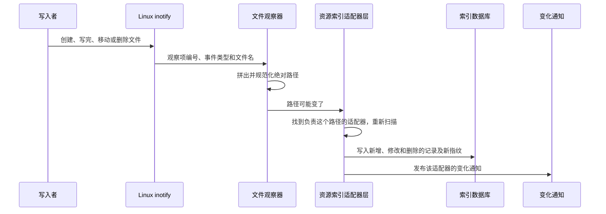

# Portal 本地文件变化观察与投影失效机制

Portal 的一部分数据以文件形式保存在共享目录中，例如 Skill 包、论文清单、项目知识和各类登记表。这些文件可能由 Portal 之外的命令行工具、Resident 或其他服务直接修改。为了让资源列表、搜索结果和知识归档页面及时反映这些修改，Portal 观察相关目录的文件变化，通知负责这些数据的组件重新读取。

本篇说明文件变化怎样被发现、交给谁处理，以及漏掉变化时怎样补回。文件内容由负责它的组件解释；变化怎样送到浏览器见 decision_abaedeefca6f。

## 必要概念

- **投影**：负责某类数据的组件为搜索、列表或页面显示整理出的副本，可以随时从源文件重新生成。本篇的投影有两个：ResourceService 的资源索引（decision_8dc6b3d03ca7）和知识归档页面。**投影失效**指副本可能已经过时，需要重新读取源文件。
- **inotify**：Linux 内核提供的文件变化通知接口。进程为一个目录登记**观察项**，目录中发生创建、写入完成、移动、删除等事件时，内核通知进程。一个观察项只覆盖一层目录，子目录需要分别登记。
- **队列溢出（overflow）**：内核的事件队列满了，一部分事件已经丢失，无法知道具体漏掉了哪些路径。
- **指纹**：由源文件的元数据或内容摘要算出的标识，指纹不变说明源文件没有变化。
- **定期核对**：不依赖文件事件，定期重新计算指纹并与上次比较，补回漏掉的变化。

## 参与组件

| 组件 | 负责什么 | 位置 |
| --- | --- | --- |
| 文件观察器 `RecursiveFileChangeWatcher` | 为目录登记 inotify 观察项，把内核事件转换成“某路径可能变了”或“事件已溢出”两种回调 | `notifications/file_watch.py` |
| 资源索引的适配器层 `AdapterLayer` | 判断变化路径属于哪个资源适配器，重新扫描并更新资源索引；在 ResourceService 进程中运行 | `resource_index_backend.py` |
| 知识归档观察 | 把归档目录中的变化转换成知识归档页面的变化通知；在 Portal Web 进程中运行 | `knowledge_archive_projection.py` |
| 显式变化提示 `resource.notify_source_changed` | 写入者主动告诉 ResourceService 某个来源变了 | `resources/service.py` |

资源适配器负责扫描一类来源并转换成统一的资源记录。ResourceService 组装基础适配器与已安装功能通过 `resource.index_adapters` 提供的适配器；可选功能未安装时不参与扫描。适配器的数据表示与索引职责见 decision_8dc6b3d03ca7，文件观察器只根据当前启用适配器声明的路径分派变化。

## 设计点

- **观察器只报告路径，不读取文件。** 它不打开变化的文件，也不判断谁能看到；收到路径的组件重新读取、校验并按权限处理。
- **事件溢出时重新读取全部来源。** 观察器收到溢出事件时调用溢出回调，不猜测漏掉了哪些路径。
- **定期核对按固定周期运行，不等队列空闲。** 资源索引在进程启动时核对一次全部来源，之后每个周期核对一次尚未排队的适配器，即使其他适配器的刷新请求一直不断；这样覆盖观察器未运行、事件丢失和 Portal 停机期间的修改。
- **更新结果保存后才通知浏览器。** 资源索引先把更新写入数据库，再发布变化通知，浏览器随后查询时读到的是已保存的结果。
- **写入者可以主动报告变化。** 知道自己改了哪个来源的写入者调用 `resource.notify_source_changed`，不必等待文件事件或定期核对。

## 一次文件修改怎样处理

## 文件观察器

**观察的事件。** 写入句柄关闭（`IN_CLOSE_WRITE`）、移出（`IN_MOVED_FROM`）、移入（`IN_MOVED_TO`）、创建（`IN_CREATE`）、删除（`IN_DELETE`）、被观察目录自身被删除（`IN_DELETE_SELF`）和自身被移动（`IN_MOVE_SELF`）。

**构造参数。** 一组目录、路径回调 `on_change(path)`、溢出回调 `on_overflow()`、线程名、是否递归 `recursive`（默认是）和是否跟踪新目录 `track_new_directories`（默认与 `recursive` 相同）。目录先展开 `~`、规范化为绝对路径并去重；构造时不存在或不是目录的路径被跳过。

**启动。** `start()` 启动一个后台线程。线程创建 inotify 句柄（非阻塞，且不会被子进程继承），为每个目录登记观察项；递归模式下同时登记所有已有子目录，但跳过名称以点开头的目录和路径中含 `__pycache__` 的目录。之后每次空闲等待内核事件最多 1 秒。事件回调在观察线程内同步执行，耗时回调会延后后续事件和停止处理；停止时的线程等待上限见下文。

**处理事件：**

- 溢出事件：调用 `on_overflow()`。
- 观察项被内核移除（`IN_IGNORED`，通常在目录被删除后）：删除对应的记录，不调用路径回调。
- 其他事件：把观察项对应的目录和事件中的文件名拼成绝对路径（没有文件名时就是目录本身），调用 `on_change(path)`。如果是新建或移入的目录，且 `track_new_directories` 为真，先为这个目录及其子目录登记观察项。

**补充目录。** `add_directories(directories, recursive=False)` 把后来出现的目录加入观察集合。线程已经运行时立即登记，重复的目录不重复登记；`recursive=True` 时同时登记已有子目录。

**停止。** `stop()` 设置停止标志、关闭 inotify 句柄，最多等待线程 2 秒。

**回调出错。** `on_change` 或 `on_overflow` 抛出异常时，线程记录错误后结束，之后不再报告事件。资源索引仍由定期核对补回变化；知识归档观察器没有这项定期核对，页面重新读取归档文件取得当前状态。进程重启后可重新建立观察器。

**状态：**

| 字段 | 含义 |
| --- | --- |
| `enabled` | 总是 `true`，只表示观察器对象存在 |
| `recursive`、`track_new_directories` | 构造时的设置 |
| `ready` | 后台线程已经完成登记并在运行 |
| `watch_count` | 当前登记的观察项数量 |
| `last_event_at` | 最近一次调用路径回调的时间 |
| `last_error` | 最近一次登记失败或线程出错的信息（最多 1000 字符） |

判断目录是否真的被观察，要看 `ready` 为真且 `watch_count` 大于 0；目录集合为空或全部登记失败时，`ready` 仍可能为真。

## 资源索引

**观察哪些目录。** 适配器层启动时收集所有适配器声明的观察目录，建立一个非递归、但跟踪新目录的观察器。适配器声明观察目录时已经把来源目录展开到需要的深度（常见为一到三层，跳过以点开头的目录和 `__pycache__`），所以不需要递归登记。每次全量扫描完成后，适配器层重新收集观察目录，用 `add_directories` 补充新出现的目录。环境变量 `PORTAL_RESOURCE_INDEX_WATCH` 为 `0`、`false`、`no` 或 `off` 时不建立观察器，只靠定期核对和显式提示。

**变化请求怎样合并。** 每个适配器最多有一个排队中的刷新请求，新请求并入已有请求：只要有一个请求要求强制刷新，合并后就强制刷新；只要有一个请求没有给出路径，合并后就是全量扫描；否则合并所有路径。

| 来源 | 请求内容 |
| --- | --- |
| 文件观察器报告路径 | 找出负责该路径的适配器，强制刷新这个路径 |
| 文件观察器报告溢出 | 所有适配器强制全量扫描 |
| `resource.notify_source_changed` | 按路径、资源 ID 或资源类型找出适配器，强制刷新；给的路径是文件时按这个路径刷新，是目录或没有路径时全量扫描 |
| 进程启动 | 所有适配器按指纹核对 |
| 每 `PORTAL_RESOURCE_INDEX_RECONCILE_SECONDS` 秒（默认 300，最少 300），不论队列中是否还有请求 | 尚未排队的适配器按指纹核对 |

**怎样刷新。** 一个后台线程依次处理排队的适配器：

- 给了路径且适配器支持按路径扫描时，只重新读取这些路径，写入变化的记录；
- 否则计算指纹：不是强制刷新、已有索引且指纹与上次相同时，只记录核对时间；
- 其他情况全量扫描，用扫描结果替换这个适配器的全部记录。

一次刷新出错时，错误记录在该适配器的状态中并写入日志，线程继续处理下一项。所有适配器共用这一个线程，一次刷新在队列中等待或运行达到 5 秒时，日志报告适配器、等待时间、运行时间和剩余排队数。线程先尝试把本轮结果写入数据库；持久化成功、刷新成功且内容有变化（或是强制刷新）时，再调用变化回调，由 ResourceService 发布 `portal.resource.changed.projection.<适配器>`（decision_abaedeefca6f）。持久化失败时记录错误、不发布本轮变化，等待者得到失败的完成结果；内存中的刷新结果不能视为持久化成功。

**显式提示的等待。** `resource.notify_source_changed` 的参数 `kind` 取 `created`、`updated`、`deleted`、`moved` 或 `unknown`，至少要给出路径、资源 ID 或资源类型之一。`wait` 为真时，调用方最多等待 `timeout` 秒（默认 30 秒），直到相关适配器刷新完成。

## 知识归档

知识归档的任务文件保存在 `KNOWLEDGE_ARCHIVE_ROOT`（默认 `${staging_root}/shared/knowledge_archive_jobs`）下，每个任务目录为 `<用户>/<归档 ID>/`。Portal Web 在第一次打开浏览器事件流 `/api/events` 时建立一个递归观察器；根目录不存在时不建立。

- 变化路径位于根目录下且至少有两层时，前两层分别是任务所属用户和归档 ID，其余部分作为变化字段；变化的是任务目录本身时，字段为 `job`。
- 字段以 `.tmp` 结尾或包含以点开头的路径段时忽略，避免把原子写入过程中的临时文件当成完成状态。
- 其余变化发布为页面数据通知：页面数据名 `knowledge-archive`，目标为归档 ID，`actor` 为任务所属用户（只有这个用户能收到），`fields` 为变化字段。
- 事件溢出时发布目标为 `snapshot`、字段为 `filesystem-overflow` 的通知，不带用户，所有登录用户的归档页面重新读取。

这些通知直接写入 Portal Web 进程内的通知中心，不经过 NATS。归档文件本身是恢复依据：通知丢失时，页面重新读取即可得到当前状态。

## 故障与恢复

| 情况 | 影响 | 恢复方式 |
| --- | --- | --- |
| 目录在建立观察器时不存在 | 这个目录没有被观察 | 资源索引在下一次全量扫描后补充并由定期核对补回；知识归档根目录出现后，再次打开事件流时重试建立观察器 |
| 单个文件事件丢失 | 对应的资源记录暂时过时 | 定期核对按指纹发现并刷新 |
| 内核事件队列溢出 | 不知道漏掉了哪些路径 | 资源索引全量扫描所有适配器；知识归档页面重新读取 |
| 被观察的目录被删除或移动 | 内核移除观察项 | 记录被清理；来源重新出现后，由全量扫描后的目录补充或进程重启恢复观察 |
| 回调出错 | 观察线程结束，`last_error` 记录原因 | 资源索引继续定期核对；知识归档页面重新读取文件。进程重启后恢复观察 |
| Portal 停机期间文件被修改 | 没有文件事件 | 资源索引在进程启动时核对全部来源 |
| 浏览器错过变化通知 | 页面暂时显示旧内容 | 浏览器重新连接事件流或重新读取 |
